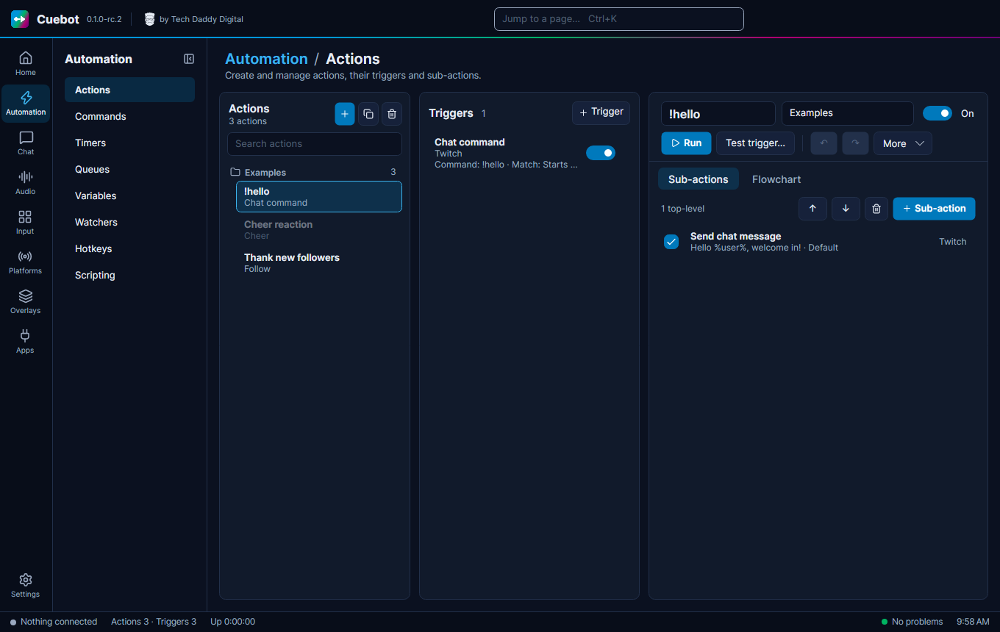

  

<h1 align="center">Cuebot</h1>

  Streaming automation for Twitch, YouTube, Kick and Rumble, in one desktop app for Windows and Linux.

  
  
  

  

Cuebot runs on your computer. You build **actions** ("switch to the BRB scene, play a sound and post a message") and
choose what **triggers** them: a chat command, a follow, a raid, a channel-point redemption, a donation, a key press,
a Stream Deck button or a timer. Text-to-speech, chat moderation and your stream gear live in the same app.

> **Cuebot is in testing (version 0.1, release candidates).** It works, but expect rough edges. Please
> [report what you find](https://github.com/TechDaddyKB/cuebot/issues/new/choose).

## What it does

- **Actions and triggers.** Build each action as a list of steps or as a flowchart, with real branching (If/Else,
  Switch, loops). Chat commands, timers, queues, variables and per-viewer points are built in.
- **All your platforms.** Sign in to Twitch, YouTube, Kick and Rumble. Read every chat in one place, react to events
  and moderate (delete, time out, ban).
- **OBS and stream apps.** Switch scenes, show sources, start the stream or a recording from an action. Works with
  OBS Studio, Streamlabs Desktop, Meld Studio, Lumia Stream, PolyPop and more.
- **Text-to-speech.** Read chat and alerts aloud with Windows voices, espeak-ng, ElevenLabs, Azure, Google, Amazon
  Polly, IBM Watson and others, with voice aliases, filters and a queue. Voice commands too.
- **Donations and integrations.** Streamlabs, StreamElements, Ko-fi and other tips; VTube Studio, Voicemod, Crowd
  Control, heart-rate monitors and incoming webhooks.
- **Your gear.** Stream Deck (with or without the Elgato software), MIDI controllers, game controllers, Elgato lights,
  GoXLR and Wave Link can trigger actions or be controlled by them.
- **Scripting.** C# and Python steps for anything custom, plus a WebSocket and HTTP API for other tools.
- **Setup help.** A built-in assistant can set things up for you, using the AI service you choose.
- **Coming from Streamer.bot?** Paste a Streamer.bot import string into Cuebot to bring your actions across.

  
  

## Download

Get the latest build from the [releases page](https://github.com/TechDaddyKB/cuebot/releases).

| System | Download | How to run |
| --- | --- | --- |
| Windows 10/11 (64-bit) | `Cuebot-win-x64.zip` | Unzip to a folder you keep, then run `Cuebot.exe`. |
| Linux (x86-64) | `Cuebot-x86_64.AppImage` | `chmod +x Cuebot-x86_64.AppImage`, then run it. |
| Linux (x86-64 or ARM64) | `Cuebot-<version>-linux-<arch>.tar.gz` | Extract and run `Cuebot`. |

Nothing else needs to be installed: each download includes everything it needs. Arch Linux packages (`cuebot`,
`cuebot-bin`) will be on the AUR with the first stable release.

The [installation guide](https://github.com/TechDaddyKB/cuebot/wiki/Installation) covers Windows SmartScreen, Linux
desktop integration and updating.

## Getting started

1. Start Cuebot and open **Platforms**. Click **Sign in** for each platform you stream on.
2. Open **Apps > Stream apps** and connect OBS (or your stream app).
3. Open **Automation > Actions**, create an action, add a few steps and a trigger, and press **Run** to try it.

The [wiki](https://github.com/TechDaddyKB/cuebot/wiki) walks through each part, from your first chat command to
backups and Linux setup.

## Your data

Cuebot keeps its settings, actions and sign-ins on your computer; sign-ins are stored encrypted. It has no analytics or
telemetry and talks to a service only when you connect it. The [privacy policy](https://techdaddydigital.com/privacy/)
lists exactly what goes where.

## Help and feedback

- **Something broken or missing?** [Open an issue](https://github.com/TechDaddyKB/cuebot/issues/new/choose).
  Settings > Support builds a report with your log, removes tokens and keys, and opens the issue for you.
- **Security problem?** Please report it privately: see [SECURITY.md](SECURITY.md).
- **Want to help build it?** See [CONTRIBUTING.md](CONTRIBUTING.md).

## License

Cuebot is free and open source under the [MIT license](LICENSE). It includes third-party components under their own
licenses; see [THIRD-PARTY-NOTICES.md](THIRD-PARTY-NOTICES.md).

Cuebot is made by [Tech Daddy Digital](https://techdaddydigital.com/cuebot/). It is not affiliated with or endorsed
by Streamer.bot, Speaker.bot, Twitch, YouTube, Kick, Rumble, OBS or any other product it works with; their names are
used only to say what Cuebot is compatible with.
