# The action editor

This page walks through every part of **Automation > Actions**: the list of actions, the action's header and its
**More** menu, the **Triggers** column, and the **Sub-actions** tab (the list editor). The **Flowchart** tab has
[its own page](flowchart.md). New here? Do [Your first action](your-first-action.md) first.

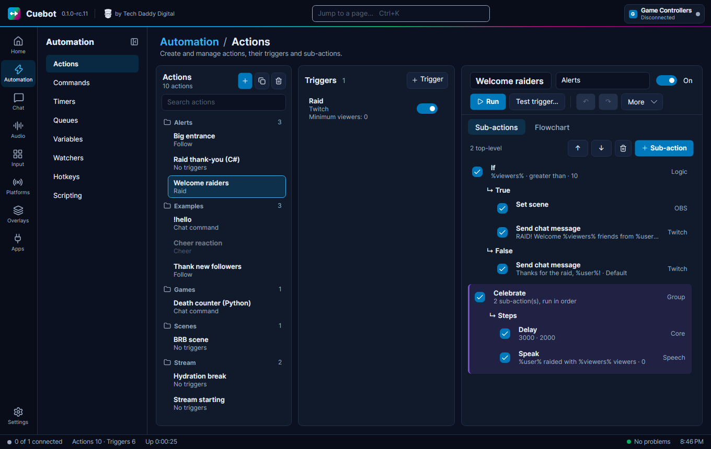

The page has three columns:

| Column | What it holds |
| --- | --- |
| **Actions** (left) | All your actions, sorted into folders by group. |
| **Triggers** (middle) | The triggers of the selected action, and the settings of the trigger you click. |
| **Editor** (right) | The selected action: its name, buttons, and the **Sub-actions** and **Flowchart** tabs. |

!!! note "Narrow window"
    When the Cuebot window is narrower than about 1280 pixels, the **Triggers** column folds away and becomes a
    **Triggers** tab next to **Sub-actions** and **Flowchart**. Everything in it works the same.

    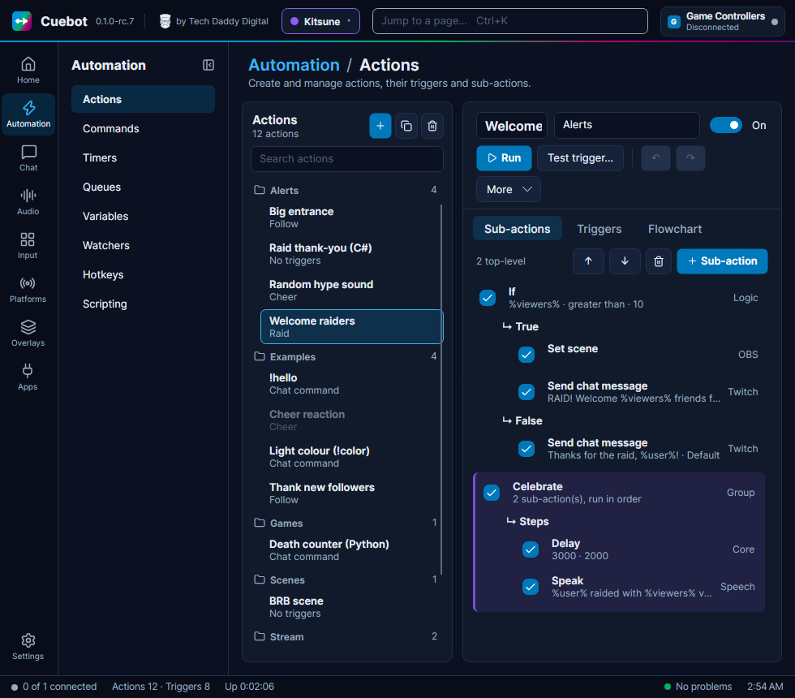

## The actions list

At the top you see **Actions** and how many there are, like `11 actions`. While you search it shows how many match,
like `4 of 12`.

| Button | What it does |
| --- | --- |
| **+** (blue) | **New action**: adds an empty action called `New action` (or `New action 2`, ...) and selects it. |
| Copy icon | **Duplicate** (++ctrl+d++): makes a full copy of the selected action, called `Name (copy)`. |
| Bin icon | **Delete**: deletes the selected action at once. |

!!! tip "Deleted by mistake?"
    After you delete an action, a line above the search box says **Deleted 'Name'.** Click **Undo delete** (or press
    ++ctrl+z++ while no action is selected) and it comes back in its old place, with its triggers, its sub-actions and
    its undo history. Cuebot remembers the last 20 deleted actions until you close it. The **×** on that line hides it,
    and then the deleted actions are gone for good.

**Search actions** filters the list as you type. It looks at the action's name *and* its group, so typing `alerts`
shows every action in the **Alerts** folder.

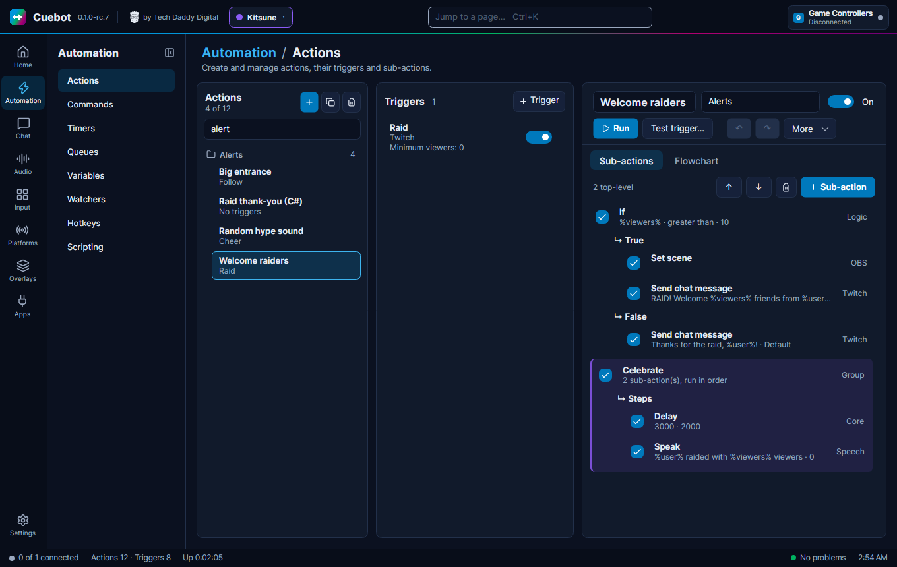

**Folders.** Actions are sorted into folders by their **Group** (A to Z), and by name inside each folder. The number
on the right of a folder is how many actions it holds. Actions without a group sit in a folder called **No group**.
To move an action to another folder, change its **Group** box in the editor. To rename a whole folder, change the
group of each action in it.

**Each row** shows the action's name and, under it, its trigger: `Raid`, `No triggers`, or `Follow +1` when it has
more than one. A **faded row** is an action that is switched off, like **Cheer reaction** in the picture.

**Right-click** an action for:

| Menu item | What it does |
| --- | --- |
| **Copy action** (++ctrl+c++) | Copies the whole action, with its triggers and sub-actions. |
| **Paste** (++ctrl+v++) | Pastes what you copied. A copied action is added as a new action. |
| **Duplicate action** (++ctrl+d++) | Same as the copy icon. |
| **Export to code** › **C#** / **Python** | Makes a copy of the action that runs as one script, and switches this one off. See [Turn an action into code](../developers/export-to-code.md). |
| **Delete action** | Deletes it. **Undo delete** brings it back. |

Keys while the list has the focus (click an action first):

| Key | What it does |
| --- | --- |
| ++delete++ | Asks first: the line under the buttons says *Press Delete again to delete the action 'Name'.* Press ++delete++ again within 5 seconds to delete it. |
| ++ctrl+o++ | Switch the action on or off. |
| ++ctrl+c++ / ++ctrl+v++ / ++ctrl+d++ | Copy, paste, duplicate the action. |

## The action header

At the top of the editor:

| Part | What it does |
| --- | --- |
| Name box | The action's name. Other steps find it by this name (like **Run action**), so keep it unique. |
| **Group** box | The folder it sits in. Type a new name to make a new folder. |
| **On** / **Off** switch | The whole action on or off. An action that is off never starts from its triggers. |
| **Run** | Starts the action now, with no trigger values. |
| **Test trigger…** (++f5++) | Starts it as if a trigger fired, with values you type. See [Testing](#testing-run-and-test-trigger). |
| **↶** / **↷** | Undo and redo (++ctrl+z++ / ++ctrl+y++). Greyed out when there is nothing to undo or redo. |
| **More** | Copy, paste, export and the action's settings. See below. |

Under the buttons, two short lines can appear:

- The result of the last **Run** or test: `'Welcome raiders' completed`, or `... failed — see Dashboard log`.
- What your last edit did: `Copied 1 sub-action.`, `Pasted 2 triggers into 'X'.`, `Undone.`, and so on.

## Action settings: the More menu

Click **More** to open it. The top part has buttons; the bottom part is the action's settings.

| Item | What it does |
| --- | --- |
| **Copy** | Copies the selected trigger or sub-action, or the whole action when nothing is selected (++ctrl+c++). |
| **Paste** | Pastes an action, sub-actions or triggers, also from another Cuebot (++ctrl+v++). |
| **Export to code** **C#** / **Python** | Makes a copy of this action that runs as one C# or Python script, and switches this one off. See [Turn an action into code](../developers/export-to-code.md). |
| **Queue** | Which waiting line the runs use. **Default**, or a queue you made on the **Queues** page. Pause, resume and "one at a time" are set there. See [Queues](queues.md). |
| **Allow concurrent runs (Default queue only)** | Only for actions in the **Default** queue. Off: when the action starts again while it is still running, the new run waits. On: runs may overlap. Greyed out for actions in a named queue, which follow that queue's own setting. |
| **Random action** | Runs only **one** of the top-level sub-actions, picked at random. See [Random action](#random-action-and-weights). |
| **Concurrent sub-actions** | Runs all top-level sub-actions at the same time instead of one after another. Greyed out (and ignored) while **Random action** is ticked. |
| **Always run** | Starts even while the action's queue is paused. |
| **Exclude from history** | Keeps runs out of the **Pending** and **History** lists. Handy for actions that run very often, like a chat logger. |

The **ACTION** box on the [flowchart](flowchart.md) sums these up in small text, like `Runs queued`,
`Runs concurrently`, `Queue: Alerts`, `· one random step`, `· steps in parallel` or `· always runs`.

### Random action and weights

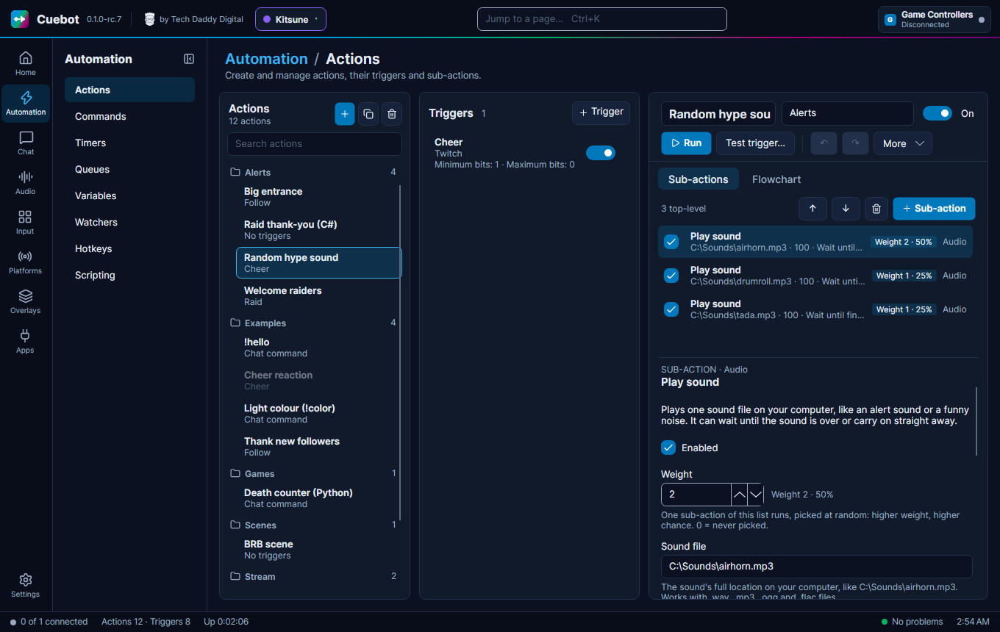

With **Random action** ticked, Cuebot picks **one** enabled top-level step each time and runs only that one. Great
for "play one of three sounds".

- Each top-level step gets a **Weight** setting and a badge in the list, like `Weight 2 · 50%`.
- A bigger weight means a bigger chance. In the picture, airhorn (weight 2) has 50%, drumroll and tada (weight 1)
  have 25% each.
- Weight `0` means "never picked" (unless every step is 0; then all are equally likely).
- Steps that are switched off are never picked; their badge says `disabled`.

A **Group** step with **Run one random step** ticked does the same for the steps inside it. See
[Logic and branches](logic-and-branches.md#pick-one-at-random).

## The Triggers column

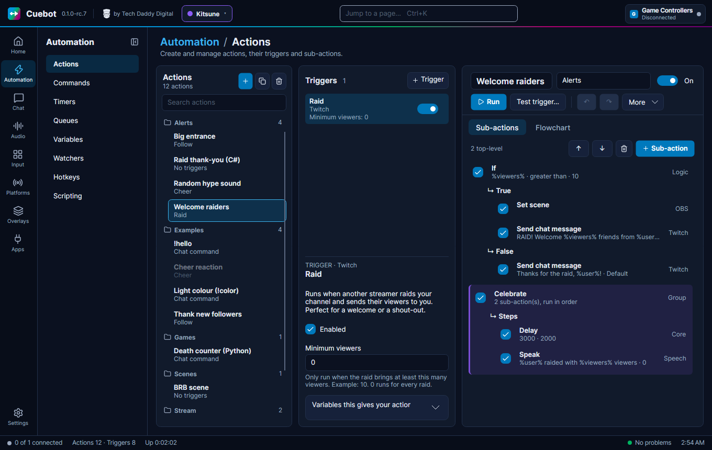

The header says **Triggers** and how many the action has. With none, it says *No triggers yet: the action runs only
when started by hand, a command or another action.*

### Add a trigger

1. Click **+ Trigger**.
2. In the **Add trigger** window, type a few words, like `twitch follow` or `obs scene`. See
   [The search window](#the-search-window).
3. Pick one and click **Add**. It is added at the end and selected.

### Each trigger

Each row shows the trigger's name, its group (like **Twitch**), a short summary of its settings (like
`Minimum viewers: 0`), and an **on/off switch**. A trigger that is off no longer starts the action; the action's other
triggers still do.

Click a trigger to see its details under the list:

- **TRIGGER · Twitch** and its name, then a plain explanation of when it fires.
- **Enabled**: the same as the on/off switch.
- **Always run**: only on triggers with a minimum and a maximum, like bits or viewers. See below.
- Its **settings** (often called filters): they make the trigger pickier. A channel point trigger can be set to one
  reward, a command trigger to one command. Each setting has a hint under it.
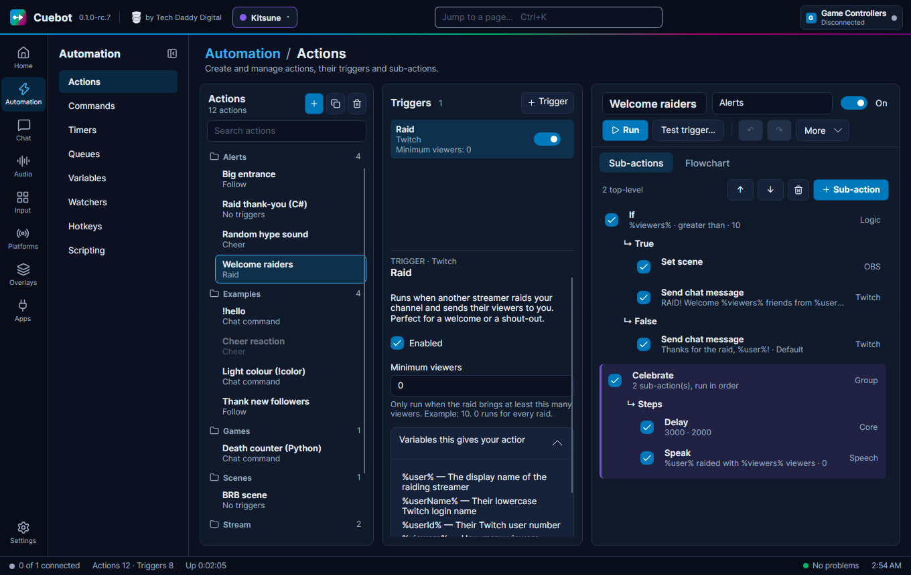

- **Variables this gives your action**: click to open. It lists the `%words%` this trigger hands your action, like
  `%user% — The display name of the raiding streamer`. You can select and copy them.

**Range triggers and Always run.** Some triggers have a range, like a Cheer with **Minimum bits** and **Maximum
bits**. When one cheer matches several Cheer triggers (say "1 to 99 bits" and "any amount"), only the trigger with the
**narrowest** range runs. That lets you make a special reaction for exactly 100 bits without the general one also
firing. Tick **Always run** on a trigger to make it run anyway, even when a narrower one matches.

### Remove, copy or move a trigger

- **Delete**: select the trigger and press ++delete++, or click the bin button above the sub-action list (it deletes
  whatever is selected). On the **Flowchart**, select its box and press ++delete++.
- **Copy / Duplicate**: select it and press ++ctrl+c++ or ++ctrl+d++. A pasted trigger goes after the selected
  trigger, or at the end. You can paste triggers into another action, too.
- The order of triggers does not matter: any one of them starts the action, so there is nothing to move.

## The Sub-actions tab (the list editor)

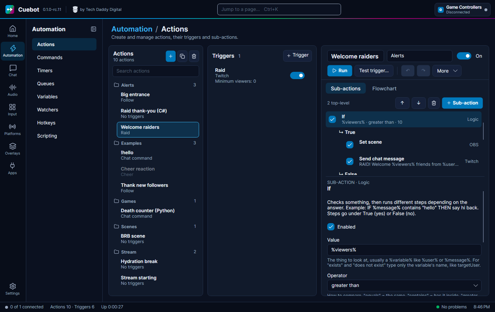

### The toolbar

On the left it counts the steps of the main list, like `2 top-level` (steps inside branches are not counted).

| Button | What it does |
| --- | --- |
| **↑** / **↓** | Move the selected sub-action up or down, inside its own list (++ctrl+up++ / ++ctrl+down++). |
| Bin icon | Delete the selected sub-action, with everything inside it (++delete++). Also deletes a selected trigger. |
| **+ Sub-action** | Opens the search window. The new step goes after the selected sub-action, or into the selected branch. |

### The list

Each row is one step:

- A **tick box** on the left: ticked = on. Untick it to switch the step off without deleting it. A step that is off
  is skipped when the action runs, together with everything inside it.
- The step's **name** in bold, and under it a short **summary** of its settings, like `%viewers% · greater than · 10`.
- The step's **group** on the right, like **Twitch**, **OBS** or **Logic**.
- A **weight badge**, like `Weight 1 · 25%`, when one step is picked at random.

Steps with branches show them as lines starting with **↳**, like **↳ True** and **↳ False**, with their steps
indented underneath. A **Group** step is drawn as a tinted box with a coloured bar on the left, in the group's colour.
See [Branch steps in the list](#branch-steps-in-the-list).

### Where a new step goes

| What is selected | The new (or pasted) step goes … |
| --- | --- |
| A sub-action | right after it, in the same list (inside the same branch). |
| A branch line, like **↳ True** | at the end of that branch. |
| Nothing, or a trigger | at the end of the main list. |

After adding, the new step is selected, so the next one you add goes right after it.

### A step's details

Click a step and its details open under the list:

- **SUB-ACTION · Twitch** and the step's name, then a plain explanation of what it does.
- **Enabled**: the same as the tick box.
- **Weight**: only when one step of the list is picked at random. *0 = never picked.*
- Its **settings**. There are text boxes (some suggest values as you type), bigger boxes for long text, tick boxes,
  drop-down lists and, for code steps, a code editor. Each has a hint under it.
- **Variables this adds for the next steps**: click to open. The `%words%` this step creates, which the steps after it
  can use. For example **Split text into inputs** adds `%input0%`, `%input1%`, ...
- A reminder at the bottom: words in `%` signs are swapped for real values, words in `~` signs are saved values.

Changes save by themselves. Typing in a box counts as one undo step per pause.

### Moving steps

- **↑** / **↓** (++ctrl+up++ / ++ctrl+down++) move a step one place, inside its own list.
- ++ctrl+home++ / ++ctrl+end++ move it to the top or bottom of its own list.
- These never move a step into or out of a branch. To do that, drag it on the [Flowchart](flowchart.md#move-a-step-to-another-place-rewire),
  or copy it, select the place you want, paste, and delete the old one.

### Right-click menu

Right-click a step (it gets selected first) for:

| Menu item | What it does |
| --- | --- |
| **Copy** (++ctrl+c++) | Copies the step with everything inside it. On a branch line it copies that branch's steps. |
| **Paste** (++ctrl+v++) | Pastes after the selected step, or into the selected branch. |
| **Duplicate** (++ctrl+d++) | Puts a copy right under the step. |
| **Delete** (++delete++) | Deletes the step and everything inside it. ++ctrl+z++ brings it back. |
| **Copy whole action** | Copies the entire action. |
| **Undo** / **Redo** | Same as ↶ and ↷. |

## The search window

**+ Trigger** and **+ Sub-action** open the same kind of window, titled **Add trigger** or **Add sub-action**.

- Each line shows the group in grey (like **OBS**) and the name. Point at a line to see its description; the selected
  one's description also shows in the box at the bottom.
- Type words in the search box. **Every word must appear**, in any order: `obs scene` finds **OBS › Set scene** and
  **OBS › Create scene**. Lines whose name matches come first; after them come lines that only mention your words in
  their description.
- The first match is selected for you. ++up++ / ++down++ move the selection.
- ++enter++, a double-click or **Add** adds it. ++esc++ or **Cancel** closes the window.

## Testing: Run and Test trigger

- **Run** starts the action now, without trigger values. `%user%` and friends stay empty, so text shows them as typed,
  and a step that needs a number from them (like `$math(%bits% / 10)$`) fails. So does a deck button, unless you give it
  the values under its **Variables** (for example `bits=100`). Use **Test trigger…** to try such an action.
- **Test trigger…** (++f5++) opens a window. Pick a trigger under **Run as if this trigger fired** (or **Custom
  arguments only**), check the `name=value` lines under **Arguments**, and click **Run test**.
  - **Arguments** starts with a made-up value for each of the chosen trigger's variables: a cheer gets `bits=100`
    (or the trigger's **Minimum bits**, if higher), a Super Chat gets `amount=5` and `currency=USD`. Change them as
    you like; picking another trigger starts again from its own values.
  - The values become `%name%` variables. Numbers become real numbers.
  - Cuebot also adds the trigger's own values (`%triggerName%`, `%triggerCategory%`, `%eventType%`, ...) and
    `%isTest%` = `true`.
  - The trigger's settings (filters) are not checked. The run waits in the action's queue like a real one.
  - Empty lines and lines starting with `#` are skipped. A bad line shows an error, like `Line 3: expected name=value`.

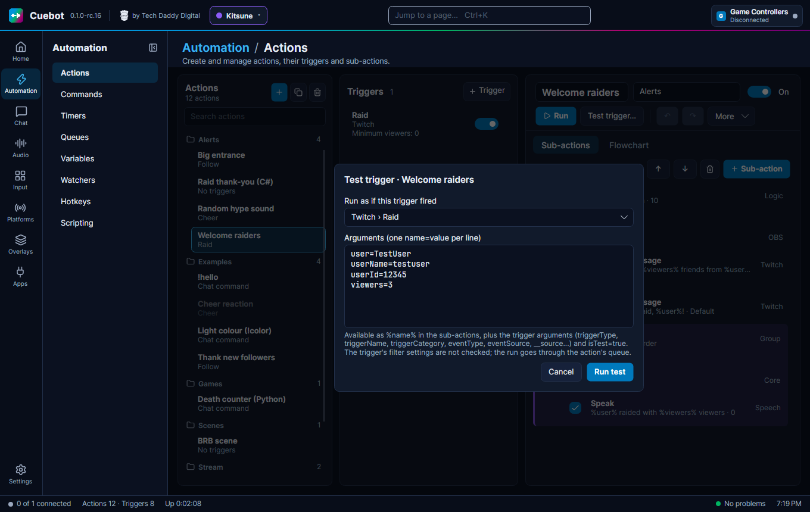

Both are **real**: the steps really happen. Every run also shows up on the [History](history.md) page, unless the
action has **Exclude from history** ticked.

## Copy, paste and duplicate

What ++ctrl+c++ copies depends on what is selected:

| Selected | Copies |
| --- | --- |
| An action in the actions list (the list has the focus) | the whole action |
| A trigger | that trigger |
| A sub-action | that step, with its branches and everything inside |
| A branch line (like **↳ True**) | the steps in that branch (an empty branch copies nothing) |
| Nothing in the action | the whole action |

Cuebot puts the copy on your computer's clipboard too, as text. So you can paste it into **another Cuebot**, or send
it to a friend in Discord, and they paste it with ++ctrl+v++ on their Actions page. Random text on the clipboard is
ignored: only things Cuebot copied can be pasted.

Pasting always makes fresh copies. A pasted action whose name is taken gets `(copy)`, `(copy 2)`, ... added.

**Duplicate** (++ctrl+d++) copies and pastes in one go: a selected step is copied right under itself, a selected
trigger right after itself. A selected branch line (like **True** or **Steps**) is part of its sub-action, so
++ctrl+d++ does nothing there: select the sub-action itself to copy it with all its branches. With nothing selected,
the whole action is duplicated.

## Undo and redo

- Each action has its **own** undo history. Switching to another action and back keeps it.
- It remembers up to 100 changes, until you close Cuebot.
- Typing in one box is merged into one undo step per pause. Ticking a box is one step each.
- Moving boxes on the flowchart and **Auto-arrange** can be undone too.
- A deleted **whole action** comes back with **Undo delete** (see [the actions list](#the-actions-list)).

## Keyboard shortcuts

These work on the Actions page when you are **not** typing in a text box (in a text box, ++ctrl+c++, ++ctrl+v++
and ++ctrl+z++ work on the text as usual). They work the same in the list and on the flowchart.

| Key | What it does |
| --- | --- |
| ++f5++ | **Test trigger…** for the selected action. |
| ++ctrl+c++ / ++ctrl+v++ | Copy / paste (see above). |
| ++ctrl+d++ | Duplicate the selected step or trigger (or, in the actions list, the action). |
| ++delete++ | Delete the selected sub-action (the step list must have the focus; in the flowchart also triggers). In the actions list: delete the action, after a second press. |
| ++ctrl+z++ | Undo. |
| ++ctrl+y++ or ++ctrl+shift+z++ | Redo. |
| ++ctrl+o++ | Switch the selected trigger or sub-action on or off. In the actions list, or with nothing selected: the whole action. |
| ++ctrl+up++ / ++ctrl+down++ | Move the selected sub-action up / down. |
| ++ctrl+home++ / ++ctrl+end++ | Move the selected sub-action to the top / bottom of its list. |
| ++ctrl+r++ | With a **Group** step selected: jump to its **Name** box to rename it. |
| ++esc++ | Close the search window or the test window. |

The **Settings** page lists every Cuebot shortcut.

## Branch steps in the list

Some steps hold other steps. In the list, their branches show as **↳** lines with the steps indented under them.

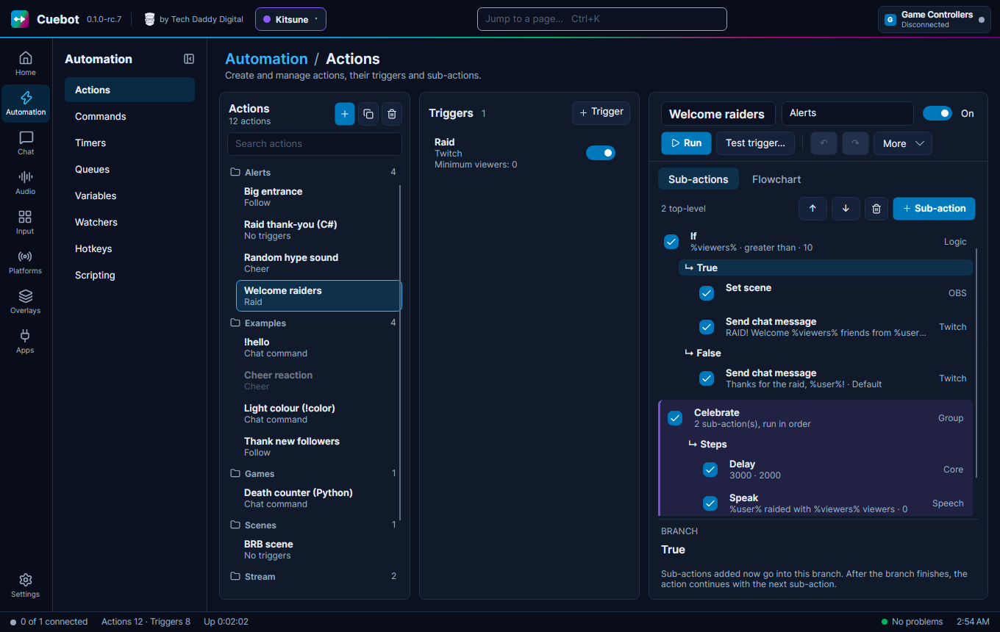

| Step | Its branches in the list |
| --- | --- |
| **If** | **↳ True** and **↳ False**. |
| **Switch** | One line per case you type, plus **↳ Default**. Change the cases and the lines change with them. |
| **While** | **↳ Body**: the steps it repeats. |
| **Group** | **↳ Steps**, inside a tinted box in the group's colour. Its summary says `2 sub-action(s), run in order` or `Runs one of 3 sub-action(s), picked by weight`. |
| **Run at the same time** | **↳ Lane 1**, **↳ Lane 2**, ... Its summary says `3 lanes at once, then the next step`. |
| Some other steps | Like **File exists** (**True** / **False**) or **Spend points** (**Paid** / **Not enough**). |

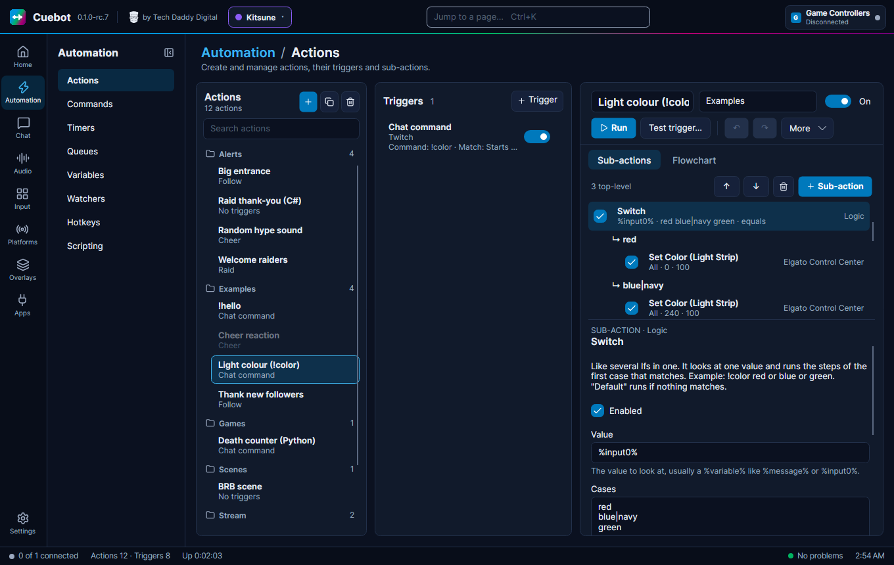

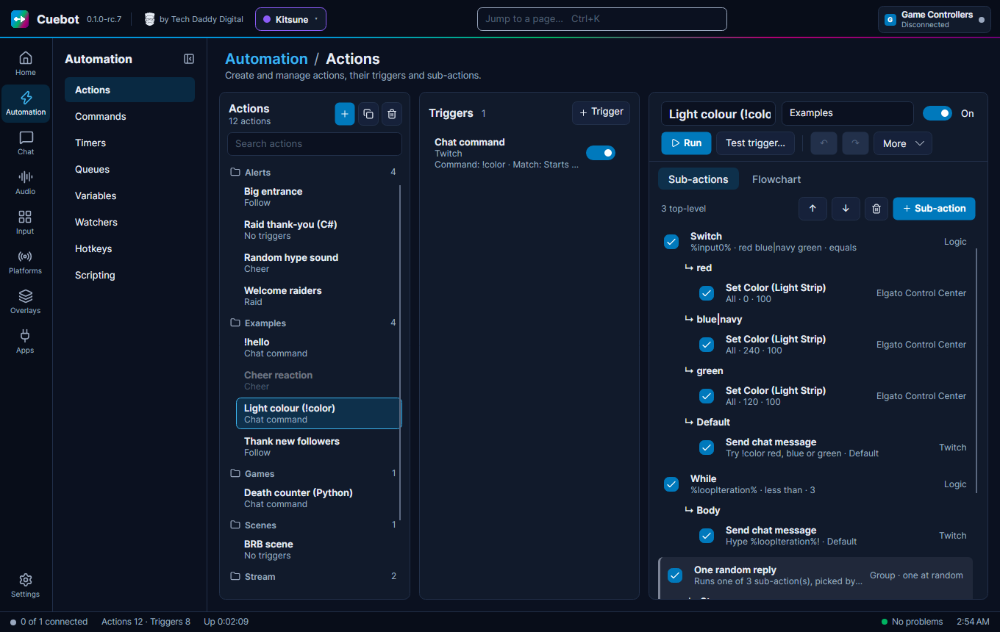

How to work with them:

1. Add the branch step, like **Logic › If**. Its branch lines appear at once, empty.
2. Click a branch line, like **↳ True**. The panel under the list says **BRANCH** and the branch name: *Sub-actions
   added now go into this branch. After the branch finishes, the action continues with the next sub-action.*
3. Click **+ Sub-action** (or paste). The step goes at the end of that branch.
4. To add a step **after** the If (not inside it), select the If itself and click **+ Sub-action**.

If you remove a case from a **Switch**, its steps are hidden but not lost: type the case again and they come back.

What each of these steps does when it runs is on [Logic and branches](logic-and-branches.md).

Next: [The flowchart editor](flowchart.md).
