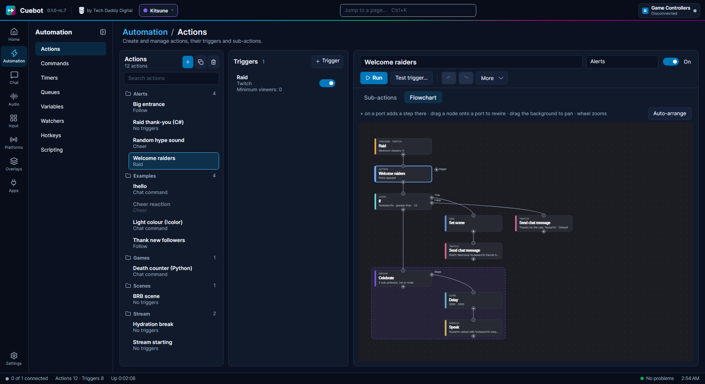
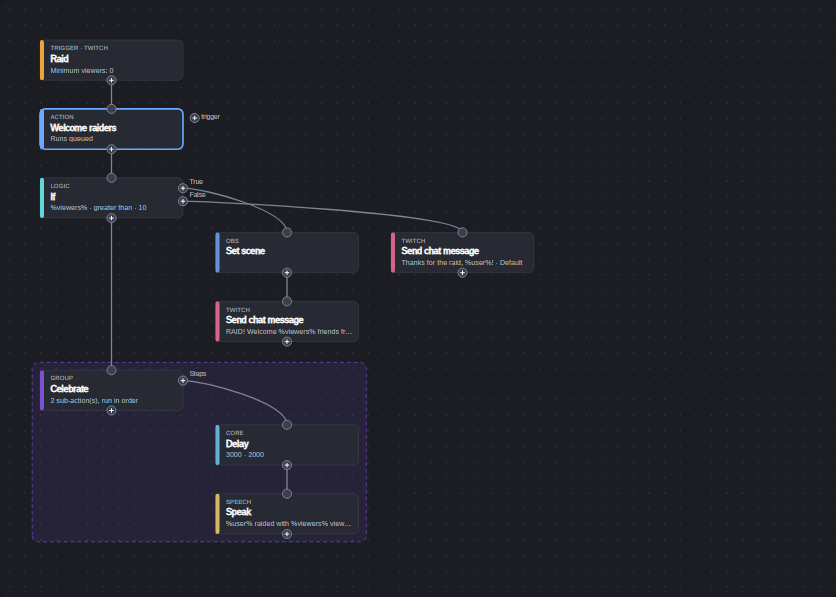
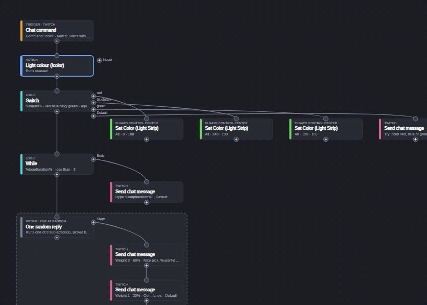
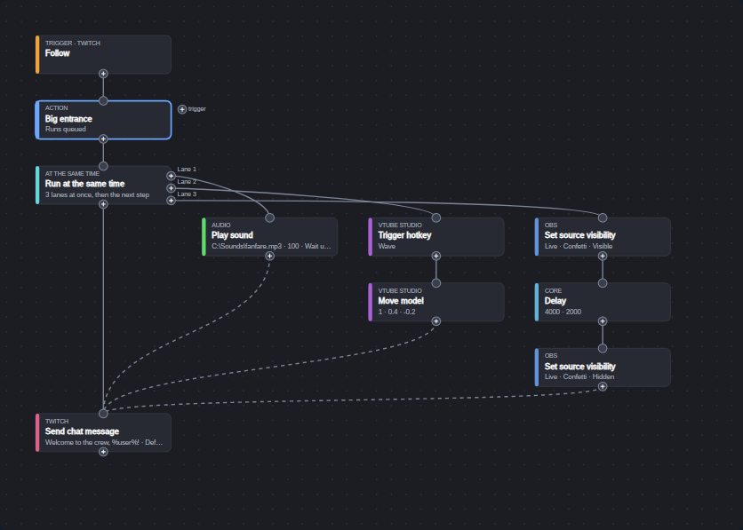
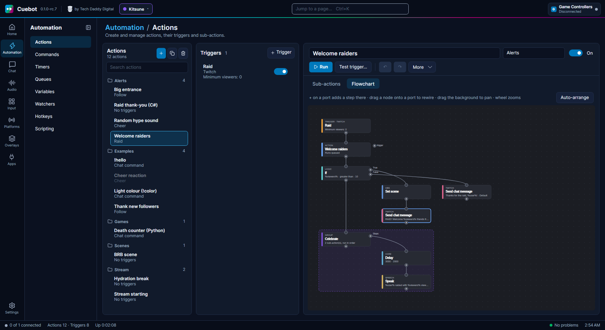
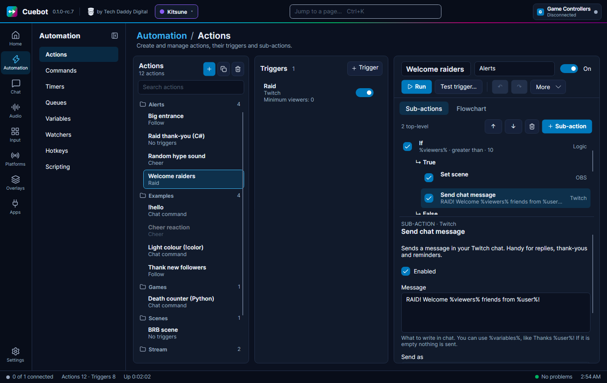

# The flowchart editor

Every action can be shown two ways: as a **list** of steps (the **Sub-actions** tab) or as a **flowchart** (the
**Flowchart** tab). This is the flowchart, also called the **node editor**. It shows the same action as boxes joined
by lines. Change one view and the other changes too: there is only one action.

The flowchart shines when an action makes decisions. You can *see* which steps run when the answer is yes, which run
when it is no, and what happens at the same time.

## Open it

1. Go to **Automation > Actions**.
2. Click an action in the list.
3. Click the **Flowchart** tab, next to **Sub-actions**.

The whole action is fitted to the screen when you open it. The flowchart likes room: make the Cuebot window wide, or
full screen with ++f11++.

Above the canvas is a one-line reminder: *+ on a port adds a step there · drag a node onto a port to rewire · drag
the background to pan · wheel zooms*. And on the right, the **Auto-arrange** button.

## The words: nodes, ports and wires

| Word | What it is |
| --- | --- |
| **Node** | One box. A trigger, the action itself, or one step. |
| **Port** | A small round dot on the edge of a box, where a line starts or ends. |
| **"+" port** | A dot with a **+** in it. It is an *exit* of a box: click it to add something there, or drop a box on it to move that box there. |
| **Plain port** | A dot without a +, on the top of a box. It is the box's *entrance*: lines arrive here. |
| **Wire** | A line from one box's exit to the next box's entrance. It shows the order: Cuebot follows the wire. |

## Reading the flowchart

Read it like a map, from top to bottom. Branches go off to the right.

| What you see | What it means |
| --- | --- |
| **Boxes along the top**, small label **TRIGGER · TWITCH**, orange stripe | The triggers: what starts the action. All of them wire into the action box. |
| **The box under them**, label **ACTION**, blue stripe | The action itself, with its name. Its small text says how it runs, like `Runs queued`, `Queue: Alerts`, `· one random step` or `· steps in parallel`. |
| **Boxes going down** | The steps, in the order they run. The small label is the step's group, like **TWITCH**, **OBS** or **LOGIC**; each group gets its own stripe colour. The bold text is the step's name, the small grey text a summary of its settings. |
| **A box with ports on its right side** | A step with branches, like an **If**. Each branch has its own labelled **+** port, and its steps hang to the right of it. |
| **A dashed coloured frame** | A **Group** step and everything inside it. |
| **Dashed wires** | The ends of **Run at the same time** lanes, joining the next step: "wait here until every lane is done". |
| **A faded box** | Switched off. A step that is off fades together with everything inside it. When the whole action is off, everything is faded. |
| **A thick blue border** | The selected box. When nothing is selected, the **ACTION** box has it: then copy and paste work on the whole action. |
| **A weight in the grey text**, like `Weight 2 · 50%` | The step's chance, when the action (or its group) runs one step at random. |

The canvas follows Cuebot's light or dark theme.

### Where the ports are

| Box | Ports |
| --- | --- |
| Trigger | One **+** at the bottom: adds another trigger. |
| ACTION | A plain port on top (the triggers arrive here). A **+** at the bottom: adds a step at the very start. A **+** on the right, labelled **trigger**: adds a trigger. |
| Step | A plain port on top. A **+** at the bottom: adds a step right after this one. |
| Step with branches | Also one **+** per branch on its right side, labelled with the branch name (**True**, **False**, **Steps**, **Lane 1**, ...): adds a step at the start of that branch. |

Point at a **+** port and it lights up blue, and the mouse pointer turns into a hand.

### Decisions: steps that split

| Step | Its branch ports |
| --- | --- |
| **If** | **True** and **False**: yes and no. |
| **Switch** | One port per case you type, plus **Default** for "none of them". |
| **While** | **Body**: the steps it repeats. |
| **Group** | **Steps**: the steps inside the frame. |
| **Run at the same time** | **Lane 1**, **Lane 2**, ...: all of them run at once (see below). |
| **File exists**, **User in group** | **True** and **False**. |
| **Check points** / **Spend points** | **Enough** / **Paid**, and **Not enough**. |

When the branch that was chosen is done, the action carries on with the box *under* the decision (follow the long
wire on the left).

In the picture above, the raid action asks **If %viewers% greater than 10**. On **True** it switches the OBS scene
and writes a big welcome. On **False** it only says thanks. Then both carry on with the **Celebrate** group.

### Groups: a frame around steps

A **Group** step draws a dashed, tinted frame around itself and the steps inside it. Its label says **GROUP**, or
**GROUP · ONE AT RANDOM** when only one of its steps runs, picked at random. The stripe and the frame use the group's
**Colour** setting. Groups can sit inside other groups; the inner frame is drawn on top.

### Doing several things at once: Run at the same time

Normally one step waits for the one before it. **Run at the same time** (in the **Logic** group) starts several
little lists at the same moment. Think of a relay race where every runner starts at once.

- Its label says **AT THE SAME TIME**, and it has a **+** port for each lane: **Lane 1**, **Lane 2**, ...
- All lanes start together. Inside a lane, the steps still go one after another.
- **Dashed wires** run from the end of each lane to the next step. They mean "wait here until every lane is done".
- Want more lanes? Select the step, go to the **Sub-actions** tab and change **Lanes** (2 to 10). The new port
  appears at once.

In the picture, a follow plays a fanfare (lane 1), makes the VTube Studio model wave and move (lane 2), and shows a
confetti source for 4 seconds (lane 3). The chat message waits for all three.
[Logic and branches](logic-and-branches.md#do-several-things-at-once) has the rules for variables and errors.

### Steps at the same time, or one at random

Under **More**, an action can run **all its steps at the same time** (**Concurrent sub-actions**), or **only one
step, picked at random** (**Random action**). The flowchart still draws them as one line going down. Only the small
text in the **ACTION** box tells you: `· steps in parallel` or `· one random step`. For a random action, each step
also shows its weight.

## Changing the action

### Add a step or a trigger at a port

1. Click a **+** port.
2. The search window opens (**Add sub-action** or **Add trigger**). Type a few words, like `obs scene`.
3. Pick a line with the mouse or the arrow keys, and click **Add** (or press ++enter++).

| Click the + … | Adds … |
| --- | --- |
| under a step | a step right after that step |
| under the **ACTION** box | a step at the very start |
| on a branch port (like **True**) | a step at the start of that branch |
| under a trigger, or the **trigger** port next to the ACTION box | another trigger |

The new step is selected. Its settings are on the **Sub-actions** tab (see [Edit a box](#select-and-edit-a-box)).

### Move a box on the screen

Drag a box to move it. Nothing changes in what the action does: this only tidies the picture.

- Steps that hang under or inside the box you move, and that you never moved yourself, **come along**. So dragging
  an If drags its True and False steps with it.
- Moving the **ACTION** box moves the whole chain of steps under it.
- A tiny wiggle (a few pixels) is not a drag, so clicking a box never moves it by accident.
- ++ctrl+z++ undoes a move.

### Move a step to another place (rewire)

Drag a step and drop it on a **+** port somewhere else. While you drag, the port under the pointer turns **green**
when you can drop there. Let go, and the step moves to that place in the action, together with everything inside it.
It is then placed neatly at its new spot.

Examples:

- Drag a chat step from the **False** branch onto the **True** port: it becomes the first step of True.
- Drag a step out of a group onto the **+** under the group: it now runs after the group.
- Drag the last step onto the **+** under the ACTION box: it now runs first.

Some drops are not allowed, and the port stays grey:

- A step can't be dropped on its own ports, or into its own branches (a group can't go inside itself).
- Triggers and the ACTION box can't be rewired, only moved on the screen. Trigger ports and the **trigger** port are
  not drop targets.
- If you let go anywhere else, the step simply stays where you put it on the screen.

!!! note "No free wiring"
    You can't draw a wire from one port to another by hand. The wires always follow the order of the steps. To change
    the order, drop the step on the **+** port where it should go.

### Select and edit a box

Click a box to select it (thick blue border).

- **A trigger**: its settings show in the **Triggers** column, as in the list editor. (On a narrow window, open the
  **Triggers** tab.)
- **A step**: the flowchart has no settings panel. Click the **Sub-actions** tab: the same step is already
  selected, with its settings under the list. Change them, then come back to **Flowchart**.

### Auto-arrange

**Auto-arrange** (top right) forgets every position you dragged and lays the whole flowchart out neatly again: triggers
in a row at the top, steps going down, branches to the right. ++ctrl+z++ brings your own layout back.

## Moving around

| To … | Do this |
| --- | --- |
| Look at another part (pan) | Drag the empty background. This also unselects the selected box. |
| Zoom in or out | Turn the mouse wheel. It zooms around the mouse pointer, from 30% up to 250%. |
| See the whole action again | Click the background, then press ++home++. It zooms to fit (never above 100%). |

## Right-click menu

Right-click a box: it gets selected, and a menu opens.

| Menu item | What it does |
| --- | --- |
| **Copy** (++ctrl+c++) | Copies the step (with everything inside it) or trigger. On the background or the ACTION box: the whole action. |
| **Paste** (++ctrl+v++) | Pastes after the selected step, or (triggers) after the selected trigger. |
| **Duplicate** (++ctrl+d++) | Puts a copy right after the selected step or trigger. |
| **Delete** (++delete++) | Deletes the selected step or trigger. |
| **Copy whole action** | Copies the entire action. |
| **Undo** / **Redo** | Undo and redo. |

## Keys

Click inside the flowchart first, so it has the focus.

| Key | What it does |
| --- | --- |
| ++delete++ or ++backspace++ | Delete the selected step or trigger, without asking. ++ctrl+z++ brings it back. |
| ++ctrl+c++, ++ctrl+v++, ++ctrl+d++ | Copy, paste (after the selected step) and duplicate. |
| ++ctrl+z++, ++ctrl+y++ | Undo and redo. Moving boxes and **Auto-arrange** can be undone too. |
| ++ctrl+o++ | Switch the selected step or trigger on or off (with nothing selected: the whole action). |
| ++ctrl+up++, ++ctrl+down++ | Move the selected step up or down in its list. |
| ++ctrl+home++, ++ctrl+end++ | Move the selected step to the top or the bottom of its list. |
| ++home++ | Fit the whole action on the screen. |
| ++f5++ | **Test trigger…**: try the action with pretend values. |

## How the layout is saved

The position of every box you dragged is saved inside the action, together with its steps, so the picture looks the
same tomorrow, and a whole action you copy and paste (or duplicate) keeps its layout. Boxes you never
dragged have no saved position: Cuebot places them automatically, under or beside the box they belong to.

A few things forget a position on purpose:

- **Auto-arrange** forgets all of them.
- A step you rewire (drop on a port) is placed automatically at its new spot.
- Pasted and duplicated steps and triggers are placed automatically at their new spot.
- [Export to code](../developers/export-to-code.md) makes a new action without positions.

## List or flowchart?

Use whichever you like: it is the same action, and you can switch at any moment.

| Use the list (**Sub-actions**) to … | Use the flowchart to … |
| --- | --- |
| add steps quickly, one after another | see the whole action at once |
| change a step's settings (only here) | follow decisions, branches and lanes |
| switch steps on and off with the tick boxes | move a step into or out of a branch by dragging |
| move a step up or down with **↑** / **↓** | tidy a big action by dragging boxes |

New to actions? Start with [Your first action](your-first-action.md). Every button of the list editor is on
[The action editor](action-editor.md).
