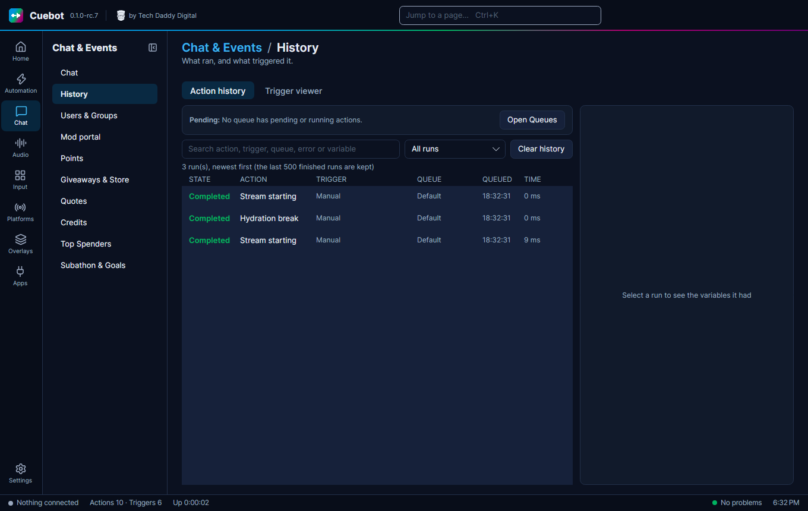

# History

**History** shows what Cuebot did and why: every action that ran, and every event that came in. It is the first place
to look when an action did not do what you expected.

## Action history

**Chat > History** lists every run: what ran, what started it and the values it had. Select a run to see its
variables. **Run again with these variables** repeats it. **Cancel run** stops one that is still going. **Open action**
jumps to the action. **Open Queues** opens the [Queues](queues.md) page, and **Clear history** empties the list.

## Trigger viewer

The **Trigger viewer** tab shows every event that comes in, like a follow, a chat message or a scene change, even when
no action uses it. Select one to see its variables. Two handy buttons:

- **Create action from this trigger** makes a new action that starts on this kind of event, and opens it.
- **Pause** stops the list from moving, so you can read it. Your actions still run as normal.
