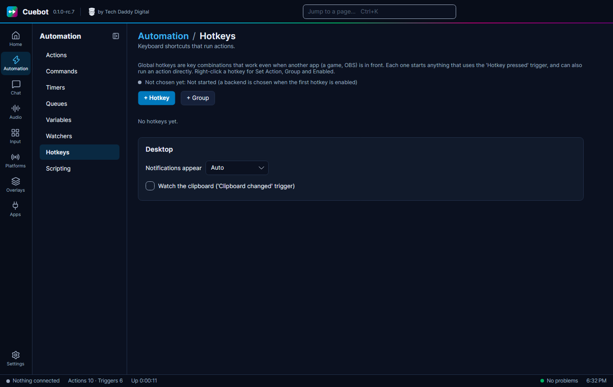

# Hotkeys

A **hotkey** is a keyboard shortcut that starts an action. Cuebot's hotkeys work even when a game or OBS is in front,
so you can fire an alert or switch a scene without leaving your game.

## Make a hotkey

1. Go to **Automation > Hotkeys**, click **+ Hotkey** and give it a name.
2. Type the keys, like `Ctrl+Shift+F1`, or right-click and choose **Record keys**.
3. Either type an action in **Run action (optional)**, or add the **Hotkey pressed** trigger to an action.
4. **Test** tries it.

**+ Group** keeps hotkeys tidy, like one group per game.

## The Desktop settings

The **Desktop** part of the page sets where Cuebot's pop-up notifications appear (**Notifications appear**), and
**Watch the clipboard ('Clipboard changed' trigger)** lets an action start whenever you copy something.

## On a Mac

!!! note "Mac"
    On a Mac, `Meta` is the **Command** key and `Alt` is **Option**. The first time you turn on a hotkey, macOS asks
    whether Cuebot may watch the keyboard: open **System Settings > Privacy & Security > Input Monitoring**, turn on
    **Cuebot**, then quit and reopen Cuebot. The app in front still gets the keys, so pick combos it does not use.
    The **Keyboard press** sub-action needs **Accessibility** in the same place, for the same reason.
