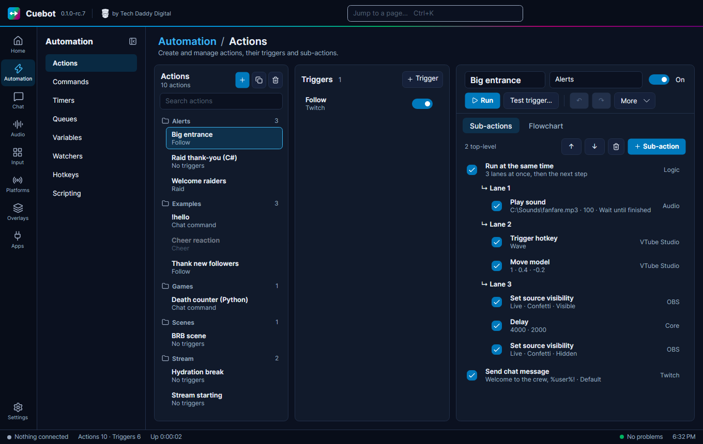
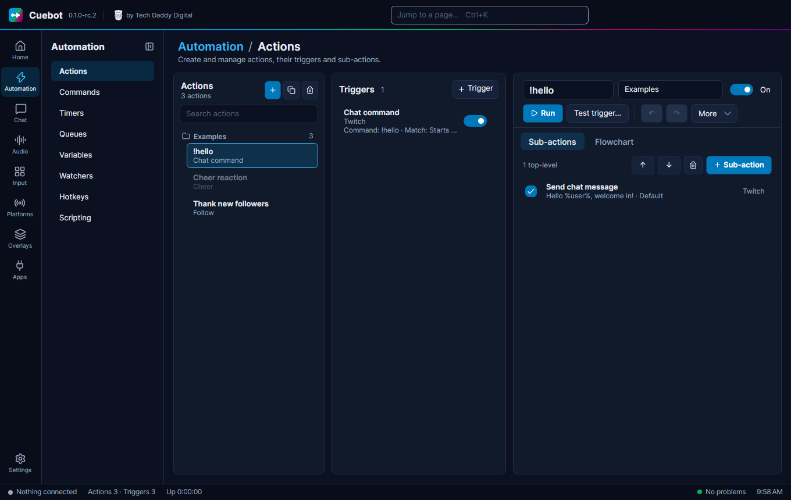
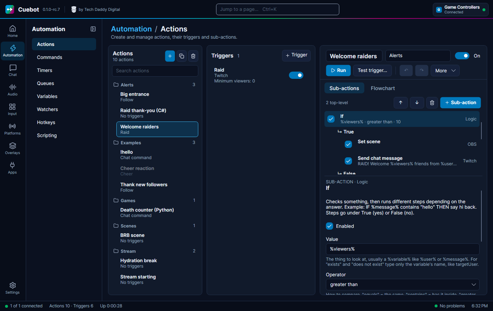
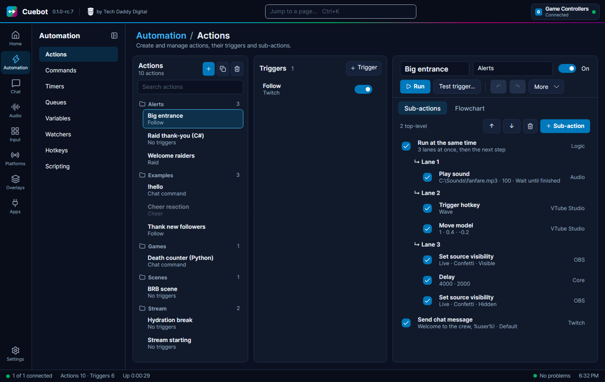
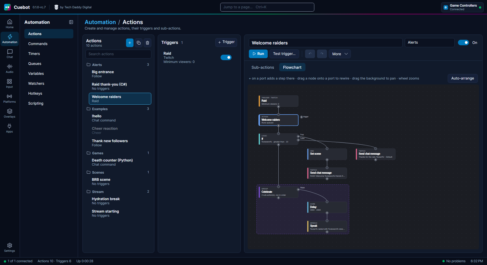

# How actions work

Everything Cuebot does is built from three pieces. Once you know them, you know Cuebot.

| Piece | What it is | Stream example |
| --- | --- | --- |
| **Action** | A job, with a name. | "Thank new followers" |
| **Sub-action** | One step of that job. An action has a list of them. | "Write *Thanks for the follow!* in chat" |
| **Trigger** | What starts the job. | "Someone followed my channel" |

Think of a recipe card. The **action** is the card. The **sub-actions** are the steps written on it, done from top to
bottom. The **trigger** is the moment you pick the card up.

- One action can have **many triggers**. "Say thanks" could start on a follow *and* on a sub.
- One trigger type can start **many actions**.
- An action with **no trigger** only runs when you start it by hand, from a command, or from another action.

All of this lives in **Automation > Actions**.

## Building an action

1. Go to **Automation > Actions** and click **+** (New action).
2. Click the name at the top and give it a clear name, like `Thank new followers`.
3. Optional: type a **Group** name, like `Alerts`. Groups are folders that keep the list tidy.
4. On the **Sub-actions** tab click **+ Sub-action**. Type what you want to do, for example `chat`, `scene`, `sound`
   or `speak`, pick one and click **Add**.
5. Fill in its settings. Each setting has a short hint under it.
6. Add more sub-actions the same way. A new one goes in **after the one you selected**.
7. Click **+ Trigger** and pick what should start it, for example **Twitch › Follow**.

You can try an action at any time:

- **Run** starts it right now.
- **Test trigger…** (++f5++) starts it as if a trigger fired. You type pretend values, one `name=value` per line, like
  `user=Bob`, and Cuebot uses them. Good for testing a follow alert without a real follower. The trigger's filters
  are not checked, and the run waits in the action's queue like any other. Cuebot also hands the action
  `%isTest%` = `true`, so a step can tell it is a test.

!!! note "A test is real"
    Tests really do the steps. A "send chat message" step really writes in your chat.

### Changing the list

- **↑** and **↓** (or ++ctrl+up++ / ++ctrl+down++) move the selected sub-action.
- The tick box on a sub-action turns it off without deleting it.
- ++ctrl+z++ undoes, ++ctrl+y++ redoes. Each action has its own undo.
- ++ctrl+c++ / ++ctrl+v++ copy and paste actions, triggers and sub-actions, even into another Cuebot.
- ++ctrl+d++ makes a copy, ++delete++ deletes.

### Turning things off

The **On** / **Off** buttons switch a whole action off. Each trigger also has its own on/off switch. An action that is
off does nothing, even when its trigger happens.

## Triggers

Click a trigger in the list to see its settings. Many triggers have **filters**: settings that make them pickier.
For example, a channel point trigger can be set to one reward only, like "Hydrate".

Open **Variables this gives your action** under a trigger. It lists the `%words%` you can use in your messages, like
`%user%` for the viewer's name. See [Variables](variables.md).

There are hundreds of triggers: chat messages, commands, follows, subs, cheers, raids, donations, OBS scene changes,
Stream Deck buttons, hotkeys, timers and many more. The [trigger reference](../../reference/triggers/index.md) lists
every one.

## Decisions and repeats

Sometimes a step should only happen *sometimes*. These sub-actions help. You find them in the **Logic** and **Core**
groups of the list:

| Sub-action | What it does | Example |
| --- | --- | --- |
| **If** | Checks something, then runs one of two lists. | If `%bits%` is more than 499, switch to the "Celebration" scene. Otherwise just say thanks. |
| **Switch** | Picks one list out of many, by value. | A different sound for each reward name. |
| **While** | Repeats a list while something is true. | |
| **Loop break** / **Loop continue** | Stop a repeat early / skip to the next round. | |
| **Delay** | Waits, in milliseconds (1000 = 1 second). | Show an alert, wait 5000, hide it. |
| **Group** | Keeps several steps together, like a folder. | |
| **Run at the same time** | Runs two or more lists (lanes) at once, then carries on when all are done. | Play a sound *and* wave the avatar, then say thanks. |
| **Run action** | Starts another action. | Reuse one "play alert sound" action everywhere. |
| **Stop action** | Stops here. | |

When you select a step that has its own lists (like **If**), the word **BRANCH** shows up. New sub-actions then go
into that list. After the list, the action carries on with the next step.

The **Cheer reaction** action in the **Examples** group shows an **If** in use. It starts switched off.

**Run at the same time** shows its lanes in the list like an **If** shows True and False. Each lane's steps go one
after another, but the lanes all start together. The step after it waits until every lane is done.
[The flowchart editor](flowchart.md#doing-several-things-at-once-run-at-the-same-time) explains the rules.

### More options

The **More** button on an action has extra choices:

- **Random action**: run only *one* step, picked at random. Each step gets a **Weight**: a bigger number means a bigger
  chance. Great for "pick a random sound".
- **Concurrent sub-actions**: run all steps at the same time instead of one after another. It does nothing while
  **Random action** is ticked.
- **Always run**: run even when the action's queue is paused.
- **Exclude from history**: keep this action out of the **Pending** and **History** lists (handy for things that run
  very often).
- **Queue**: which waiting line the action uses. See [Queues](queues.md).
- **Export to code**, then **C#** or **Python**: makes a copy of the action that runs as one script, and switches this
  one off. You find it on the right-click menu of the action list too. See
  [Turn an action into code](../developers/export-to-code.md).

## Flowchart

The **Flowchart** tab shows the same action as boxes joined by lines. It is the same action, just drawn differently.
Change one view and the other changes too. [The flowchart editor](flowchart.md) explains it all.

## Scripts (for the curious)

When no sub-action does what you want, a code step lets you write a little program in C# or Python. This is optional
and needs some coding. The steps are in the **Code** group of the sub-action list; see the
[Code sub-actions](../../reference/sub-actions/code.md). C# code written for Streamer.bot (the `CPH` methods) works in
Cuebot too. [Writing code (C# and Python)](../developers/writing-code.md) walks you through it, with examples, and
shows how **Automation > Scripting** sets up Python.

Next: [Variables, the %words%](variables.md).
