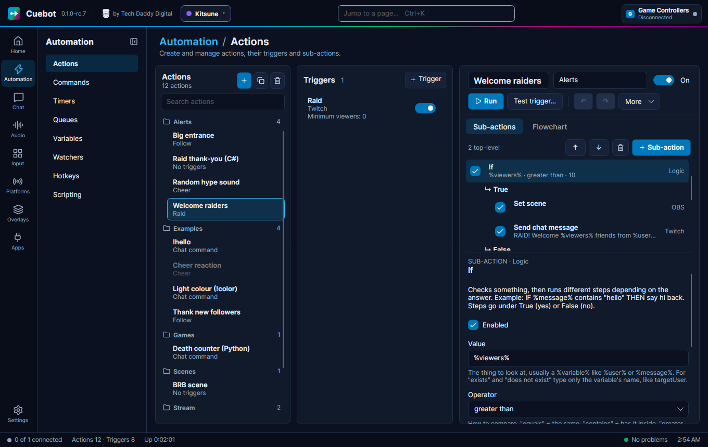
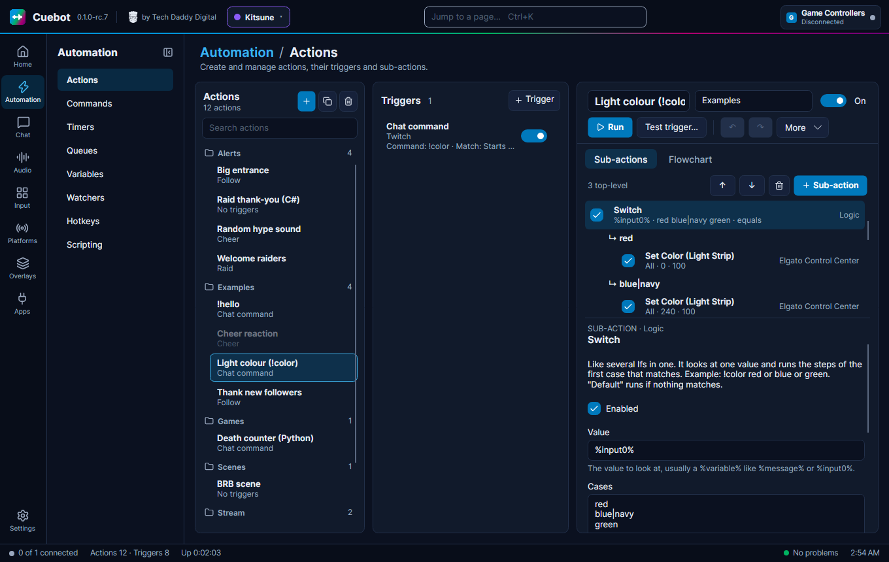
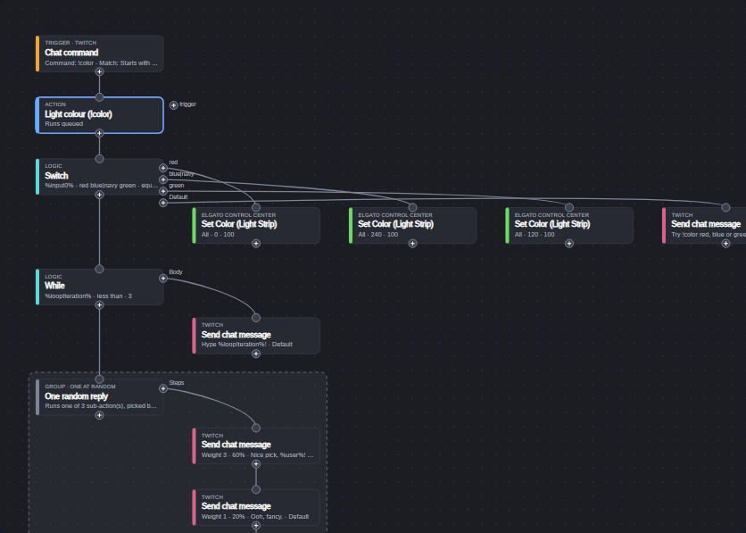
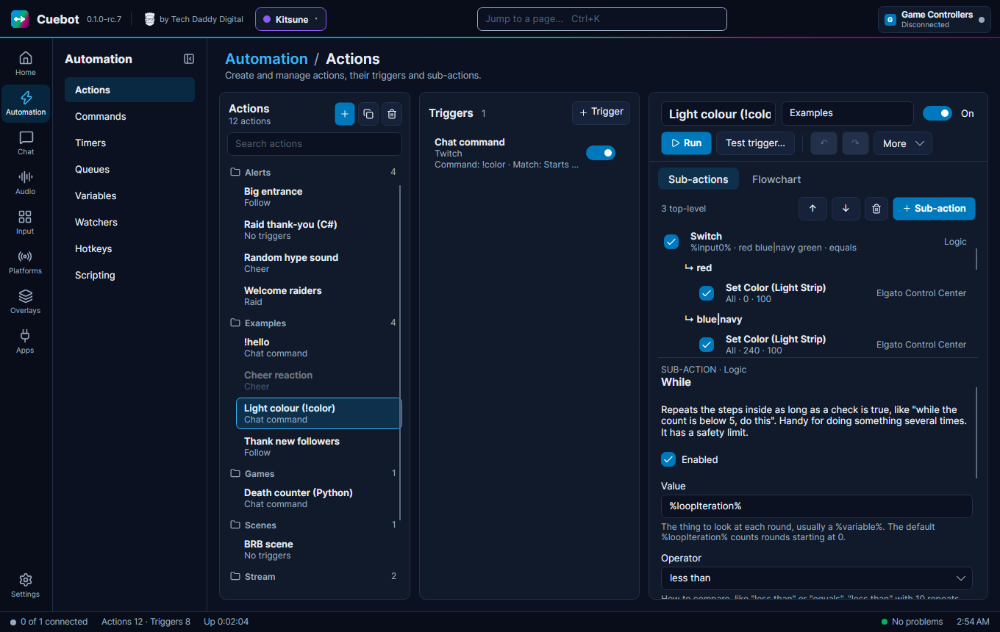
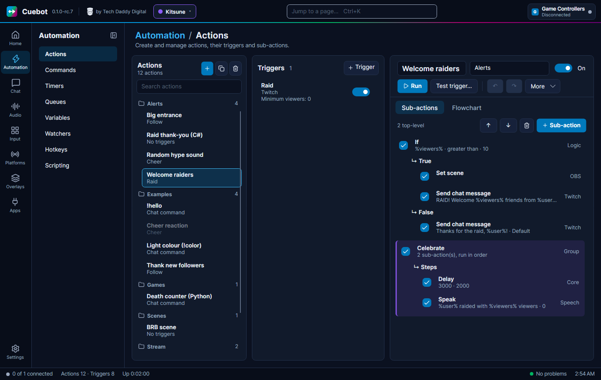
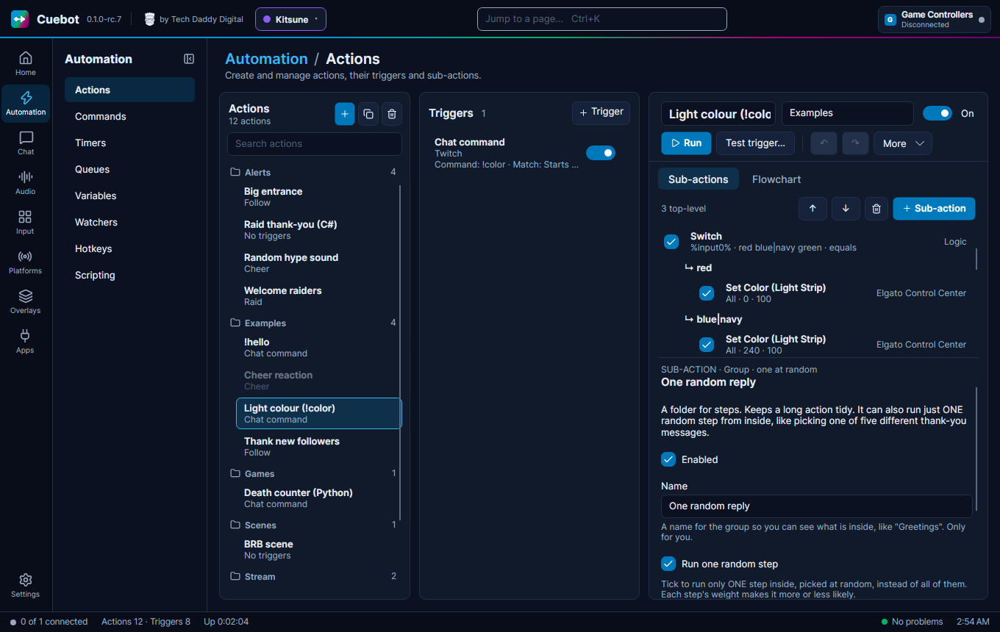
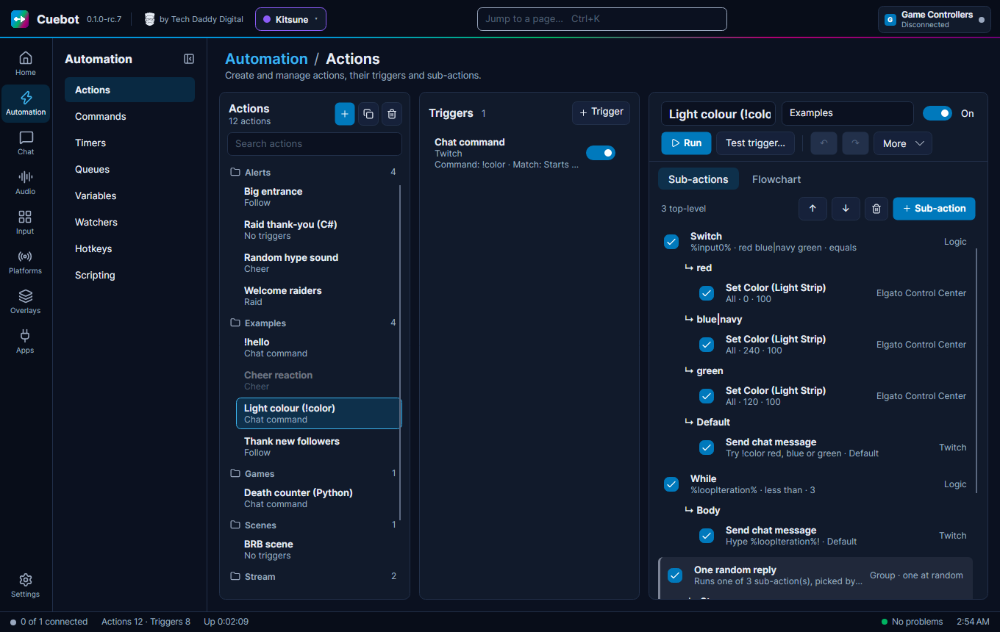

# Logic and branches

Most actions are a simple list: do this, then this, then this. But sometimes a step should only happen *sometimes*,
happen *again and again*, happen *at the same time* as another, or be *picked at random*. This page explains the
steps that do that. You find most of them in the **Logic** and **Core** groups of the **Add sub-action** window.

A **branch** is a little list of steps that belongs to one step, like the **True** list of an **If**. In the list
editor a branch shows as a **↳** line with its steps indented under it; on the flowchart as a labelled **+** port with
its steps to the right. When a branch is done, the action carries on with the step *after* the one that owns it.
How to put steps into a branch: [The action editor](action-editor.md#branch-steps-in-the-list).

## Overview

| Sub-action | Group | What it does | Example |
| --- | --- | --- | --- |
| **If** | Logic | Checks something, then runs **True** or **False**. | If `%bits%` is greater than 499, switch to the "Celebration" scene. |
| **Switch** | Logic | Picks one list out of many, by value. | A different sound for `!color red`, `!color blue`, ... |
| **While** | Logic | Repeats its **Body** while something is true. | Say "Hype!" 3 times. |
| **Loop break** / **Loop continue** | Logic | Leaves a While early / skips to its next round. | Stop counting when a viewer is found. |
| **Stop action** | Logic | Ends the action right here. | Stop if the viewer has too few points. |
| **Group** | Core | Keeps steps together in a coloured folder, or runs one of them at random. | A "Celebrate" folder, or "one of five thank-yous". |
| **Run at the same time** | Logic | Runs 2 to 10 lanes at once, then carries on. | Play a sound *and* wave the avatar, then chat. |
| **Delay** | Core | Waits, in milliseconds. | Show an alert, wait 5000, hide it. |
| **Run action** | Logic | Starts another action. | One "play alert sound" action, used everywhere. |
| **Comment** | Core | A note for you. Does nothing. | "This part greets new followers." |

On top of these, the action itself has two switches under **More**: **Random action** and **Concurrent sub-actions**.

## If: yes or no

**If** asks one question. When the answer is yes, it runs its **True** steps; otherwise its **False** steps. Either
list may stay empty.

| Setting | What to put in |
| --- | --- |
| **Value** | What to look at, usually a variable like `%viewers%`, `%message%` or `%user%`. |
| **Operator** | How to compare (see below). |
| **Compare to** | What to compare with, like `10` or `hello`. You can use variables here too. |

| Operator | True when … |
| --- | --- |
| **equals** / **not equals** | the two are the same / not the same. |
| **contains** / **does not contain** | Compare to is inside Value / is not. |
| **starts with** / **ends with** | Value begins / ends with Compare to. |
| **greater than** / **less than** | Value is bigger / smaller. |
| **is empty** / **is not empty** | Value has nothing in it (spaces count as nothing) / has something. |
| **matches regex** | Value matches a *regular expression*, a search pattern for experts. |
| **exists** / **does not exist** | a variable with that name is there / is not. Type only the name, like `targetUser`, without `%`. |

Good to know:

- Capital letters never matter: `Hello` equals `hello`.
- When **both** sides are numbers, Cuebot compares them as numbers, so `9` is less than `10`. Otherwise it compares
  them as text, letter by letter.
- A variable that doesn't exist stays as its own text, like `%viewers%`. So when you test an If, give it the values
  it needs (see [Testing](action-editor.md#testing-run-and-test-trigger)).
- **matches regex** adds `%match.count%` and `%match[0]%` (the matched text; `%match[1]%` is the first captured
  piece) for the steps after it.

Need *and* or *or*? Put an If inside the True branch of another If (*and*), or use a **Switch** with several values on
one line (*or*).

## Switch: one of many

**Switch** is like several Ifs in one. It looks at one **Value** and runs the steps of the **first case that
matches**. If none matches, it runs **Default**.

1. Add **Logic › Switch**. Set **Value** to, for example, `%input0%`.
2. In **Cases**, type one case per line, like `red`, `blue`, `green`. A branch appears for each line, plus
   **Default**.
3. Put the steps for each case into its branch.

- Several words for the same steps go on one line with `|` between them: `red|crimson|scarlet`.
- **Match with** sets how a case is compared, like the If's operators (**equals**, **contains**, ...).
- `%switchCase%` tells the next steps which case matched (or `Default`).
- Remove a case and its steps are hidden, not deleted. Type the case again and they come back.

The example action **Light colour (!color)** (folder **Examples**) shows it in use. A viewer types `!color blue`;
the Switch looks at `%input0%` (the first word after the command) and sets an Elgato light to red, blue or green.
Anything else lands in **Default**, which replies with the colours you can pick. On the flowchart each case is its own
port on the right of the Switch:

## While, Loop break and Loop continue: repeat

**While** repeats its **Body** steps as long as its check is true. It counts the rounds for you in
`%loopIteration%`, starting at 0.

| Setting | Starts as | What it means |
| --- | --- | --- |
| **Value** | `%loopIteration%` | What to check each round. |
| **Operator** | `less than` | How to compare. |
| **Compare to** | `10` | So by default it runs 10 rounds: 0 to 9. |
| **Safety limit (iterations, 0 = none)** | `10000` | The most rounds allowed, so a mistake can never loop forever. |

Example, "say Hype! three times": add a While, set **Compare to** to `3`, put **Send chat message** `Hype %loopIteration%!`
in its **Body**. Chat shows *Hype 0!*, *Hype 1!*, *Hype 2!*. The **Light colour (!color)** example does exactly this.

- The check is done *before* each round, with the variables as they are at that moment.
- When the safety limit is reached, the loop stops, a warning goes to the log, and the action carries on.
- **Loop break** (inside the Body) leaves the loop at once; the action carries on after the While.
- **Loop continue** skips the rest of this round and starts the next one.
- Outside a loop, both of them simply stop the whole action.
- Loops inside loops work: each While keeps its own `%loopIteration%`.

## Stop action

**Stop action** ends the action right where it is. The steps after it don't run. It isn't an error: the run still
counts as completed. Put it inside an If, like "if the viewer has too few points, stop".

Inside **Run at the same time**, a Stop in one lane stops the other lanes too.

## Group: a folder for steps

A **Group** (group **Core**) holds steps in its **Steps** branch and runs them in order. It keeps a long action tidy,
and lets you switch a whole part on or off with one tick box.

| Setting | What it does |
| --- | --- |
| **Name** | Shown instead of "Group", like `Celebrate`. Only for you. ++ctrl+r++ jumps to this box. |
| **Run one random step** | Run only **one** step inside, picked at random. |
| **Colour** | The tint of its box in the list and its frame on the flowchart, like `#3A7BD5`. Empty = grey. |

### Pick one at random

Tick **Run one random step** on a group, and each time only one of the steps inside runs. The label becomes
**GROUP · ONE AT RANDOM** and the summary says `Runs one of 3 sub-action(s), picked by weight`.

Every step inside then shows a **Weight** setting and a badge like `Weight 2 · 50%`:

- A bigger weight means a bigger chance. Weights 3, 1 and 1 give 60%, 20% and 20% (that is the **One random reply**
  group of the **Light colour (!color)** example).
- Weight `0` means never picked (unless all of them are 0: then each is equally likely).
- Steps that are switched off are never picked.
- **Set sub-action weight** (group **Core**) changes a weight while the stream runs (and saves it).

**Random action** under the action's **More** menu does the same for the action's top-level steps. See
[Random action and weights](action-editor.md#random-action-and-weights).

## Do several things at once

**Run at the same time** (group **Logic**) runs its lanes all at once. Inside a lane, steps still go one after
another. The step after it waits until **every** lane is done.

1. Add **Logic › Run at the same time**. It starts with **Lanes** = `2`; change it to up to `10`.
2. Click **↳ Lane 1** and add its steps. Then **↳ Lane 2**, and so on.
3. Add the step that should wait for all of them *after* the Run at the same time step (select it, then
   **+ Sub-action**).

The rules, so nothing surprises you:

- Each lane gets its own copy of the action's variables. When all lanes are done, their changes come back together,
  lane by lane, in order. If two lanes set the same variable, the **higher lane number wins**.
- A **Stop action** in one lane stops the other lanes too, and the action ends there.
- If a step in one lane fails, the other lanes stop and the action fails.
- A lane with no switched-on steps is skipped.

**Concurrent sub-actions** under **More** does the same with the action's top-level steps: they all start at once,
each as its own lane of one step (and later steps win when two set the same variable). It does nothing while
**Random action** is ticked.

## Delay: wait

**Delay** (group **Core**) waits before the next step. **Milliseconds** are thousandths of a second: `1000` is 1
second, `5000` is 5 seconds.

Tick **Random delay** to wait a random time between **Milliseconds** and **To (milliseconds)**: with 1000 and 3000 it
waits 1 to 3 seconds. `%delayMs%` tells the next steps how long it really waited.

A delay holds up only its own action (and, if the action uses a queue, the runs waiting behind it).

## Run action: reuse an action

**Run action** starts another action, like calling a helper. Make one "Play alert sound" action and run it from all
your alerts; change it once and every alert changes.

| Setting | What it does |
| --- | --- |
| **Action** | The other action's name, exactly as in your list. A wrong name makes the step fail with `No action named '...'`. |
| **Wait for it to finish** | Ticked (the default): this action waits until the other one is done. Unticked: both carry on at the same time. |

- The other action gets a **copy** of this action's variables, so `%user%` works there too.
- It starts at once: it doesn't wait in its queue.
- It runs even if that action is switched **Off**. So a helper action can stay off and have no trigger.
- If the other action fails (and you wait for it), this action fails too.
- An action that runs itself, again and again, is stopped after 16 levels with an error.

## When a step fails

If a step can't do its job (OBS is not connected, a file is missing, an action name is wrong), the action **stops at
that step** and the run is marked failed. The **Run** or **Test** line says `... failed — see Dashboard log`, and the
log says which step failed and why. The [History](history.md) page lists the run as failed, with the error.

Some steps report a problem without failing: they set a variable like `%success%` to `false` instead (look under
**Variables this adds for the next steps**). Check it with an **If** to react to it.

## Other steps that branch

Some steps from other groups also have branches. They do a job and then take one way or the other:

| Step | Branches |
| --- | --- |
| **File exists** (Files) | **True**, **False** |
| **User in group** (Groups, Kick) | **True**, **False** |
| **Check points** (Points) | **Enough**, **Not enough** |
| **Spend points** (Points) | **Paid**, **Not enough** |
| **Transfer points** (Points) | **Transferred**, **Failed** |
| **Add song to Spotify queue** (Spotify) | **Added**, **Not added** |
| **Get Warudo toggle state** (Warudo) | **On**, **Off** |

## Steps that control other actions

These live in the **Core** group. They change actions while the stream runs:

| Sub-action | What it does |
| --- | --- |
| **Turn action on/off** | Switches an action on or off, like the **On** / **Off** switch. |
| **Turn trigger on/off** / **Turn sub-action on/off** | Switches one trigger or step of an action. |
| **Set action group state** / **Get action group state** | Switches (or checks) every action in a group folder. |
| **Get action state** | Tells you whether an action is on. |
| **Clear action queue** / **Set action queue pause state** / **Set queue to one at a time** | Control a [queue](queues.md). |
| **Send local signal** / **Wait for local signal** | One action waits until another one says "go". |

Every setting of every logic step is in the reference: [Logic sub-actions](../../reference/sub-actions/logic.md) and
[Core sub-actions](../../reference/sub-actions/core.md).
