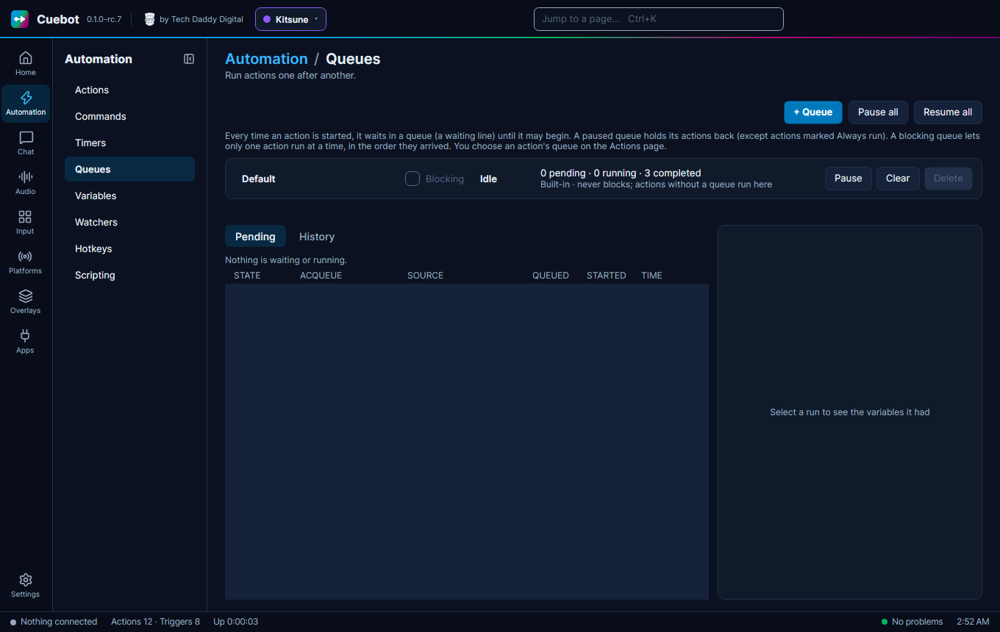

# Queues: one at a time

What if ten people follow at once? Without a plan, ten alerts would play on top of each other. **Queues** fix this:
they make actions wait their turn, so alerts play one after another.

A queue is a waiting line. Every action waits in one before it starts. A **blocking** queue lets only one action run at
a time, in order. Perfect for alerts.

## Make a queue for your alerts

1. Go to **Automation > Queues** and click **+ Queue**. Name it, for example `Alerts`, and tick **Blocking**.
2. In each alert action, pick that queue under **More > Queue** (on **Automation > Actions**, see
   [Action settings: the More menu](action-editor.md#action-settings-the-more-menu)).

## Watching and controlling the line

The Queues page also shows what is waiting (**Pending**) and what ran (**History**), and has **Pause**, **Resume** and
**Clear** for each queue. **Pause all** and **Resume all** do every queue at once (handy before a break), and
**Requeue** runs a finished action again, with the same values it had the first time.

A paused queue holds its actions back, except actions with **Always run** ticked under **More**. **Delete** removes a
queue you made; its actions move to the **Default** queue.

## The Default queue

Actions in the **Default** queue normally wait for each other too. Tick **Allow concurrent runs (Default queue only)**
under **More** to let one action run several times at once.
