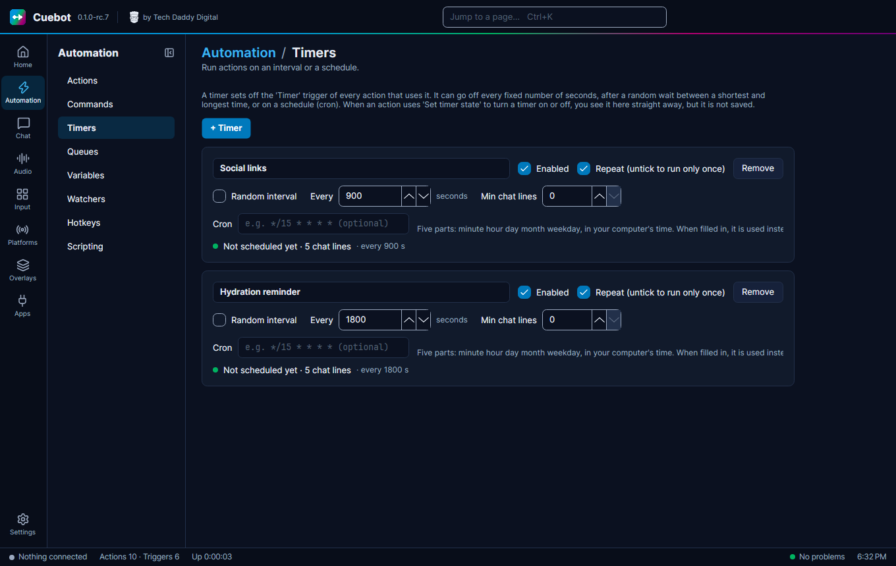

# Timers

A **timer** starts actions on a clock, like "post my Discord link every 15 minutes". Use it for anything that should
happen by itself while you stream.

## Make a timer

1. Go to **Automation > Timers**, click **+ Timer** and name it.
2. Pick how often:
    - **Every** … seconds;
    - **Random interval**: a random wait **Between** two numbers of seconds;
    - **Min chat lines**: only go off when at least that many chat messages came in since last time, so it does not
      post into an empty chat;
    - **Cron**: a schedule, like `0 20 * * 5` (every Friday at 20:00). Five parts: minute, hour, day, month, weekday,
      in your computer's time. When you fill it in, it is used instead of the seconds.
3. In your action, add the **Timer** trigger and pick the timer.

## A timer that goes off once

Untick **Repeat (untick to run only once)** for a timer that goes off one time only, like a "stream ends in 10
minutes" reminder.
