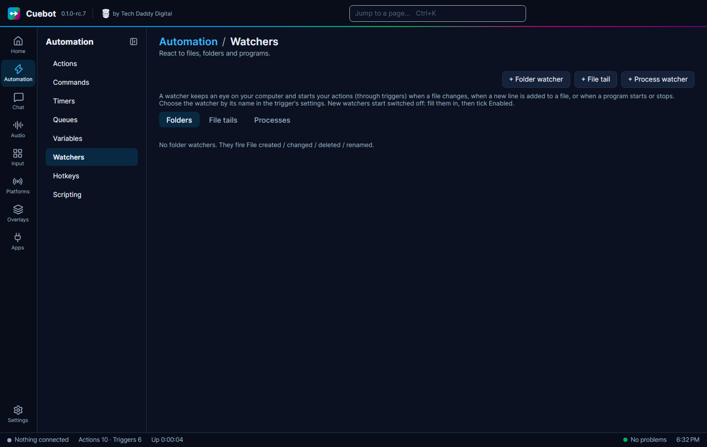

# Watchers

A **watcher** keeps an eye on your computer and starts your actions when something changes there: a new file, a new
line in a log, or a program that opens. Handy for games that write what happens to a file.

## The three kinds

On **Automation > Watchers**:

- **+ Folder watcher**: a file appears, changes, is deleted or renamed in a folder. Example: a new screenshot.
- **+ File tail**: a new line is added to a text file. Example: a game writes "You died" to its log.
- **+ Process watcher**: a program starts or stops. Example: switch to the "Gaming" scene when your game opens.

## Their settings

A folder watcher can also look in folders inside the folder (**Include subfolders**), and **Fire on:** picks which
changes count: created, changed, deleted or renamed. A file tail can **Skip empty lines**.

A process watcher does not fire "started" for programs that were already running when Cuebot started.

Then add the matching trigger to an action (like **File created**, **File tail line** or **Process started**) and pick
the watcher by its name.
