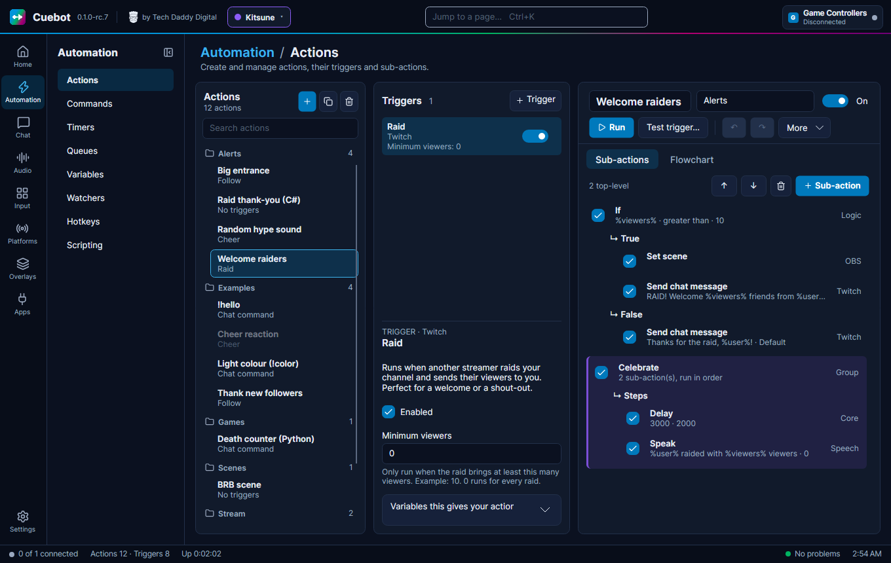
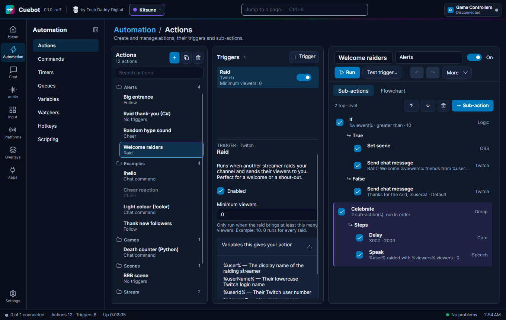
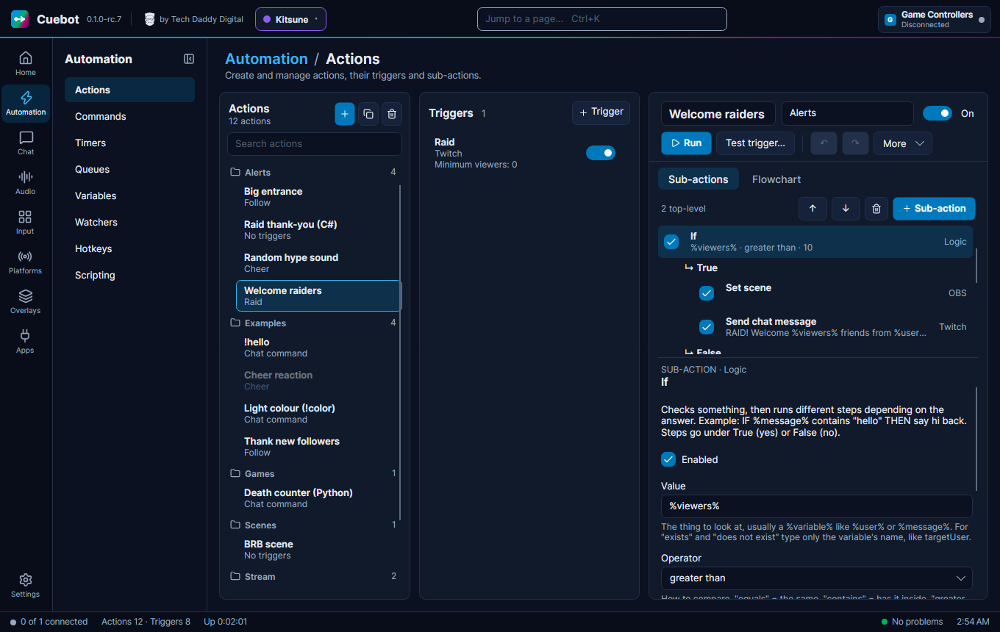
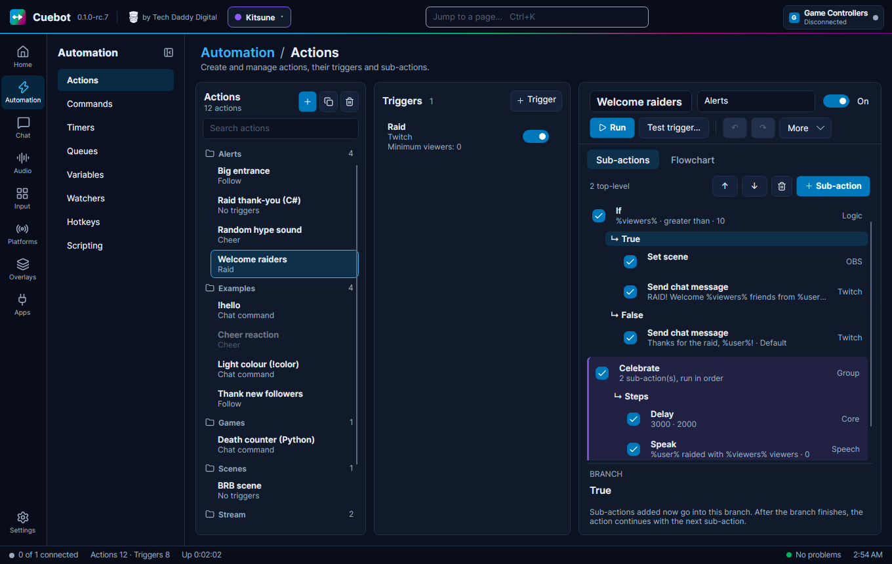
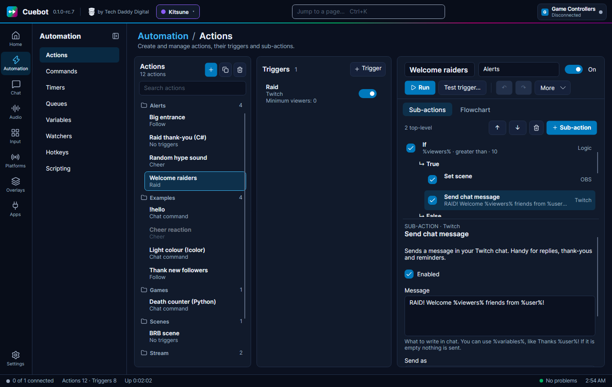
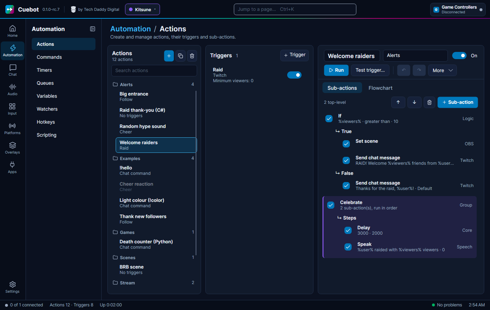
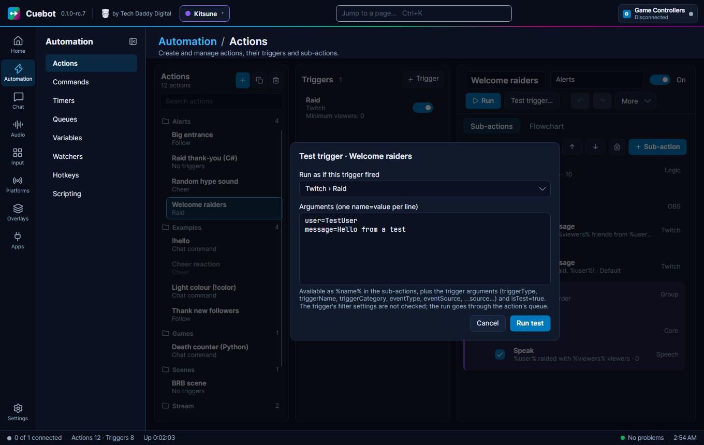
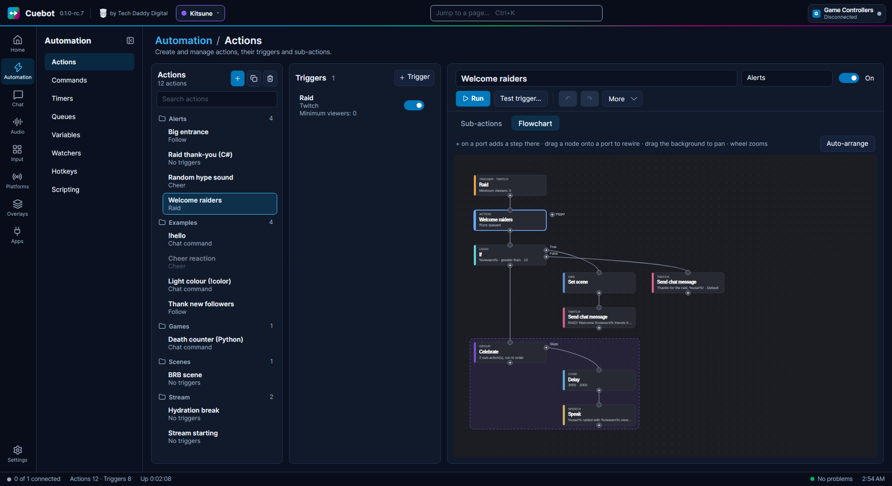

# Your first action

In this tutorial you build a real action, click by click: **Welcome raiders**. When someone raids your channel, Cuebot
writes a welcome in chat. A big raid (more than 10 viewers) gets a loud welcome, a small raid a friendly thank-you.
Then you test it without waiting for a real raid.

It takes about five minutes. You learn the four things you will use all the time: making an action, adding a
trigger, adding sub-actions (also into a branch), and testing.

**What you need:** Cuebot open. To see the chat messages for real, your Twitch account connected on
[**Platforms > Twitch**](../platforms/twitch.md). Without it, everything works the same except the chat step, which fails and tells you so.

## 1. Make the action

1. Click **Automation** in the left bar, then **Actions**.
2. In the **Actions** column, click the blue **+** button (it says **New action** when you point at it). A new action
   called `New action` appears and is selected.
3. In the editor on the right, click the name box at the top and type `Welcome raiders`.
4. In the box next to it (it says **Group** when empty), type `Alerts`. Groups are folders: the action now sits in an
   **Alerts** folder in the list.
5. Check that the switch on the right says **On**.

There is no Save button: Cuebot saves every change by itself a moment later. (++ctrl+s++ saves at once, if you like.)

## 2. Add the trigger: "when someone raids"


1. Click **+ Trigger** at the top of the **Triggers** column.
2. The **Add trigger** window opens. Type `raid`. The list shrinks to the triggers with "raid" in their name.
3. Click the line **Raid** with the grey word **Twitch** in front of it (the grey word is the group it belongs to; this guide writes it as **Twitch › Raid**). The box at the bottom tells you what
   it does: *Runs when another streamer raids your channel*.
4. Click **Add** (or press ++enter++, or double-click the line).



The trigger appears in the **Triggers** column and its settings show underneath:

- **Minimum viewers**: leave it at `0`, so every raid counts.


- Click **Variables this gives your action** to open it. You see `%user%` (the raiding streamer) and `%viewers%`
  (how many came along). You will use both in a moment.

## 3. Add an If: "was it a big raid?"


1. Click **+ Sub-action** (blue button above the step list, on the **Sub-actions** tab).
2. The **Add sub-action** window opens. Type `logic if`. Each word you type must appear, so this finds **Logic › If**.
3. Pick **Logic › If** and click **Add**.



The If step is now in the list, with two lines under it: **↳ True** and **↳ False**. Its settings show below the
list. Fill them in:

| Setting | Type or pick |
| --- | --- |
| **Value** | `%viewers%` |
| **Operator** | `greater than` |
| **Compare to** | `10` |

In plain words: *if the number of viewers is greater than 10, do the True steps, otherwise do the False steps.*

## 4. Put a step into True



1. Click the **↳ True** line under the If. The panel below now says **BRANCH · True**: *Sub-actions added now go into
   this branch*.
2. Click **+ Sub-action**, type `twitch send chat`, pick **Twitch › Send chat message** and click **Add**.
3. In **Message** type: `RAID! Welcome %viewers% friends from %user%!`



The new step sits indented under **↳ True**. That indent means "inside the True branch".

!!! tip "Where does a new step go?"
    A new sub-action goes **after the step you selected**, in the same list. If you selected a branch line (like
    **↳ True**), it goes at the end of that branch. If nothing is selected, it goes at the very end.

## 5. Put a step into False

1. Click the **↳ False** line.
2. Click **+ Sub-action**, pick **Twitch › Send chat message** again and click **Add**.
3. In **Message** type: `Thanks for the raid, %user%!`

Optional: click **↳ True** again and add **OBS › Set scene** with your celebration scene, so big raids also switch
scenes. Your action now looks like the top part of this one (the purple **Celebrate** group is an extra you can add
later):



## 6. Test it with pretend values

You don't need a real raid. **Test trigger…** starts the action as if the trigger had fired, with values you type.



1. Click **Test trigger…** (or press ++f5++).
2. **Run as if this trigger fired** already shows **Twitch › Raid**.
3. In **Arguments**, replace the example lines with:

    ```
    user=Bob
    viewers=25
    ```

4. Click **Run test**.

Under the buttons you see `Testing 'Welcome raiders'...`, then `Test of 'Welcome raiders' completed`. In your chat:
*RAID! Welcome 25 friends from Bob!*

Now press ++f5++ again, change `viewers=25` to `viewers=3` and run it. This time you get *Thanks for the raid, Bob!*:
the If took the False way.

!!! warning "A test is real"
    A test really does the steps. A chat step really writes in your chat, a scene step really switches scenes.

Good to know about tests:

- Each line is `name=value`. Empty lines and lines starting with `#` are skipped. A line without `=` gives an error
  like `Line 2: expected name=value`, and nothing runs.
- Numbers you type become real numbers, so `viewers=25` can be compared with `greater than`.
- The trigger's own settings (like **Minimum viewers**) are **not** checked during a test.
- The test waits in the action's queue like a real run.
- Cuebot adds `%isTest%` = `true`, so a step can tell it is a test (for example an If that skips the sound).
- **Custom arguments only**, at the bottom of the trigger list, runs with just your lines and no trigger values.

## 7. Or just run it

The blue **Run** button starts the action right now, with no trigger values at all. That is handy for actions
without a trigger, like "BRB scene". For this action, `%user%` and `%viewers%` would have no value, and Cuebot leaves
words it doesn't know as they are: chat would literally show *Thanks for the raid, %user%!*. So use **Test trigger…**
for actions that need trigger values.

If something goes wrong, the line under the buttons says `'Welcome raiders' failed — see Dashboard log`. The
Dashboard log tells you which step failed and why (for example: Twitch is not connected).

## 8. See it as a flowchart

Click the **Flowchart** tab. It is the same action, drawn as boxes: the **Raid** trigger at the top, the action under
it, the **If** with its **True** and **False** ways going to the right.



[The flowchart editor](flowchart.md) explains everything you can do there.

## What you learned

- **+** makes an action; the name and group boxes are at the top of the editor.
- **+ Trigger** and **+ Sub-action** open a search window: type a few words, pick, **Add**.
- Select a branch line (**↳ True**) to put new steps inside it.
- **Test trigger…** (++f5++) runs the action with pretend values; **Run** runs it with none.

Next: [The action editor](action-editor.md), every button and shortcut in detail.
