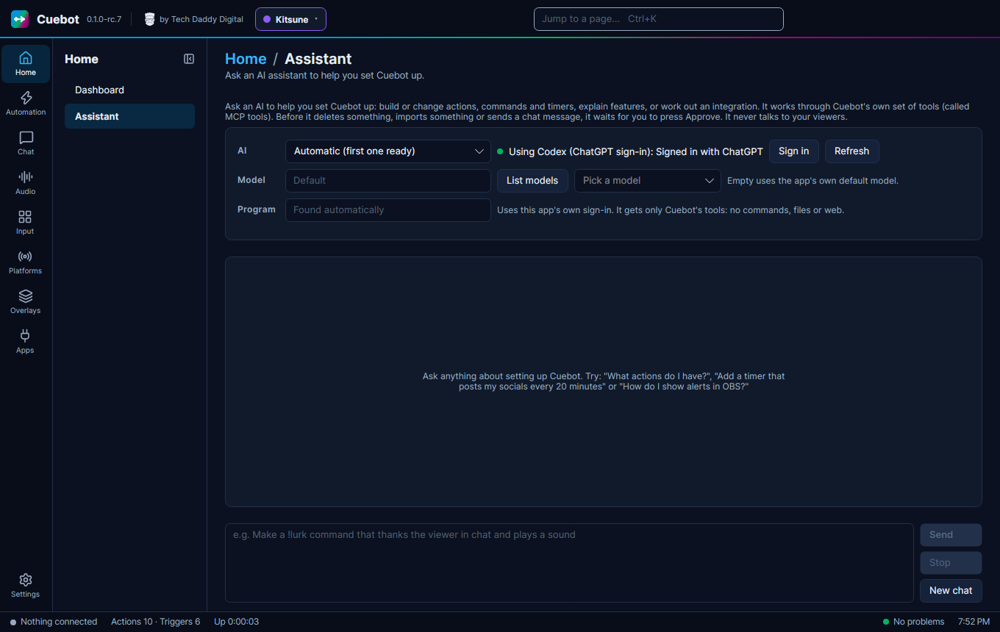
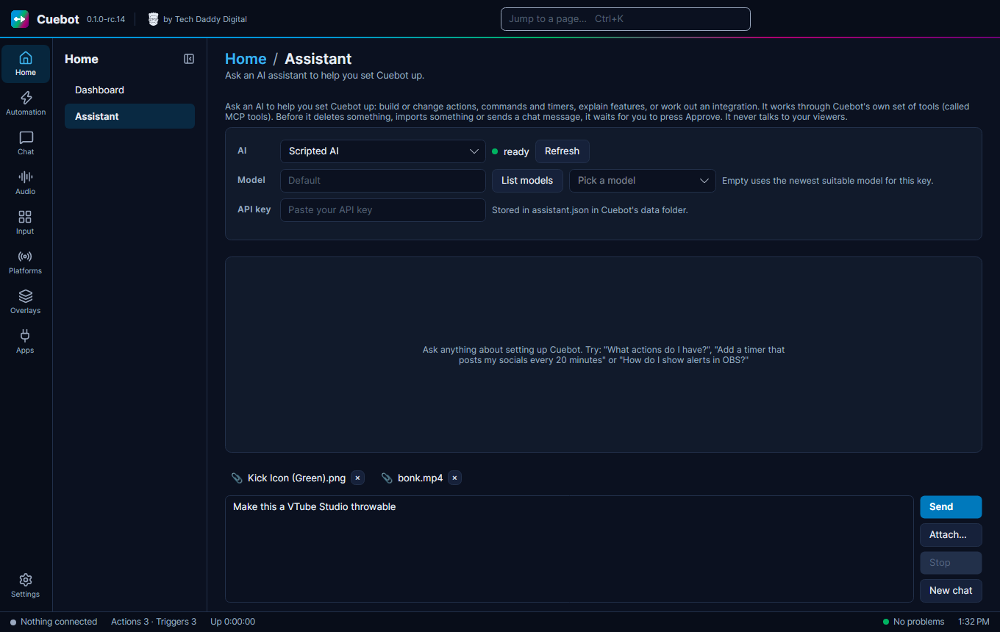
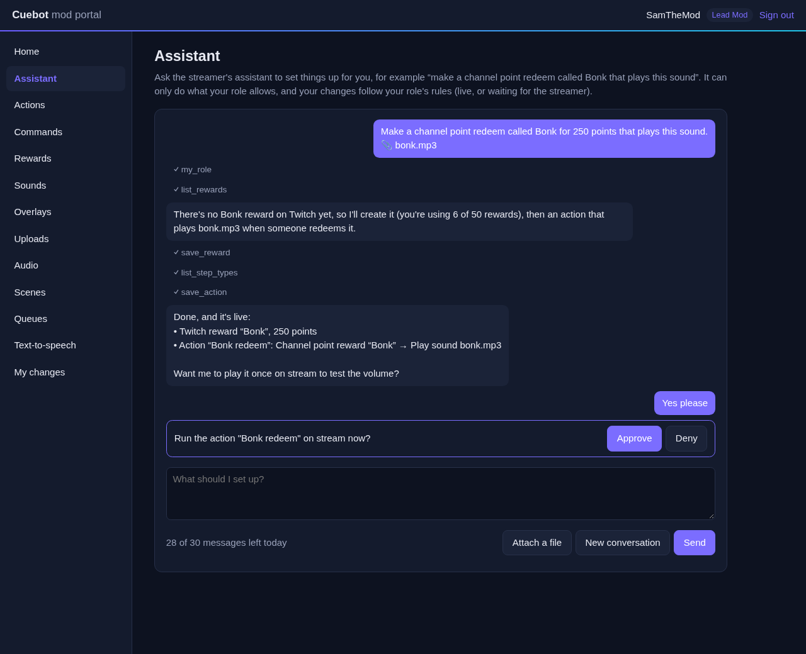

# The setup assistant

Cuebot has a built-in **assistant**: a chat window where you type what you want, in plain words, and an AI (a computer
program that understands text) sets it up for you. It saves you clicking through the pages yourself.

> "Make a !discord command that posts my Discord link, with a 30 second cooldown."

The assistant then makes the command and the action, just as if you had clicked through the pages yourself.

!!! note "The assistant is only for setting things up"
    It helps *you* build things in Cuebot. It never talks to your viewers, and your actions cannot use it.

## What you need

The assistant does not have its own AI. It borrows one you already use. Pick **one** of these:

- **An AI app you are already signed in to** on this computer: **Codex** (with a ChatGPT sign-in), **Claude Code**,
  **Grok CLI** or **Antigravity CLI**. Cuebot uses that app's sign-in, so you do not paste any key. The app gets only
  Cuebot's tools: it cannot run commands, read your files or use the web.
- **An API key**: a secret code from an AI company that lets programs use its AI. Cuebot works with keys for
  **Claude (Anthropic)**, **OpenAI**, **Grok (xAI)** and **Gemini (Google)**. The company may charge you for what you
  use.
- **A model on your own computer**, through the free program **Ollama** (or LM Studio). It costs nothing and nothing
  leaves your computer, but these small models make many more mistakes and can be slow. See
  [The assistant on your own computer](local-models.md) before you choose it.

!!! warning "Partly checked"
    The AI apps (Codex, Claude Code, Grok CLI, Antigravity CLI) were tried for real on Linux, and so were an OpenAI key
    and Ollama. Keys for **Claude (Anthropic)**, **Grok (xAI)** and **Gemini (Google)** were only checked with pretend
    services, and **LM Studio** is not confirmed. See [What's experimental](../help/experimental.md).

!!! note "Flatpak on Linux"
    The Flatpak version of Cuebot cannot reach other apps on your computer, so it needs an API key.

## Setting it up

1. Go to **Home > Assistant**.
2. In **AI**, pick your choice. **Automatic (first one ready)** uses the first one that works.
3. Using an AI app? Click **Sign in** if Cuebot asks you to, then **Refresh**. **Program** is usually found by itself.
4. Using an API key? Paste it into **API key**. It is saved in Cuebot's data folder (in `assistant.json`) and hidden
   on screen.
5. Optional: pick a **Model** (the AI's "brain" size). Leave it on **Default** if you are unsure. Once the AI is ready,
   the list next to **List models** shows the choices by itself; pick one, or type a model name.

## Using it

Type what you want and click **Send** (or press **Enter**). Some ideas:

- "Make a !lurk command that says thanks for lurking, %user%."
- "Post my socials in chat every 20 minutes, but only if people are chatting."
- "What does my 'Raid alert' action do?"
- "Add a giveaway for a Steam key that costs 100 points."
- "Set up OBS so it hears the text-to-speech." It adds an audio capture source to the scene you're on. On Linux that
  captures everything you hear; to capture only Cuebot, install OBS's Application Audio Capture (PipeWire) plugin first.

**Stop** stops an answer, **New chat** starts fresh.

### Sending it files

Click **Attach…** to pick pictures, videos or sounds, or drop them on the message box. They show above the box; click
**✕** to take one off. When you send, the assistant gets where each file is on your computer. Nothing is uploaded
anywhere by Cuebot, but an online AI gets the file's path in your message.

### Fixing pictures and videos

The assistant can make an edited copy of a picture or video, so it fits where it goes:

- **Pictures:** resize, crop, trim empty edges, make it square or round, turn or flip it, make a background colour
  see-through, or fill see-through parts with a colour. Saves as PNG, JPG or WebP. Example: "Make this logo a VTube
  Studio throwable" gives a trimmed, square, 512-pixel PNG with a see-through background.
- **Videos:** cut a part out, shrink, crop, turn or flip it, change the frame rate, mute it, or turn it into a WebM
  (for OBS and overlays), an animated WebP, one picture (PNG) or just the sound (MP3).

It also works with a web address, like a logo from a brand page. The original is never changed: the copy is saved
next to it with `-edited` in the name, or in the `media` folder in Cuebot's data folder for files from the web. If a
file with that name is already there, the assistant asks before replacing it. SVG pictures can't be edited yet: save
them as PNG first. Videos need ffmpeg, which comes with Cuebot's downloads.

### It asks before big changes

Before the assistant deletes something, imports something, or writes in your chat, it shows **The assistant wants
to:** and waits. Click **Approve** to let it, or **Deny** to stop it.

Always check what it made. It can make mistakes, just like a person.

### Undo what it did

When an answer created, changed or deleted actions, commands or timers, Cuebot adds a card at the end of the answer:
"The assistant created the action 'Lurk', created the command 'Lurk'." Click **Undo these changes** to put them all
back the way they were. If you changed one of them yourself after the answer, Cuebot keeps your version and says so.
The button works until you close Cuebot. Other things the assistant can change (overlays, points, quotes...) are not
covered: check those yourself.

### When Cuebot can't do it yet

If you ask for something Cuebot has no way to do, the assistant says so and offers to send Cuebot's developers a
**feature request**. Say yes and it writes one up: a short title and what you wanted to do. Before anything is sent,
Cuebot shows you the whole text under **The assistant wants to:**. Click **Approve** to send it, or **Deny** to drop it.
It asks even when you turned off **Confirm destructive tools**.

The request becomes a **public issue** on Cuebot's GitHub page, labelled `enhancement`, so read it before you approve
it. The assistant is told to leave out names, channels and anything private, and Cuebot removes keys and tokens it
recognises. You don't need a GitHub account. Afterwards the assistant gives you the link so you can follow it. If the
request can't be sent (no internet, or too many sent from your PC recently), it gives you a GitHub link with the text
filled in instead. That one needs a GitHub account.

### What it can and cannot touch

- **Can:** actions, triggers, sub-actions, commands, timers, variables, overlays, polls, quotes, points, giveaways,
  decks and more.
- **Files:** it can read the pictures, videos and sounds you point it to and save edited copies. It cannot open or
  change other files.
- **Cannot:** your sign-ins, API keys, passwords, and the server settings. Those stay out of its reach.

Cuebot logs only the *names* of what the assistant did, not the details. The last conversation is saved in your data
folder, so it is still there next time.

## Letting your mods use it

Your mods can use the Assistant too, from the [mod portal](../mods/mod-portal.md#the-assistant-for-mods). Their
conversations run on the AI you chose here, with only the tools their role allows, and each mod has a daily number
of messages you set.

## The other way round

Rather use your favourite AI app outside Cuebot, and let it work on Cuebot? See
[Using your own AI app with Cuebot (MCP)](ai-apps.md).
