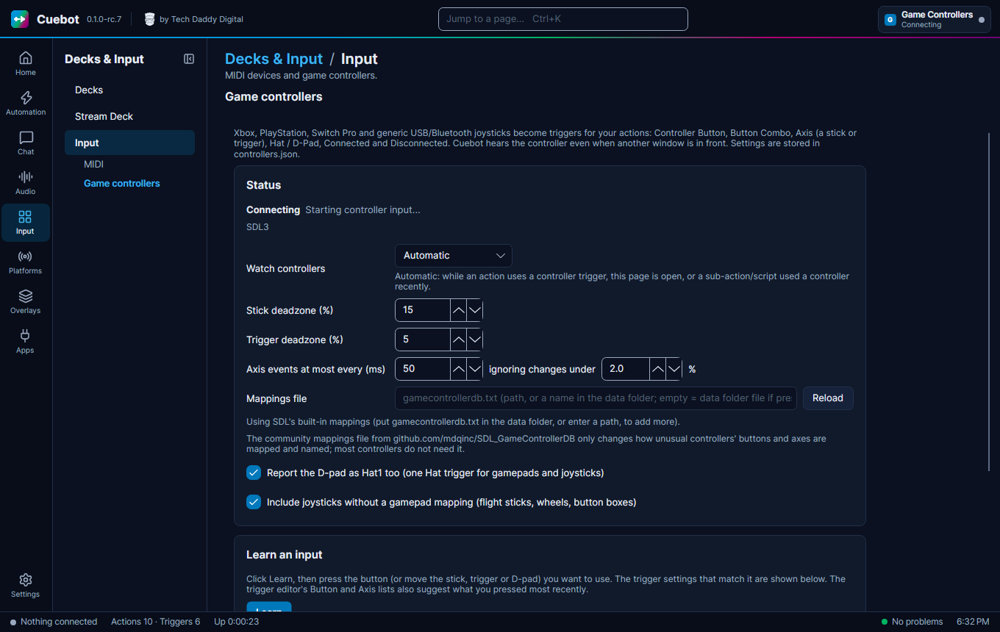

# Controllers and MIDI

Buttons, pads, knobs and game controllers can all start your actions. This page lists what Cuebot can use, and where
to set each one up.

| Device | Where | What it does |
| --- | --- | --- |
| **Stream Deck** | Input > Stream Deck | See the [Stream Deck page](stream-deck.md). |
| **Decks** (buttons in a browser) | Input > Decks | See [Decks](decks.md). |
| **MIDI controllers** (pads, keyboards, knob boxes) | Input > Input, **MIDI** | Keys and knobs start the **MIDI Message** trigger; actions can send MIDI back. |
| **Game controllers** (Xbox, PlayStation, Switch Pro and others) | Input > Input, **Game controllers** | Buttons, button combos and sticks become triggers. Rumble and lights on pads that have them. |
| **Keyboard shortcuts** | Automation > Hotkeys | See [Hotkeys](../actions/hotkeys.md). |
| **Your voice** | Audio > Voice Control | See [Voice control](../sound/voice-control.md). |

**MIDI tip:** add an event for each key or knob, then click **Learn new event** and press it. (On an event you already
have, **Learn** changes which key it listens to.) Cuebot fills in the details for you.

!!! warning "Partly checked"
    Sending MIDI was tried on Windows and Linux, and on a Mac with Cuebot's own pretend MIDI ports, but pressing keys
    on a real MIDI controller was not. Game controllers:
    Cuebot's controller part starts on Windows and Linux, but nobody has pressed a real controller yet. See
    [What's experimental](../help/experimental.md).

**On Linux**, PlayStation and Switch pads need extra permission for rumble and lights. Install your distribution's
`steam-devices` or `game-devices-udev` package.
