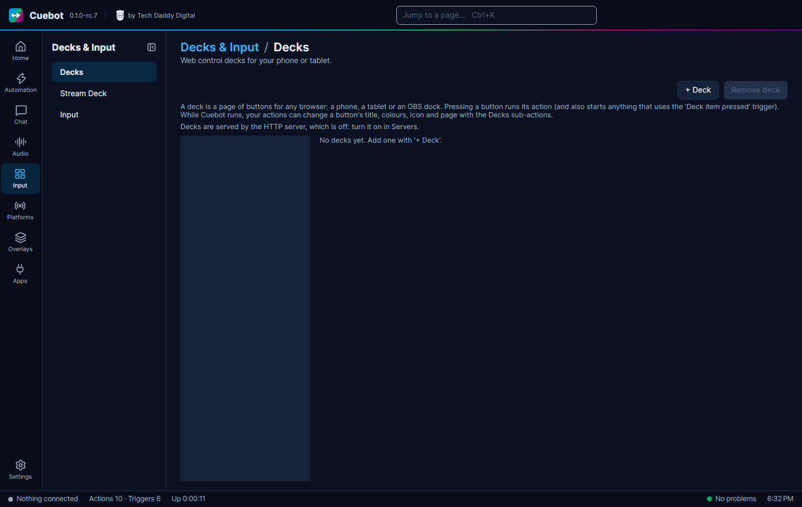

# Decks

A **deck** is a page of buttons that opens in any web browser: your phone, a tablet, or a dock in OBS. Press a
button, and its action runs. It is like a [Stream Deck](stream-deck.md), but free and on a screen you already have.

## Make a deck

1. Decks need Cuebot's **HTTP server**. Go to **Apps > Servers**, tick **Enabled** on the **HTTP server** card and
   click **Apply and restart servers**. (The Decks page reminds you if it is off.)
2. Go to **Input > Decks** and click **+ Deck**. Give it a name.
3. Set how many **Rows** and **Columns** of buttons you want.
4. Click **+ Button**. Give it a **Title** and pick the **Action** to run. Add colours and an icon if you like.
5. Click **Open** next to **Address** to see the deck in your browser.

While you stream, your actions can change a button's title, colour, icon or page with the **Decks** sub-actions (see
the [Decks sub-actions](../../reference/sub-actions/decks.md)).

## Using it from your phone

!!! tip "Using it from your phone"
    At first, the deck only opens on this computer. Your phone is a different device, so Cuebot has to allow your home
    network first: tick **Allow LAN connections** on **Apps > Servers** and let the HTTP server listen on your network
    address. Only do this on a home network you trust. Cuebot then makes a deck token so nobody else on the network
    can press your buttons: open the deck from the link on the **Decks** page, which includes it.

The [Cuebot phone app](../mods/phone-app.md) shows your decks on its **Deck** tab, so you don't need a browser there.
