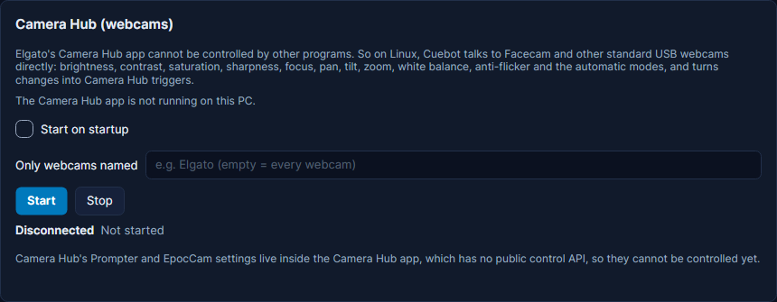
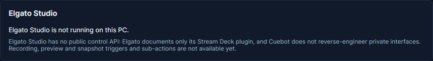

# Elgato cameras and webcams

Elgato makes the **Facecam** webcams and two apps for them: **Camera Hub** (webcam settings) and **Elgato Studio**
(recording). Cuebot can change a webcam's picture from an action, like brightness, zoom or focus, and start an action
when one of those settings changes. For example: zoom in on your face when someone sends a big tip, and zoom back out
after ten seconds.

What works depends on your computer:

| | Linux | Windows | macOS |
| --- | --- | --- | --- |
| **Webcam settings** (Facecam and other USB webcams) | Yes, Cuebot talks to the webcam itself | Not yet | Not yet |
| **Camera Hub app** | Does not exist on Linux | Cuebot only sees whether it is running | Cuebot only sees whether it is running |
| **Elgato Studio app** | Does not exist on Linux | Cuebot only sees whether it is running | Cuebot only sees whether it is running |

Why so little on Windows and macOS? Camera Hub and Elgato Studio have no public way for other programs to control
them (an **API**: a door that lets one app give orders to another). Elgato only lets its own Stream Deck plugin in, and
Cuebot does not break into private doors. On Linux there is no Camera Hub, so Cuebot talks to the webcam directly
instead, using the standard controls every USB webcam has.

## What you need

- **Linux.**
- A **Facecam** (any model) or any normal USB webcam. They all use the same standard ("UVC").
- Permission to use the camera. On most Linux systems your user is already allowed; if not, it must be in the
  `video` group.

## Set it up (Linux)

1. Plug in your webcam.
2. In Cuebot open **Apps > Apps & devices**, then **Lights & cameras** in the list on the left. Scroll to the card
   **Camera Hub (webcams)**.
3. Optional: in **Only webcams named**, type part of a webcam's name, like `Elgato`, if Cuebot should leave your other
   webcams alone. Empty means every webcam.
4. Click **Start**. Each webcam shows up with its name and its current settings (brightness, contrast, zoom and so
   on), plus where it lives on your computer (like `/dev/video0`).
5. Tick **Start on startup** if Cuebot should watch your webcams every time it opens.

**How you know it worked:** the status line says **Connected**, and your webcam is listed with its settings.

## What Cuebot can do

### Sub-actions (do this)

In an action, click **+ Sub-action** and search for **Elgato Camera Hub**.

| Sub-action | What it does |
| --- | --- |
| **Webcam Set Brightness**, **Contrast**, **Saturation** (colour strength) | 0 to 100 % of what the webcam can do. |
| **Webcam Set Sharpness** | In the webcam's own steps (a Facecam has 0 to 4). |
| **Webcam Set Focus** | Moves the focus nearer or farther, 0 to 100 %. Turn auto focus off first. |
| **Webcam Set Pan** / **Tilt** | Moves the picture left-right or up-down, 0 to 100 %. Mostly useful when zoomed in. |
| **Webcam Set Zoom** | From 100 (widest) to 400 (closest). |
| **Webcam Set White Balance** | How warm (orange) or cool (blue) the colours look, in Kelvin. Turn auto white balance off first. |
| **Webcam Set Auto Focus**, **Auto White Balance**, **Auto Exposure** | Lets the camera choose by itself, or not: on, off or toggle. |
| **Webcam Set Anti Flicker** | Stops room lamps from flickering on camera: **Off**, **50 Hz**, **60 Hz** or **Auto**. |
| **Webcam Get Settings** | Reads all of a webcam's settings into variables for later steps. |

The number steps have **Add to current value**: tick it to go up or down by an amount, like `-10`. Each step has a
**Webcam** box: a webcam's name (several with commas, or **All**). Empty means the first webcam Cuebot found.

Full details: [Elgato Camera Hub sub-actions](../../reference/sub-actions/elgato-camera-hub.md).

### Triggers (when this happens)

In an action, click **+ Trigger** and search for **Elgato Camera Hub**. Cuebot checks your webcams about every 2
seconds, so it also notices changes made in other programs (like `v4l2-ctl` or guvcview), a moment later.

| Trigger | Runs when |
| --- | --- |
| **Webcam Brightness Changed**, **Contrast**, **Saturation**, **Sharpness**, **Focus**, **Pan**, **Tilt**, **Zoom Changed** | That setting changes. The variables hold the new and the old value, like `%brightness%` and `%oldBrightness%`. |
| **Webcam White Balance Changed** / **Webcam Shutter Speed Changed** | You change it by hand. |
| **Webcam Live White Balance Changed** / **Webcam Live Shutter Speed Changed** | The camera changes it by itself, because an automatic mode is on. |
| **Webcam Auto Focus**, **Auto White Balance**, **Auto Exposure Enabled** / **Disabled** | An automatic mode is turned on or off. |
| **Webcam Anti Flicker Changed** | The anti-flicker setting changes. |
| **Webcam Mirrored**, **Webcam Flipped**, **Webcam Device Orientation Changed** | The picture is mirrored or turned upside down. |
| **Webcam Connected** / **Webcam Disconnected** | You plug a webcam in, or out. |
| **Connected** / **Disconnected** | Cuebot starts or stops watching your webcams. |

Every webcam trigger gives you `%deviceName%`, the webcam's name.

Full details: [Elgato Camera Hub triggers](../../reference/triggers/elgato-camera-hub.md).

## Examples

**Zoom in on a big tip.** Make an action called *Close-up*. Add a tip trigger, for example **Ko-fi > Donation**. Add
these sub-actions: **Webcam Set Zoom** with **Zoom** `200`; **Delay** of 10000 milliseconds; **Webcam Set Zoom** with
**Zoom** `100`.

**Warmer picture in the evening.** Make an action called *Evening look*. Add **Webcam Set Auto White Balance** with
**Mode** `Disabled`, then **Webcam Set White Balance** with `3500`. Run it from a [deck button](decks.md) or a
[timer](../actions/timers.md).

**Tell chat when the camera was unplugged.** Make an action with the trigger **Webcam Disconnected** and the
sub-action **Send chat message (any platform)** with `Oops, %deviceName% fell off. Back in a moment!`.

## What is not possible (yet)

- **Windows and macOS:** the card shows **Not available on this system** and **The Camera Hub app is running on this PC,
  but it has no public control API.** (or **…is not running on this PC.**). Nothing else works there for now.
- **Camera Hub's Prompter and EpocCam:** they live inside the Camera Hub app, so they cannot be controlled.
- **Settings that are not standard webcam controls:** ISO, HDR (dynamic range), noise reduction, white balance tint and
  similar Facecam extras.
- **Elgato Studio:** the **Elgato Studio** card only says **Elgato Studio is running on this PC.** or **…is not
  running on this PC.** Recording, preview and snapshot triggers and sub-actions are not available.

## Troubleshooting

| You see | What to do |
| --- | --- |
| **Not available on this system: …** | You are on Windows or macOS. Webcam control only works on Linux for now. |
| **No webcam found.** | Plug the webcam in and click **Start** again. Check **Only webcams named**: if it holds a word, only webcams with that word in their name count. |
| **Cannot open /dev/video0 (… is the user in the 'video' group?)** | Your user may not use the camera. Add it to the `video` group (`sudo usermod -aG video $USER`), then log out and in again. |
| **Setting … failed (… is an automatic mode on?)** | The camera ignores manual focus, white balance or shutter while its automatic mode is on. Add **Webcam Set Auto Focus** (or **Auto White Balance**, **Auto Exposure**) with **Mode** `Disabled` first. |
| **No webcam matches '…'.** | The **Webcam** box in a step has a name no webcam has. Use the name shown on the card, or leave it empty. |
| **Camera Hub (webcam control) is not started.** | Click **Start** on the card, or tick **Start on startup**. |

!!! warning "Experimental"
    Webcam controls have only been checked by Cuebot's own tests, with a pretend webcam. Nobody has tried a real
    webcam yet, or spotting the Camera Hub and Elgato Studio apps. Please try it before you rely on it on stream. See
    [What's experimental](../help/experimental.md).

## How it works (for the curious)

On Linux, Cuebot uses **V4L2**, Linux's own way of talking to video devices (the same one `v4l2-ctl` uses). It reads
and sets the webcam's standard controls every 2 seconds and turns differences into triggers. On Windows and macOS it
only checks whether a program called Camera Hub or Elgato Studio is running. Settings are stored in `elgato.json` in
Cuebot's data folder, next to the [Elgato lights](elgato-lights.md).
