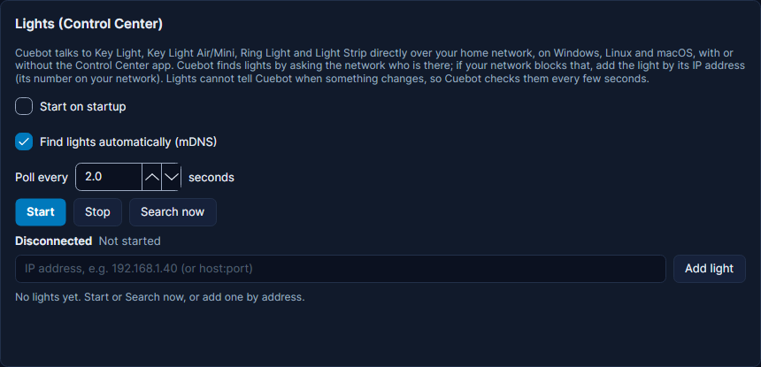

# Elgato lights

Elgato's **Key Light**, **Key Light Air**, **Key Light Mini**, **Ring Light** and **Light Strip** are lamps you control
over your home network. Cuebot can turn them on and off, change how bright they are, how warm or cool the light is,
and the colour of a Light Strip. It can also start an action when someone changes a light. For example: when a raid
comes in, flash your Light Strip red for a few seconds.

You do not need Elgato's **Control Center** app. Cuebot talks to each light straight over your network, on Windows,
Linux and macOS. Control Center can stay open next to Cuebot if you like it.

## What you need

- One or more Elgato lights, already set up on your Wi-Fi (with Elgato's Control Center or phone app, once).
- The light and your computer on the **same home network**.
- Nothing else: no account, no key, no password.

## Set it up

1. Switch your lights on at the wall, so they are on your network.
2. In Cuebot open **Apps > Apps & devices**, then **Lights & cameras** in the list on the left. The first card is
   **Lights (Control Center)**.
3. Leave **Find lights automatically (mDNS)** ticked. (**mDNS** is the way devices on a home network say "I am here"
   to each other.)
4. Click **Start**. Cuebot looks for lights and lists each one it finds, with its name, kind of light and address.
   Click **Search now** to look again later, for example after you switched on another light.
5. Click **Identify** next to a light. That light blinks, so you know which one it is.
6. Tick **Start on startup** if Cuebot should start talking to your lights every time it opens.

**How you know it worked:** the status line says **Connected** and how many lights are reachable (like
`2 lights reachable`), and each light row says **Online**. You can switch a
light **On** or **Off**, and move its **Brightness** and **Temperature (K)** sliders right there on the card.

### Type the address instead

Some routers block the "I am here" messages, so Cuebot finds nothing. Then add the light by hand:

1. Find the light's **IP address**: its number on your network, like `192.168.1.40`. Elgato's Control Center app shows
   it in the light's settings, and so does your router's list of devices.
2. Type it in the box **IP address, e.g. 192.168.1.40 (or host:port)** and click **Add light**.

Cuebot remembers each light by its serial number. So if your router later gives the light a new address, Cuebot
follows it when it finds the light again. A light you add by hand shows **added by hand** in its row.

!!! tip "Give your router a fixed address for the light"
    If you add lights by hand and your router hands out new addresses now and then, tell the router to always give the
    light the same address (often called a "DHCP reservation"). Then the address you typed keeps working.

### The other settings on the card

| Setting | What it does |
| --- | --- |
| **Poll every … seconds** | Lights cannot tell Cuebot when something changes, so Cuebot asks them every few seconds (2 by default). Lower is quicker to notice, higher is calmer. |
| **Stop** | Stops talking to your lights. They stay as they are. |
| **Remove** | Takes a light off Cuebot's list. The light itself is not changed. Cuebot then also stops adding it back when it searches. |

## What Cuebot can do

### Sub-actions (do this)

In an action, click **+ Sub-action** and search for **Elgato Control Center**.

| Sub-action | What it does |
| --- | --- |
| **Set Power State** | Turns a light **On**, **Off**, or **Toggle** (flips it). |
| **Set Brightness** | Sets brightness from 0 to 100. Tick **Add to current value** to go up or down by an amount instead, like `-10`. |
| **Set Colour Warmth** | Sets how warm (orange) or cool (blue) the white light is, in Kelvin: about 2900 (warm) to 7000 (cool). Also has **Add to current value**. |
| **Set Color (Light Strip)** | Sets the colour of a colour light. **Hue** 0 to 360 goes round the colour wheel (0 red, 120 green, 240 blue); **Saturation** 0 is white, 100 is full colour. |
| **Make Light Blink** | Makes the light blink for a moment, like **Identify** on the card. |
| **Get Light Info** | Reads a light's settings into variables for later steps, like `%brightness%` and `%powerState%`. |

Every one of them has a **Device** box. Type a light's name, serial number or IP address, several with commas, or
leave **All** for every light. After the step you have `%deviceName%`, `%powerState%`, `%brightness%`,
`%temperature%`, `%hue%`, `%saturation%` and `%elgatoLightCount%` (how many lights were changed).

Full details: [Elgato Control Center sub-actions](../../reference/sub-actions/elgato-control-center.md).

### Triggers (when this happens)

In an action, click **+ Trigger** and search for **Elgato Control Center**. They run for changes made anywhere: in
Cuebot, in Control Center, in Elgato's phone app or with a Stream Deck.

| Trigger | Runs when |
| --- | --- |
| **Device Powered On** / **Device Powered Off** | A light is turned on, or off. |
| **Device Power State Changed** | A light is turned on or off (either way). |
| **Brightness Changed** | The brightness changes. `%oldBrightness%` has the value before. |
| **Colour Warmth Changed** | The colour warmth changes. |
| **Color Changed (Light Strip)** | The colour of a colour light changes. |
| **Device Added** / **Device Removed** | Cuebot finds a new light, or you remove one from the list. |
| **Device Renamed** | You rename a light in Control Center. |
| **Device Configuration Changed** | The light's own settings change, like what it does when it gets power. |
| **Light Lost Connection** / **Light Back Online** | A light stops answering (two missed checks in a row), or answers again. |

Each trigger has a **Devices** box: leave it empty for every light, or type names, serial numbers or IP addresses
with commas between them.

Full details: [Elgato Control Center triggers](../../reference/triggers/elgato-control-center.md).

## Examples

**Light on when you go live.** Make an action called *Lights on*. Add the trigger **Twitch > Stream online**. Add
the sub-action **Elgato Control Center > Set Power State** with **Device** `All` and **State** `On`, then **Set
Brightness** with **Brightness** `70`.

**Red flash for a raid (Light Strip).** Make an action called *Raid flash*. Add the trigger **Twitch > Raid**. Add
these sub-actions:

1. **Get Light Info** with **Device** `Light Strip` (your strip's name), so `%hue%` and `%saturation%` hold its colour now.
2. **Set Color (Light Strip)** with **Hue** `0` and **Saturation** `100` (red).
3. **Delay** of 5000 milliseconds (5 seconds).
4. **Set Color (Light Strip)** with **Hue** `%hue%` and **Saturation** `%saturation%`, to put the old colour back.

**Brightness up and down from chat or a deck.** Make two actions, *Brighter* and *Darker*. In each, add **Set
Brightness** with **Add to current value** ticked: `10` in one, `-10` in the other. Start them from a
[deck button](decks.md), a [Stream Deck key](stream-deck.md) or a chat command.

## Troubleshooting

| You see | What to do |
| --- | --- |
| **No lights found yet (searching with mDNS)** | Your network may block the "I am here" messages (guest Wi-Fi and some mesh routers do). Add the light by its IP address. Check the light is switched on and on the same network as your computer. |
| **No new lights found.** after **Search now** | Same as above. Lights Cuebot already knows are not listed again. |
| **1 of 2 lights reachable** | One light does not answer. Look for the row that says **Offline**. |
| **Offline** or **Offline (…)** next to a light | The light does not answer: no power, weak Wi-Fi, or a new IP address. Switch it on, then click **Search now**, or remove it and add it again with its new address. |
| **None of 2 lights is answering; retrying** | No light answers at all. Check the computer is on the same network (not a VPN or guest network). |
| **No Elgato light matches '…'.** in the log | The **Device** box in a step has a name that no light has. Use the name shown on the card, or **All**. |
| **This light has no colour temperature (a Light Strip in colour mode?). Use Set Color.** | You used **Set Colour Warmth** on a light that only does colour. Use **Set Color (Light Strip)** instead. |
| **Temperature must be in Kelvin (2900-7000) …** | Type a number from 2900 to 7000. |

!!! warning "Experimental"
    Elgato lights have only been checked by Cuebot's own tests, with a pretend light. Nobody has tried a real light
    yet, or finding lights on a real home network. Please try it before you rely on it on stream. See
    [What's experimental](../help/experimental.md).

## How it works (for the curious)

Every Elgato light runs a tiny web server on **port 9123** (a **port** is the door number an app listens on). Cuebot
asks it how it is set, and sends it changes, over plain HTTP on your home network. There is no password. Cuebot finds
lights with mDNS (they call themselves `_elg._tcp`) and checks each light every 2 seconds, plus its name and settings
every 30 seconds. The list of lights and the card's settings are stored in `elgato.json` in Cuebot's data folder.
