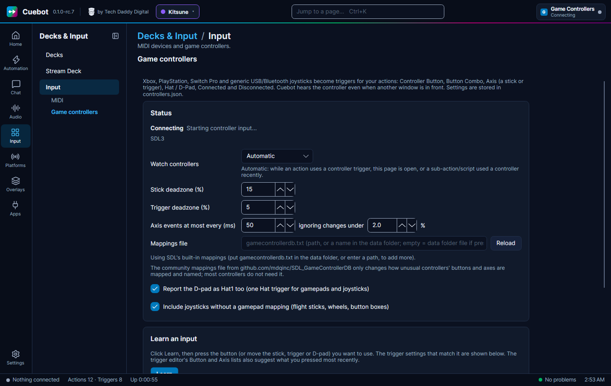
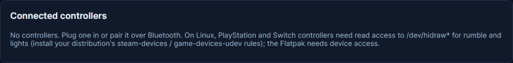
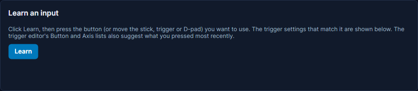
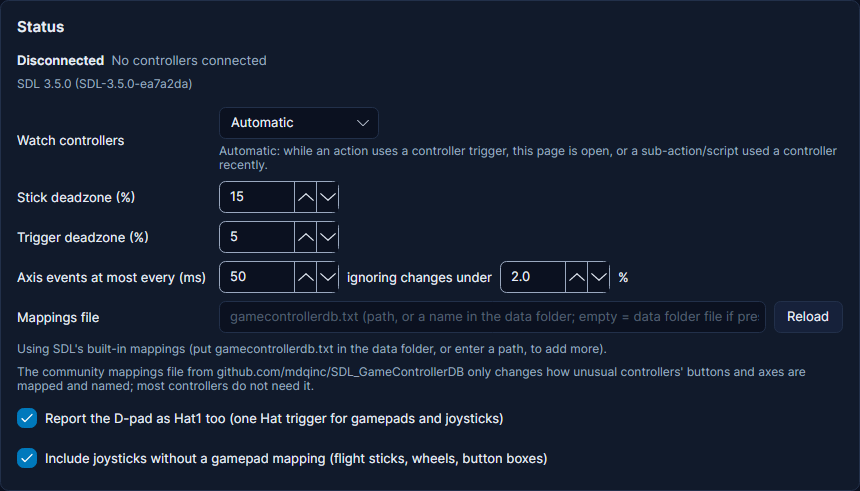

# Game controllers

Your game controller can be a set of extra hotkeys. Cuebot hears its buttons, sticks, triggers and D-pad, even while
another window (like your game) is in front, and starts your actions. It can also make the controller rumble and
change its light. For example: hold both bumpers to start a clip, or make your controller buzz when someone follows.

It works with **Xbox**, **PlayStation** (DualShock 4, DualSense), **Switch Pro** and Joy-Con, and normal USB or
Bluetooth joysticks, including flight sticks, wheels and button boxes.

## What you need

- A game controller, plugged in by USB or paired over Bluetooth.
- **Windows** or **Linux**. Nothing to install on Windows.
- **Linux, PlayStation and Switch controllers:** the buttons work as they are, but rumble and the lights need one extra
  package that gives your user access to them. Install your distribution's `steam-devices` package (Debian, Ubuntu,
  Fedora) or `game-devices-udev` (Arch, from the AUR). These are **udev rules**: small files that tell Linux which
  devices your user may use. Unplug the controller and plug it in again afterwards. The Flatpak version of Cuebot
  needs device access too.

## Set it up

1. Plug in or pair your controller.
2. In Cuebot open **Input > Input**, then **Game controllers** in the list on the left.
3. Look at **Connected controllers**: your controller is listed with its number (`#1` is the first), its name and kind,
   its battery, and the buttons and sticks you press, live.
4. Click **Learn** in **Learn an input**, then press a button (or move a stick, trigger or D-pad). Cuebot shows which
   trigger and settings match it. You do not need to remember button names.

**How you know it worked:** the status says how many controllers it sees, like **1 controller: #1 DualSense Wireless
Controller**, and the buttons light up in **Connected controllers** when you press them.

### Settings on the page

| Setting | What it does |
| --- | --- |
| **Watch controllers** | **Automatic** (the default): Cuebot only listens while an action uses a controller trigger, this page is open, or a sub-action or script used a controller in the last few minutes. **Always**: it listens from startup. **Off**: it never listens. |
| **Stick deadzone (%)** | How far you must push a stick before Cuebot notices. Raise it if a stick drifts on its own. |
| **Trigger deadzone (%)** | The same for the shoulder triggers. |
| **Axis events at most every (ms)** and **ignoring changes under … %** | Stick and trigger movement is reported at most this often, and tiny movements are ignored, so actions do not run hundreds of times. |
| **Mappings file** | Optional. A community file (`gamecontrollerdb.txt`) that names the buttons of unusual controllers. Most people leave it empty. Click **Reload** after changing it. |
| **Report the D-pad as Hat1 too** | The D-pad is also reported as a "hat", so one D-pad trigger works for both gamepads and joysticks. |
| **Include joysticks without a gamepad mapping** | Also listen to flight sticks, wheels and button boxes. |

## What Cuebot can do

### Triggers (when this happens)

In an action, click **+ Trigger** and search for **Game Controller**. Every trigger has a **Controller** box: leave it
empty for any controller, or type its number like `#1`, part of its name like `DualSense`, or its kind like `PS5` or
`Xbox One`.

| Trigger | Runs when | Main settings |
| --- | --- | --- |
| **Controller Button** | You press or release a button. | **Button** (or `Any`), **When**: Pressed, Released or Both. |
| **Controller Button Combo** | You hold several buttons together, like both bumpers. Runs once, when the last one goes down. | **Buttons** joined with `+`, like `LeftShoulder+RightShoulder`; **No other buttons held**. |
| **Controller stick or trigger** | A stick or trigger is pushed far enough (or moves at all). | **Axis** (`LeftX`, `LeftY`, `RightX`, `RightY`, `LeftTrigger`, `RightTrigger`), **Direction**, **Threshold (%)**, **Fire**. |
| **Controller D-pad** | You press the D-pad. | **Hat** (`Hat1` is a gamepad's D-pad), **Direction** (Up, Down, a diagonal, or Centered when you let go). |
| **Controller Connected** / **Controller Disconnected** | A controller is plugged in or switched on, or goes away. | |

**Button names are positions,** so they work on every controller: **South**, **East**, **West** and **North** are the
bottom, right, left and top face buttons. South is **A** on Xbox and **Cross** on PlayStation. `%buttonLabel%` gives
the name printed on your controller, like `Cross`.

**Fire** on the stick trigger: **Enter** runs once when the stick passes the threshold, **Exit** once when it comes
back, **While beyond** keeps running while it stays past it, and **Any movement** runs on every move.

Useful variables: `%button%`, `%buttonLabel%`, `%pressed%`, `%holdDurationMs%` (how long a button was held, on
release), `%heldButtons%`, `%axis%`, `%axisPercent%` (-100 to 100), `%controllerName%`, `%controllerIndex%`,
`%controllerType%` and `%batteryPercent%`.

Full details: [Game Controller triggers](../../reference/triggers/game-controller.md).

### Sub-actions (do this)

In an action, click **+ Sub-action** and search for **Game Controller**.

| Sub-action | What it does |
| --- | --- |
| **Rumble** | Makes the controller vibrate: the strength of the big and the small motor (0 to 100) and **Duration (ms)**. Use 0 to stop. |
| **Set LED Colour** | Changes the colour of the light, on controllers that have one (like PS4 and PS5 pads). **Colour** as `#0080FF` or `0,128,255`. |
| **Get Controller State** | Reads held buttons, stick positions and battery into variables for later steps. |
| **Get Controllers** | Reads the list of connected controllers into variables. |

Full details: [Game Controller sub-actions](../../reference/sub-actions/game-controller.md).

## Examples

**Secret combo.** Make an action called *Clip it*. Add the trigger **Controller Button Combo** with **Buttons**
`LeftShoulder+RightShoulder` and tick **No other buttons held**. Add your clip or replay step.

**Buzz on a new follower.** Make an action with the trigger **Twitch > Follow**. Add **Rumble** with both motors `60`
and **Duration (ms)** `400`.

**Light shows the scene.** In the action that switches to your BRB scene, add **Set LED Colour** with `#FF0000`; in
the one that switches back, `#00FF00`.

**Long press.** Make an action with **Controller Button**, **Button** `North`, **When** `Released`. Add an **If** step:
**Value** `%holdDurationMs%`, **Operator** `greater than`, **Compare to** `1000`. Put the long-press steps under
**True** and the short-press steps under **False**.

## Troubleshooting

| You see | What to do |
| --- | --- |
| **Idle: no enabled action uses a controller trigger** | Normal with **Watch controllers** on **Automatic**: Cuebot listens as soon as an action uses a controller trigger, or while this page is open. |
| **Turned off in the controller settings** | **Watch controllers** is **Off**. Set it to **Automatic**. |
| **No controllers connected** | Plug the controller in or pair it. On Linux, check another program (like Steam) sees it. |
| **Controller input is unavailable: …** | The controller part could not start. Click **Retry**. If it keeps failing, use **Settings > Support** to report it, with the message. |
| A stick runs actions on its own | Raise **Stick deadzone (%)**. |
| Rumble or the light does nothing (Linux, PlayStation or Switch) | Install `steam-devices` or `game-devices-udev` (see **What you need**), then plug the controller in again. |
| A controller has odd button names | Put the community `gamecontrollerdb.txt` (from github.com/mdqinc/SDL_GameControllerDB) in **Mappings file** and click **Reload**. |

!!! warning "Partly checked"
    Cuebot's controller part starts on Windows and Linux, but nobody has pressed a real controller yet. Please try it
    before you rely on it on stream. See [What's experimental](../help/experimental.md).

## How it works (for the curious)

Cuebot uses **SDL3**, the same free library many games use for controllers, which comes with Cuebot. It reads the
controller in the background, without a window, so it never stops your screen saver. On Linux it reads controllers
through the normal input devices, plus the `hidraw` devices for PlayStation and Switch extras (that is why those need
the udev rules). Settings are stored in `controllers.json` in Cuebot's data folder.
