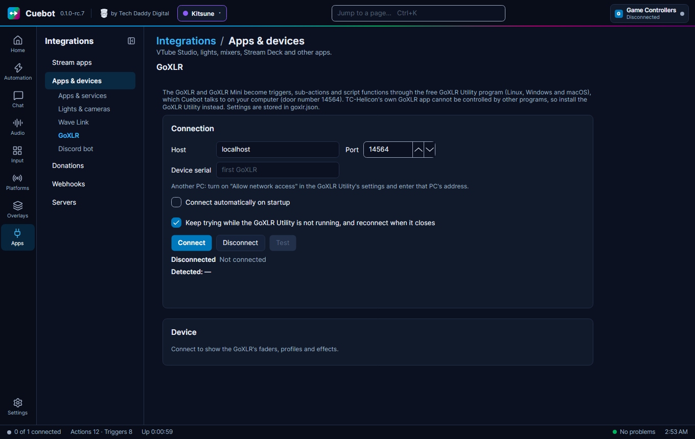

# GoXLR

The **GoXLR** and **GoXLR Mini** from TC-Helicon are mixers for streamers: faders, mute buttons, voice effects and a
sampler. Cuebot can move faders, mute channels, switch effects and profiles, play samples and change the lights. Any
GoXLR button can also start a Cuebot action. For example: a channel point reward turns on the **Robot** voice for 30
seconds.

Cuebot talks to the GoXLR through the free **GoXLR Utility**, an open-source program that replaces TC-Helicon's own
GoXLR app. TC-Helicon's app cannot be controlled by other programs, so you need the GoXLR Utility for this.

## What you need

- A GoXLR or GoXLR Mini.
- The **GoXLR Utility**, from [github.com/GoXLR-on-Linux/goxlr-utility](https://github.com/GoXLR-on-Linux/goxlr-utility).
  It runs on Linux, Windows and macOS. TC-Helicon's GoXLR app must be closed: the two cannot run at the same time.
- No account, key or password.

## Set it up

1. Install and start the GoXLR Utility, and check your GoXLR works in it.
2. In Cuebot open **Apps > Apps & devices**, then **GoXLR** in the list on the left.
3. Leave **Host** on `localhost` (this computer) and **Port** on `14564`. (A **port** is the door number an app listens
   on. 14564 is the GoXLR Utility's.)
4. Leave **Device serial** empty, unless you have more than one GoXLR: then type the serial number of the one to use.
5. Click **Connect**.
6. Tick **Connect automatically on startup**. **Keep trying while the GoXLR Utility is not running, and reconnect when
   it closes** is ticked already, so Cuebot finds the Utility by itself when you start it later.

**How you know it worked:** the status says **Connected to GoXLR Utility …** with its version, and **Detected** shows
your GoXLR and its serial number. The **Device** card now shows your faders with a volume slider and a **Mute** button
each, your **Profile** and **Mic profile** (pick one and click **Load**), a **Mute mic (cough)** button and buttons for
the voice effects. **Test** checks that the Utility answers and says how fast.

### GoXLR on another computer

If the GoXLR is plugged into a different computer (for example a gaming PC, with Cuebot on a streaming PC): in the
GoXLR Utility's settings on that computer, turn on **Allow network access**. Then in Cuebot type that computer's
address in **Host**, like `192.168.1.30`.

## What Cuebot can do

In an action, click **+ Sub-action** or **+ Trigger** and search for **GoXLR**. Channels are Mic, Line In, Console,
System, Game, Chat, Sample, Music, Headphones, Mic Monitor and Line Out. Faders are A, B, C and D. Volumes are 0 to
100.

### Sub-actions (do this)

| Sub-action | What it does |
| --- | --- |
| **Set volume** | Sets a channel's volume, or moves it up or down (tick **Add to current value**). |
| **Mute fader** | Mutes, unmutes or toggles a fader. **Mute** uses the button's own setting (for example only on stream); **Mute to all** silences it everywhere. |
| **Cough / mic mute** | Mutes or unmutes your microphone, like the Cough button. |
| **Set effect on/off** | Turns **FX**, **Megaphone**, **Robot** or **Hard Tune** on, off or toggle. |
| **Select effect preset** / **Load effect preset from library** | Picks one of the six effect presets, or loads a saved one into it. |
| **Load profile** / **Load mic profile** | Switches to a saved profile (all mixer settings) or mic profile (microphone sound). |
| **Play sample** / **Select sampler bank** | Plays or stops a sampler sound; switches bank A, B or C. |
| **Set fader channel** | Changes which channel a fader controls, like Music on fader B. |
| **Set fader mute function** | Where a fader's mute button silences the sound. |
| **Set routing** | Sends a sound to an output, or keeps it out, like Music not on stream. |
| **Set global colour**, **Set fader colours**, **Set button colours**, **Set lighting animation** | The GoXLR's lights. |
| **Set scribble strip text** | Writes a short text on a fader's little screen (not on the Mini). |
| **Get status** | Reads volumes, mutes, effects and the sampler into variables for later steps. |
| **Send raw command** | For experts: any command the GoXLR Utility understands. |

Effects, effect presets and the sampler need a full-size GoXLR; the Mini does not have them.

Full details: [GoXLR sub-actions](../../reference/sub-actions/goxlr.md).

### Triggers (when this happens)

They run for changes made anywhere: on the GoXLR itself, in the GoXLR Utility, or by Cuebot.

| Trigger | Runs when |
| --- | --- |
| **Button pressed** / **Button released** | You press or let go of any GoXLR button. Turns every button into a Cuebot hotkey. |
| **Volume changed** | A channel's volume changes. `%goXlrVolume%` and `%goXlrPreviousVolume%` hold the new and old value. |
| **Fader mute changed** | A fader is muted or unmuted. `%goXlrMuted%` is true or false. |
| **Cough / mic mute changed** | The Cough button mutes or unmutes your mic. |
| **Effect turned on/off**, **Effect preset changed** | Voice effects change. |
| **Profile changed**, **Mic profile changed** | Another profile is loaded. |
| **Fader channel changed**, **Routing changed** | A fader gets another channel; a sound is sent to or cut from an output. |
| **Sample started/stopped**, **Sampler bank changed** | The sampler plays or stops, or switches bank. |
| **Device connected** / **Device disconnected** | A GoXLR is plugged in or out. |
| **Utility connected** / **Utility disconnected** | Cuebot connects to the GoXLR Utility, or loses it. |

**Button pressed** has a **Buttons** box: type names like `Cough`, `Bleep`, `Fader 1 Mute`, `Effect Select 1` or
`Sampler Top Left`, or leave it empty for any button. `%goXlrButtonName%` tells you which one it was.

Full details: [GoXLR triggers](../../reference/triggers/goxlr.md).

## Examples

**Robot voice reward.** Make an action called *Robot voice*. Add the trigger **Twitch > Channel point reward** for your
reward. Add **Set effect on/off** with **Effect** `Robot` and **State** `On`; then **Delay** of 30000 milliseconds;
then **Set effect on/off** with **Effect** `Robot` and **State** `Off`.

**Show "mic muted" on stream.** Make an action with the trigger **Cough / mic mute changed**. Add an **If** step with
**Value** `%goXlrMuted%`, **Operator** `equals`, **Compare to** `true`, and under **True** and **False** the OBS step
**Set source visibility** to show or hide your "muted" picture.

**Spare button as a hotkey.** Make an action with the trigger **Button pressed** and **Buttons** `Bleep`. Add whatever
you like, for example **Play sound** or a scene switch.

## Troubleshooting

| You see | What to do |
| --- | --- |
| **Connecting to the GoXLR Utility at …** then **…; retrying in …** | The GoXLR Utility is not running, or not on that address. Start it. Check **Host** and **Port**. |
| **the GoXLR Utility closed the connection** | The Utility was closed or restarted. Cuebot reconnects if **Keep trying…** is ticked. |
| **GoXLR Utility … · no GoXLR plugged in** | The Utility runs, but sees no GoXLR. Plug it in, and close TC-Helicon's own GoXLR app. |
| **the server did not answer GetStatus like the GoXLR Utility** | Something else listens on that port. Check **Port** matches the GoXLR Utility's settings. |
| Cuebot on another computer cannot connect | Turn on **Allow network access** in the GoXLR Utility, and allow port 14564 in that computer's firewall. |
| A step about effects or the sampler does nothing | You have a GoXLR Mini, which has no effects or sampler. |

!!! note "Tried with a real GoXLR"
    The GoXLR was tried for real, with the GoXLR Utility on Linux. See [What's experimental](../help/experimental.md)
    for what has been checked.

## How it works (for the curious)

The GoXLR Utility runs a small web server on `localhost:14564`. Cuebot opens a **WebSocket** to it (a connection that
stays open both ways), asks for the full state once, and then gets a short message after every change, so triggers
are instant. Nothing needs a password. The Utility only listens on this computer unless you turn on **Allow network
access**. Settings are stored in `goxlr.json` in Cuebot's data folder.
