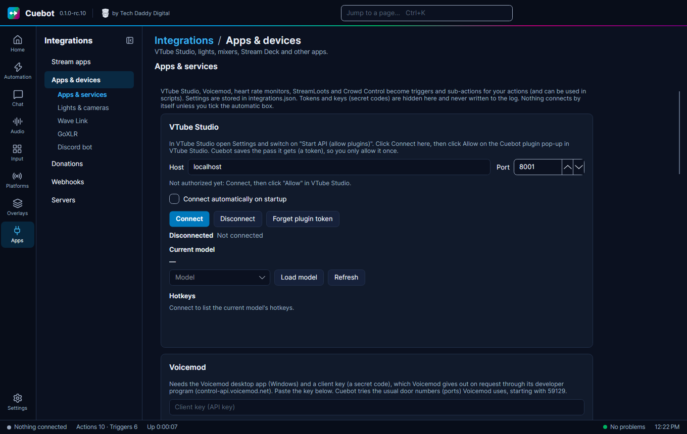

# Lights, mixers and other apps

Cuebot can turn your lights on, change your mixer, read your heart rate and more. These all live on
**Apps > Apps & devices**. It has the tabs **Apps & services**, **Elgato lights & webcams**, **Wave Link**,
**GoXLR** and **Discord bot**.

| Thing | Tab | Notes |
| --- | --- | --- |
| **Elgato Key Light, Ring Light, Light Strip** | Elgato lights & webcams | Found on your home network by themselves, with or without Elgato's app. Turn them on and off, change brightness and colour from actions. |
| **Elgato Facecam and USB webcams** | Elgato lights & webcams | On Linux, Cuebot can change brightness, zoom, focus and more. |
| **Elgato Wave Link** (audio mixer) | Wave Link | Found on this computer by itself. Change mixes, volumes and mutes. |
| **GoXLR** | GoXLR | Needs the free **GoXLR Utility** program. Faders, mutes, effects and profiles. |
| **VTube Studio** | Apps & services | In VTube Studio switch on "Start API (allow plugins)", click **Connect** in Cuebot, then **Allow** in VTube Studio. See [VTube Studio](vtuber/vtube-studio.md) for everything it can do. |
| **Voicemod** | Apps & services | Needs the Voicemod app (Windows) and a key from Voicemod's developer program. |
| **Pulsoid**, **HypeRate** | Apps & services | Your heart rate, as a value and a trigger. |
| **StreamLoots**, **Crowd Control** | Apps & services | Cards, chests and viewer effects become triggers. |
| **Your own Discord bot** | Discord bot | Posts, roles and slash commands. See the [Discord bot guide](../services/discord-bot.md). |

!!! warning "Experimental"
    These were tried for real: **VTube Studio**, **Voicemod** and the **GoXLR**. **StreamLoots** and **Crowd Control**
    connected for real, but no real card or effect has come in yet. **Elgato lights**, **webcam controls**, **Wave
    Link**, **Pulsoid**, **HypeRate** and the **Discord bot** have only been checked by Cuebot's own tests. See
    [What's experimental](../help/experimental.md).

Other VTuber apps (veadotube, VNyan, VRChat, Warudo and more) are on **Apps > Stream apps** instead: see
[VTuber apps](vtuber/index.md).

Donations and web services are on their own pages: see [Donations and services](../services/index.md).
