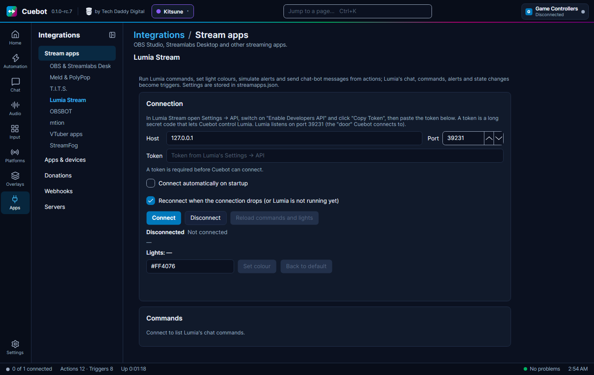

# Lumia Stream

Lumia Stream is an app that makes your smart lights react to your stream: flash on a follow, change colour on a
command. Cuebot can tell Lumia to set a colour, run one of your Lumia commands, play an alert, speak a message or post
in chat. Lumia can also start your Cuebot actions when it sees an alert, a chat message or a command. For example:
when someone raids you, Cuebot can turn your lights red for five seconds.

## What you need

- Lumia Stream, on this computer or another computer in your home network.
- Lumia's **token**: a long secret code that lets Cuebot control Lumia. You copy it in the steps below.

## Set it up

**In Lumia Stream:**

1. Open **Settings > API**.
2. Switch on **Enable Developers API**.
3. Click **Copy Token**.

**In Cuebot:**

1. Open **Apps > Stream apps**, tab **Lumia Stream**.
2. Leave **Host** at `127.0.0.1` if Lumia runs on this computer, and **Port** at `39231`. A **port** is the door
   number an app listens on.
3. Paste the token into **Token**. It is shown as dots. Keep it private.
4. Tick **Connect automatically on startup** if you want Cuebot to connect when it starts. **Reconnect when the
   connection drops (or Lumia is not running yet)** is ticked already.
5. Click **Connect**.

**How to know it worked:** the status says **Connected to Lumia Stream at 127.0.0.1:39231 (8 commands, 3 lights)**.
Your **Lights** and **Commands** are listed. To test, type a colour like `#FF0000` and click **Set colour**; **Back
to default** puts your lights back. Click **Run** next to a command to run it in Lumia.

Added or renamed something in Lumia? Click **Reload commands and lights**.

## What Cuebot can do

### Triggers (when this happens...)

Add them on **Automation > Actions** with **+ Trigger**, in the **Lumia Stream** group.

| Trigger | Runs when... | Useful variables |
| --- | --- | --- |
| **Alert** | Lumia shows an alert, like a new follower. Filter by **Alerts**; **Replays** decides what to do with alerts shown again | `%lumia.alert%`, `%user%`, `%lumia.origin%` |
| **Chat message** | Lumia sees a chat message. Filter by **Platforms** | `%user%`, `%message%` |
| **Chat message deleted** | A chat message is deleted | `%messageId%` |
| **Command used** | A chat command Lumia knows is used | `%command%`, `%user%` |
| **States changed** | Lumia is turned on or off, or stream mode switches | `%lumia.on%`, `%lumia.streamMode%` |
| **Connected** / **Disconnected** | Cuebot connects to Lumia, or loses it | `%reason%` |
| **Other event** | Any other message from Lumia | `%lumia.type%`, `%lumia.data%` |

See the [Lumia Stream triggers page](../../reference/triggers/lumia-stream.md).

### Sub-actions (do this...)

Add them with **+ Sub-action**, in the **Lumia Stream** group.

| Sub-action | What it does |
| --- | --- |
| **Set colour** | Changes your lights to a colour, like `#FF0000`. Optional: **Brightness**, **Duration (ms)** (1000 is one second), **Transition (ms)** and **Lights** (only some lights). |
| **Set to default** | Puts your lights back to their normal look. |
| **Send command** | Runs one of your Lumia commands, such as a light show. **Command type** says where it comes from (a chat command, a channel point reward...). |
| **Send alert** | Makes Lumia play one of its alerts as if it really happened, like `twitch-follower`. |
| **Chat bot message** | Sends a chat message through Lumia's chat bot, to one platform or all. |
| **Text to speech** | Makes Lumia read a message out loud. |
| **Set Lumia on/off** / **Set stream mode** | Turns Lumia, or its stream mode, on, off or flips it. |
| **Get variable** / **Set variable** | Reads or changes one of Lumia's variables. A read value goes into `%lumia.variableValue%`. |
| **Send a raw Lumia request (advanced)** | For experts: any Lumia request type with JSON details. The reply is in `%lumia.response%`. |

**Keep this look afterwards** keeps the colour or command until you change it. **Skip queue** runs it right away
instead of waiting behind other light changes. **Extra settings** (one per line as `name=value`) can be used in Lumia's
own texts as `{{name}}`.

See the [Lumia Stream sub-actions page](../../reference/sub-actions/lumia-stream.md). Scripts can use the
[lumia functions](../../reference/script-functions/lumia.md).

## Examples

**Red lights for a raid.**

1. Make an action called `Raid lights`, with your platform's raid trigger.
2. Add **Lumia Stream › Set colour** with **Colour** `#FF0000` and **Duration (ms)** `5000`.

**Run a Lumia light show from a Cuebot command.**

1. Make an action called `Party`, with a Cuebot chat command trigger like `!party`.
2. Add **Lumia Stream › Send command** with **Command** set to your Lumia command's name.

**Lights off at the end of the stream.**

1. Make an action called `Lights off`, with your "stream ended" trigger.
2. Add **Lumia Stream › Set Lumia on/off** with **State** **Off**.

## Troubleshooting

| Cuebot says | What to do |
| --- | --- |
| **A token is required before Cuebot can connect.** / **no token: copy it from Lumia's Settings → API** | Paste the token from **Settings > API > Copy Token** in Lumia. |
| **127.0.0.1:39231 not reachable (...)**, often with **retrying in ...** | Lumia is closed, or **Enable Developers API** is off. Check **Host** and **Port**. |
| **Lumia Stream refused the request: ...** | Lumia said no, with its own reason. Check the command, alert or light name. If every request fails, copy the token again. |
| **Lumia Stream did not answer in time.** | Lumia is busy. Try again. |
| **Lumia Stream is not connected.** | Click **Connect** first. |

!!! warning "Experimental"
    Lumia Stream support is built from Lumia's own instructions and checked by Cuebot's tests, but not yet with a real
    Lumia Stream. See [What's experimental](../help/experimental.md).

## How it works (for the curious)

Cuebot connects to Lumia's developer API on port 39231: a WebSocket (a live two-way link between two programs) to hear
events, and web requests to send commands. The token goes along with every request. Settings are stored in `streamapps.json`; the token
is kept as a secret and never written to Cuebot's log.
