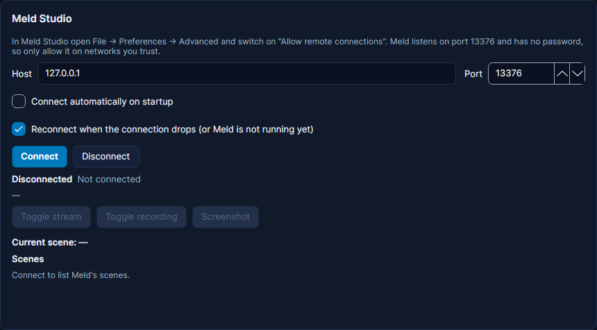

# Meld Studio

Meld Studio is a streaming app, like OBS Studio. Your stream is made of **scenes**, and each scene holds **layers**
(a camera, an image, a game capture, a browser page). Cuebot can switch scenes, show and hide layers, turn effects on
and off, mute audio tracks, start the stream and more. It also starts your actions when something changes in Meld.
For example: when you switch to your "Be right back" scene, Cuebot can mute your microphone for you.

## What you need

- Meld Studio, on this computer or another computer in your home network.
- Nothing else: Meld has no password or key for remote control.

## Set it up

**In Meld Studio:**

1. Open **File > Preferences > Advanced**.
2. Switch on **Allow remote connections**.

Meld then listens on port `13376`. A **port** is the door number an app listens on. Meld has no password, so only
allow remote connections on networks you trust (like your home network).

**In Cuebot:**

1. Open **Apps > Stream apps**, tab **Meld & PolyPop**. The **Meld Studio** card is at the top.
2. Leave **Host** at `127.0.0.1` if Meld runs on this computer. Otherwise type the other computer's address.
3. Leave **Port** at `13376`, unless you changed it in Meld.
4. Tick **Connect automatically on startup** if you want Cuebot to connect when it starts. **Reconnect when the
   connection drops (or Meld is not running yet)** is ticked already: Cuebot keeps trying until Meld is open.
5. Click **Connect**.

**How to know it worked:** the status says something like **Connected to Meld Studio at 127.0.0.1:13376 (WebChannel
API v2, 5 scenes)**. The card shows the **Current scene** and lists your **Scenes**: click **Show** next to one to
switch to it. The buttons **Toggle stream**, **Toggle recording** and **Screenshot** work now too. Careful: **Toggle
stream** really goes live or ends your stream.

## What Cuebot can do

### Triggers (when this happens...)

Add them on **Automation > Actions** with **+ Trigger**, in the **Meld Studio** group. Most have a box to react only
to some names: type them as Meld shows them, separated by commas, or leave it empty for any.

| Trigger | Runs when... | Useful variables |
| --- | --- | --- |
| **Connected** / **Disconnected** | Cuebot connects to Meld, or loses it | `%meldStudio.host%` |
| **Scene changed** | Meld shows another scene live | `%meldStudio.sceneName%`, `%meldStudio.oldSceneName%` |
| **Scene staged** | You put a scene in the "up next" spot | `%meldStudioEvent.sceneName%` |
| **Streaming started** / **Streaming stopped** | You go live, or end the stream | |
| **Recording started** / **Recording stopped** | A recording starts or stops | |
| **Layer visibility changed** | A layer is shown or hidden | `%meldStudioEvent.layerName%`, `%meldStudioEvent.visible%` |
| **Effect enabled state changed** | An effect on a layer is switched on or off | `%meldStudioEvent.effectName%`, `%meldStudioEvent.enabled%` |
| **Track muted state changed** | An audio track is muted or unmuted | `%meldStudioEvent.trackName%`, `%meldStudioEvent.muted%` |
| **Track monitoring state changed** | You start or stop hearing a track in your headphones (monitoring) | `%meldStudioEvent.monitoring%` |
| **Track gain changed** | A track's volume changes | `%meldStudioEvent.gain%` (0 is silent, 1 is full) |
| **Any Meld change (advanced)** | Anything in Meld changes. Pick the kind in **Event** | `%meldStudioEvent.event%` |

The full list is on the [Meld Studio triggers page](../../reference/triggers/meld-studio.md).

### Sub-actions (do this...)

A **sub-action** is one step inside an action. Add them with **+ Sub-action**, in the **Meld Studio** group. Most
layer steps have a **Scene** box: leave it empty and Cuebot looks in the live scene first, then in all scenes. A
layer's id works as well as its name.

| Sub-action | What it does |
| --- | --- |
| **Show scene** | Switches to another scene, live. |
| **Stage scene** / **Show staged scene** | Puts a scene "up next", then shows it later. Vertical scenes cannot be staged. |
| **Get current scene** / **Get scenes** | Keeps the live scene in `%currentScene%`, or all scene names in `%meldStudio.scenes%`. |
| **Set layer visibility state** | Shows, hides or flips (Toggle) a layer, like `Webcam`. |
| **Set effect enabled state** | Turns an effect on a layer on, off, or flips it. |
| **Set track muted state** / **Set layer track muted state** | Mutes, unmutes or flips an audio track, or one layer's sound. |
| **Set track monitoring state** | Turns listening to a track in your headphones on or off. |
| **Set track gain** | Sets a track's volume, from 0 (silent) to 1 (full). |
| **Set browser layer URL** | Makes a browser layer open another web page. |
| **Set image/media layer source** | Swaps the picture or video in an image or media layer. |
| **Media layer control** | Play, Pause, or Seek (jump to a time) in a video or sound layer. |
| **Streaming** / **Recording** | Start, stop or toggle. |
| **Record clip** | Saves the last moments (1 to 90 seconds) as a clip. |
| **Replay** | Shows or dismisses Meld's instant replay. |
| **Take screenshot** / **Take vertical screenshot** | Meld takes a picture and saves it itself. |
| **Toggle virtual camera** | Turns Meld's virtual camera on or off. |
| **Widget event** | Presses a button on a Meld widget, like `CONFETTIPOP_TRIGGER` or adding time to a subathon timer. |
| **Get status** | Keeps `%meldStudio.isConnected%`, `%meldStudio.isStreaming%` and `%meldStudio.isRecording%`. |
| **Set item property** / **Send Meld command (advanced)** | For experts: change any setting by name, or send one of Meld's own commands. |

The full list with every setting is on the [Meld Studio sub-actions page](../../reference/sub-actions/meld-studio.md).
Scripts can use the [meldstudio functions](../../reference/script-functions/meldstudio.md).

## Examples

**Mute the microphone on the BRB scene.**

1. Make an action called `BRB mute`.
2. Add the trigger **Meld Studio › Scene changed** and type `Be right back` in **Scenes**.
3. Add **Meld Studio › Set track muted state** with **Track** `Microphone` and **State** **Muted**.

Make a second action for your other scenes with **State** **Not Muted**, or use **Toggle** if you only switch between
two scenes.

**Confetti for a big cheer.**

1. Make an action called `Confetti`, with the trigger for cheers (bits) from your platform.
2. Add **Meld Studio › Widget event** with **Event** `CONFETTIPOP_TRIGGER`. Your scene needs a confetti widget.

**Show the camera for 10 seconds.**

1. Make an action called `Camera peek`.
2. Add **Meld Studio › Set layer visibility state** with **Layer** `Webcam` and **State** **Visible**.
3. Add a 10 second delay (**Core › Delay**).
4. Add the same step again with **State** **Hidden**.

## Troubleshooting

| Cuebot says | What to do |
| --- | --- |
| **127.0.0.1:13376 not reachable (...)**, often with **retrying in ...** | Meld is closed, or **Allow remote connections** is off. Open Meld and switch it on. Check the **Host** and **Port**. |
| **The WebChannel server at this address does not publish Meld Studio's "meld" object.** | Something else answers on that port. Check the **Port** is Meld's. |
| **Meld Studio did not answer in time.** | Meld is busy. Try again. |
| **This Meld Studio version does not offer '...'. Update Meld Studio.** | Your Meld is too old for that step. Update Meld. |
| **Meld Studio has no scene '...'.** (or layer, effect, audio track) | Check the spelling. Type names as Meld shows them. |
| **Meld Studio cannot stage the vertical scene '...'.** | Meld cannot stage vertical scenes. Use **Show scene** instead. |
| **Meld Studio is not connected.** | Click **Connect** on the card first. |

!!! warning "Experimental"
    Meld Studio support is built from Meld's own instructions and checked by Cuebot's tests, but not yet with a real
    Meld Studio. See [What's experimental](../help/experimental.md).

## How it works (for the curious)

Meld offers a "WebChannel" over a WebSocket (a live two-way link between two programs) on port 13376. Cuebot connects
to it, reads your scenes, layers, effects and tracks, and listens for changes. Settings are stored in
`streamapps.json`.
