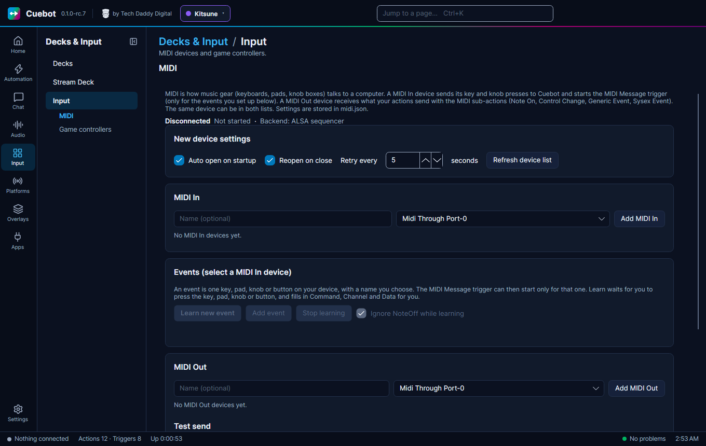
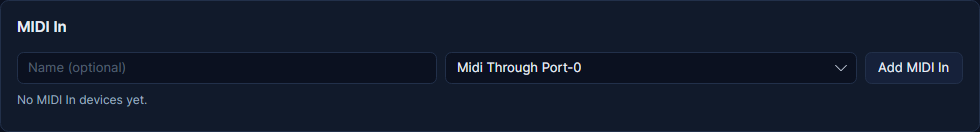
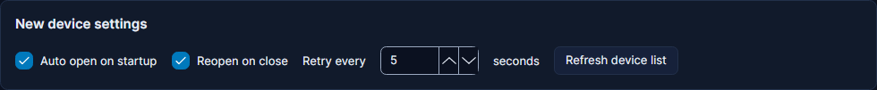
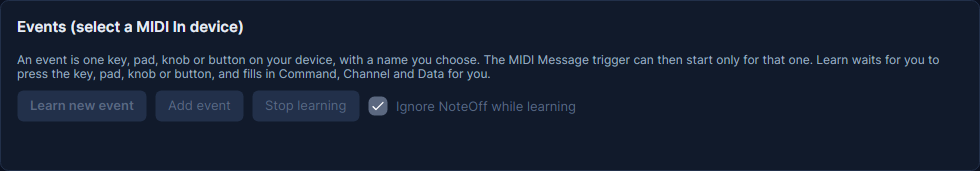
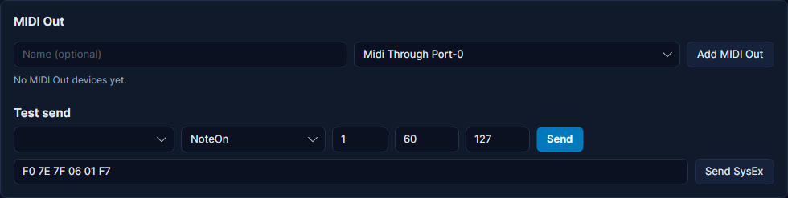

# MIDI

**MIDI** is how music gear talks to a computer: keyboards, drum pads, knob boxes and fader boxes. Cuebot can listen to
that gear, so a pad or a knob starts an action, like a big hotkey board. It can also send MIDI back, for example to
light up a pad or move a motorised fader. For example: pad 1 on your pad controller plays your "hype" sound and switches
to your Hype scene.

Two words you will see:

- **MIDI In** is gear that sends to Cuebot (you press it, Cuebot hears it).
- **MIDI Out** is gear (or a program) that Cuebot sends to. The same device can be both.

## What you need

- A MIDI device: plugged in by USB, or through a MIDI interface. Programs that make virtual MIDI ports also work.
- Windows, Linux or macOS. Nothing to install on Windows and macOS. On Linux, Cuebot uses the **ALSA sequencer**, which
  every desktop Linux has.

## Set it up

### 1. Add your device

1. Plug in your device.
2. In Cuebot open **Input > Input**, then **MIDI** in the list on the left.
3. In the **MIDI In** card, pick your device in the **Device** list. If it is not there, click **Refresh device list**
   in **New device settings**.
4. Optional: type a short name of your own in **Name (optional)**, like `Pads`. Your actions use this name.
5. Click **Add MIDI In**. The device gets a row with its state; click **Open** if it is not open yet.

The line at the top of the page shows how many devices are open (like **Connected  1 of 1 MIDI device open**) and
which **Backend** Cuebot uses: **WinMM** on Windows, **ALSA sequencer** on Linux, **CoreMIDI** on macOS.

Each device row has:

| Box | What it does |
| --- | --- |
| **Auto open** | Opens the device by itself when Cuebot starts. |
| **Reopen** | If the device goes away (cable pulled), Cuebot keeps trying to open it again, every few seconds (the number next to it). |
| **Open** / **Close** | Starts or stops using the device now. It stays in the list. |
| **Delete** | Removes the device from the list. |

**New device settings** at the top hold the starting values for **Auto open**, **Reopen** and the retry time of
devices you add later.

### 2. Teach Cuebot your keys and knobs (Learn)

An **event** is one key, pad, knob or button on your device, with a name you choose, like `Pad 1` or `Volume knob`. The
**MIDI Message** trigger can then start only for that one.

1. Click your device's row in **MIDI In**, so the **Events** card belongs to it.
2. Click **Learn new event**.
3. Press the pad, or turn the knob, on your device. Cuebot adds an event and fills in **Command** (the kind of message,
   like **NoteOn** for a key or **ControlChange** for a knob), **Ch** (the MIDI channel, 1 to 16) and **Data** (which
   key or knob, 0 to 127).
4. Give it a better name, like `Pad 1`.
5. Repeat for each pad or knob you want to use.

To change which key an event you already have listens to, click **Learn** on its row and press the new key. **Stop
learning** stops waiting.

Other boxes on an event row:

| Box | What it does |
| --- | --- |
| The tick box at the start | Switches the event on or off. |
| **Any** next to **Ch** or **Data** | Any channel, or any key or knob, counts. |
| **Ignore NoteOff** | Letting go of a key does not count, only pressing it. |
| **Ignore NoteOff while learning** (top of the card) | While learning, letting go of a key is skipped, so the key press is what gets learned. Usually what you want. |

**Incoming messages** at the bottom of the page lists everything your devices send, as it happens. Handy to see what a
knob really sends. **Clear** empties the list.

### 3. Add a MIDI Out device (only to send MIDI)

1. In the **MIDI Out** card, pick the device in the list, optionally give it a name, and click **Add MIDI Out**.
2. Try it with **Test send**: pick the device, the kind of message (like **NoteOn**), the channel and two numbers (like
   `60` for the key and `127` for how hard), and click **Send**. Many pad controllers light up a pad this way.
3. **Send SysEx** sends an advanced device-specific message, typed as hex numbers like `F0 7E 7F 06 01 F7`. Only for
   gear whose manual tells you to.

## What Cuebot can do

### The trigger (when this happens)

In an action, click **+ Trigger** and search for **MIDI Message**.

| Setting | What to put in |
| --- | --- |
| **Device** | The name of your MIDI In device on the MIDI page, or `Any`. |
| **Event** | The name of an event you learned, like `Pad 1`. `Any` means every message from the device, also ones with no event. |

Useful variables: `%eventName%` (the event that matched), `%commandCode%` (like `NoteOn`), `%channel%`,
`%noteNumber%` and `%noteName%` (like `C4`) for keys, `%velocity%` (how hard, 0 to 127), `%controllerNumber%` for
knobs, `%value%` (key velocity or knob position) and `%valueNormal%` (the same from 0 to 1).

Full details: [MIDI trigger](../../reference/triggers/midi.md).

### Sub-actions (send MIDI)

In an action, click **+ Sub-action** and search for **MIDI**. Each one has a **Device** (your MIDI Out name; empty
means the first one, and a closed device is opened for you) and a **Channel** (1 to 16; empty sends on all 16).

| Sub-action | What it does |
| --- | --- |
| **Note On** | Plays a note, or lights a pad: **Note** (0 to 127, or a name like `C4`), **Velocity**, and **Duration (ms)**. With **Send Note Off** ticked, the note is let go when the time is up. |
| **Control Change** | Moves a knob or fader: **Controller** (0 to 127, for example 7 is volume) and **Value** (0 to 127). |
| **Send any MIDI message (advanced)** | Any basic message: you pick the command and the two numbers. |
| **Send SysEx message (advanced)** | A device-specific message in hex. |

Full details: [MIDI sub-actions](../../reference/sub-actions/midi.md).

## Examples

**A pad as a hotkey.** Learn pad 1 as an event called `Pad 1`. Make an action called *Hype*. Add the trigger **MIDI
Message** with **Device** `Pads` and **Event** `Pad 1`. Add **Play sound** and an OBS scene switch.

**A knob as a volume control.** Learn a knob as `Music knob`. Make an action with the trigger **MIDI Message**,
**Event** `Music knob`. Add a volume step, like Wave Link **Set channel volume** or GoXLR **Set volume**, with a
volume worked out from `%value%` (0 to 127). The trigger runs on every little turn, so keep the action short.

**Light a pad when you go live.** Add your pad controller as **MIDI Out** too. Make an action with the trigger
**Twitch > Stream online** and the sub-action **Note On** with the pad's note, **Velocity** `127` and **Send Note
Off** unticked, so the pad stays lit. Which note and velocity give which colour is in your controller's manual.

## Troubleshooting

| You see | What to do |
| --- | --- |
| **No MIDI devices configured** | Add a device in **MIDI In** or **MIDI Out**. |
| My device is not in the list | Click **Refresh device list**. Check it is plugged in and shows up in other music programs. |
| **…the device is in use by another program** (Windows) | Another program (often a DAW or the maker's own app) has the device open, and on Windows only one program can. Close the other program, then click **Open**. |
| **The device was unplugged** / **The device closed (unplugged?)** | Plug it back in. With **Reopen** ticked, Cuebot opens it again by itself. |
| **The ALSA sequencer could not be opened (…)** (Linux) | Load the `snd-seq` kernel module (`sudo modprobe snd-seq`). In the Flatpak, Cuebot needs device access. |
| The trigger never runs | Is the device **Open**? Is the event ticked on? Look at **Incoming messages**: if nothing shows up there when you press a key, Cuebot gets nothing from the device. |
| The trigger runs twice per key | You get the key press and the release. Tick **Ignore NoteOff** on the event. |
| **No MIDI Out device named '…'.** | The **Device** in a step has a name that is not on the MIDI page. Use the name from the **MIDI Out** list. |

!!! warning "Partly checked"
    Sending MIDI was tried on Windows and Linux, and on a Mac with Cuebot's own pretend MIDI ports. Pressing keys on a
    real MIDI controller was not tried yet. See [What's experimental](../help/experimental.md).

## How it works (for the curious)

Cuebot uses each system's own MIDI layer: **WinMM** on Windows, the **ALSA sequencer** on Linux (where it shows up as
a client called "Cuebot") and **CoreMIDI** on macOS. Devices are opened by name, because their numbers can change
when you plug things in. Timing clock and active-sensing messages are dropped, since gear sends them many times a
second. Settings, devices and events are stored in `midi.json` in Cuebot's data folder.
