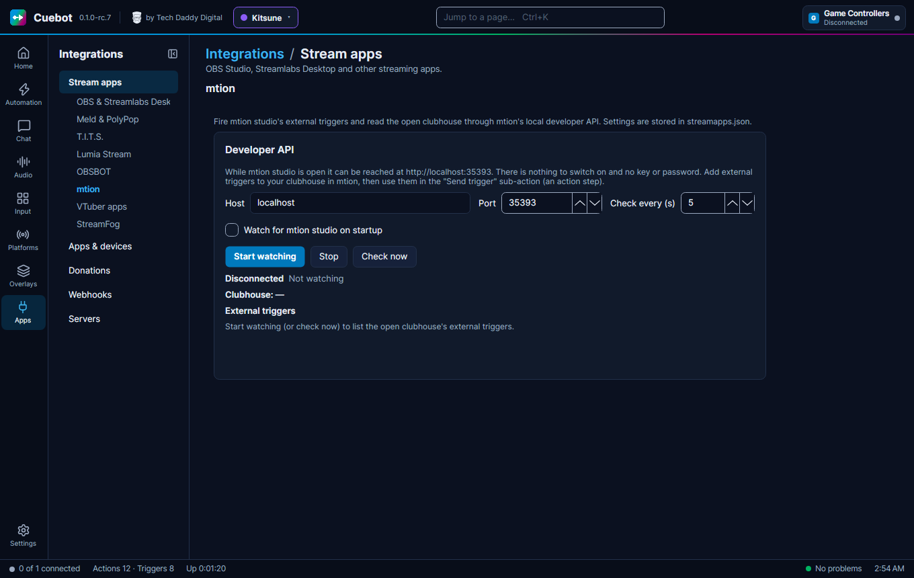

# mtion studio

mtion studio is an app for 3D stream scenes and avatars. Your scene is called a **clubhouse**. Inside a clubhouse you
can make **external triggers**: things other apps may set off, like confetti or an avatar dance. Cuebot can fire those
triggers from any action. For example: when someone subscribes, Cuebot fires your "Celebrate" trigger and your avatar
cheers.

## What you need

- mtion studio, on the same computer as Cuebot.
- Nothing to switch on and no key or password: while mtion studio is open, Cuebot can reach it at
  `http://localhost:35393`.

## Set it up

**In mtion studio:** open your clubhouse and add the external triggers you want Cuebot to use. Give each a clear name,
like `Confetti`.

**In Cuebot:**

1. Open **Apps > Stream apps**, tab **mtion**.
2. Leave **Host** at `localhost` and **Port** at `35393`. A **port** is the door number an app listens on.
3. **Check every (s)** is how often Cuebot looks whether mtion studio is open and which triggers it has (5 seconds).
4. Tick **Watch for mtion studio on startup** if you want Cuebot to look for it whenever Cuebot starts.
5. Click **Start watching**. **Check now** looks once, right away.

**How to know it worked:** the status says **mtion studio: My clubhouse** (your clubhouse's name), and **External
triggers** lists the triggers in it. Click **Fire** next to one to test it. If no clubhouse is open, the status says
**mtion studio is running (no clubhouse open)**.

## What Cuebot can do

### Triggers (when this happens...)

| Trigger | Runs when... | Useful variables |
| --- | --- | --- |
| **mtion studio started** | Cuebot notices mtion studio is open and answering | |
| **mtion studio closed** | mtion studio stops answering, for example when you close it | `%reason%` |
| **Clubhouse changed** | You open another clubhouse | `%mtion.clubhouse.name%`, `%mtion.oldClubhouse.name%` |
| **Trigger sent to mtion** | Cuebot sent an external trigger with a **Send trigger** step. It does not hear triggers mtion sets off by itself | `%mtion.trigger.name%` |

See the [mtion studio triggers page](../../reference/triggers/mtion-studio.md).

### Sub-actions (do this...)

| Sub-action | What it does |
| --- | --- |
| **Send trigger** | Fires an external trigger in the open clubhouse. **Trigger** is its name (or id). **Parameters** are extra values, one per line as `name=value`, like `Amount=5`. For a list-type value, give the option's number, starting at 0. |
| **Get active clubhouse** | Keeps the open clubhouse in `%mtion.clubhouse.name%` and `%mtion.clubhouse.id%`. |
| **Get external triggers** | Keeps the trigger names in `%mtion.triggerNames%` and the count in `%mtion.triggerCount%`. |

After **Send trigger**, `%mtion.trigger.found%` says whether the trigger exists and `%mtion.trigger.sent%` whether
mtion accepted it.

See the [mtion studio sub-actions page](../../reference/sub-actions/mtion-studio.md). Scripts can use the
[mtion functions](../../reference/script-functions/mtion.md).

## Examples

**Celebrate a sub.**

1. In mtion, add an external trigger called `Celebrate` to your clubhouse.
2. In Cuebot, make an action called `mtion celebrate`, with your platform's subscription trigger.
3. Add **mtion studio › Send trigger** with **Trigger** `Celebrate`.

**Confetti amount from bits.**

1. Give your `Confetti` trigger a number parameter called `Amount` in mtion.
2. Make an action with the trigger for cheers (bits).
3. Add **mtion studio › Send trigger** with **Trigger** `Confetti` and **Parameters** `Amount=` followed by the bits
   variable.

## Troubleshooting

| Cuebot says | What to do |
| --- | --- |
| **mtion studio is not running (http://localhost:35393/); checking every 5 s** | Open mtion studio. Cuebot finds it by itself. |
| **mtion studio is running (no clubhouse open)** | Open a clubhouse in mtion. |
| `%mtion.trigger.found%` is false | The trigger is not in the open clubhouse. Check the name, or open the right clubhouse. |
| **mtion trigger '...' has no parameter '...' (it has: ...)** | Use one of the parameter names listed in the message. |
| **mtion parameter '...' needs a number** / **needs true or false** / **is an enum: give the option's number, 0 for the first** | Give the value in the form the message asks for. |

!!! warning "Experimental"
    mtion studio support is checked by Cuebot's tests only. mtion has since been renamed, so its connection may have
    changed. See [What's experimental](../help/experimental.md).

## How it works (for the curious)

mtion studio has a small local developer API: a web address on your own computer (`http://localhost:35393`). Cuebot
asks it every few seconds whether mtion is open, which clubhouse is open and which triggers it has, and sends it your
triggers. Settings are stored in `streamapps.json`.
