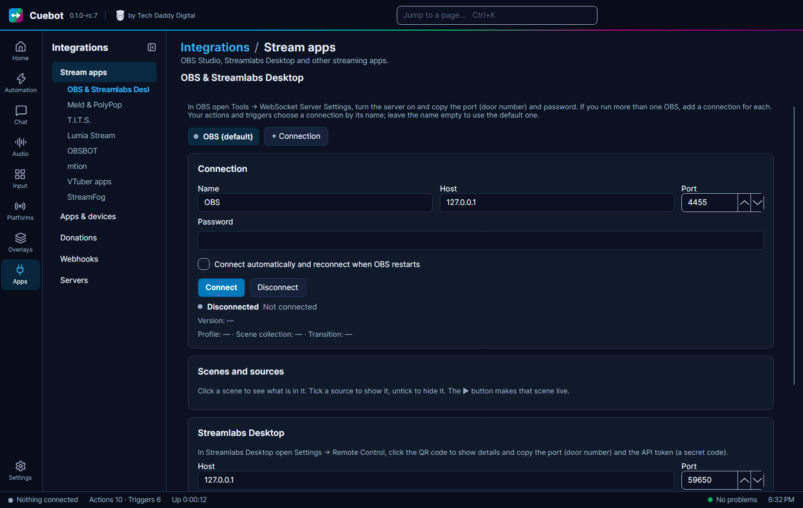

# OBS Studio

Connect Cuebot to OBS Studio and your actions can switch scenes, show and hide sources, and start or stop the stream.
OBS events, like "scene changed", can start your actions too. It is on **Apps > Stream apps**.

## Connect OBS

1. In OBS, open **Tools > WebSocket Server Settings**, tick **Enable WebSocket server** and click **Show Connect
   Info**.
2. In Cuebot, open **Apps > Stream apps** and the **OBS & Streamlabs Desktop** tab. Under **OBS Studio**, check **Host**
   and **Port** and paste the **Password** from OBS.
3. Click **Connect**, and tick **Connect automatically and reconnect when OBS restarts**.

## What you can do

Once connected, the page shows your scenes and sources, with buttons like **Start / stop stream**, **Start / stop
recording** and **Save replay**. Your viewers see the stream start or stop right away, so **Start / stop stream** asks
first: click it, then click again within 5 seconds. Your actions can now switch scenes (**Set scene**), show and hide
sources (**Set source visibility**), change text and filters, and much more. OBS events, like "scene changed" or
"stream started", become triggers.

## More than one OBS

**Two computers, or two copies of OBS?** Click **+ Connection** to add another. Give each a **Name**. OBS sub-actions
and triggers then let you pick which OBS to use; empty means the first one.

**OBS on another computer?** Put that computer's address in **Host** instead of `127.0.0.1`, and make sure its firewall
lets the port through.

The OBS steps are listed in the [OBS sub-actions](../../reference/sub-actions/obs.md).
