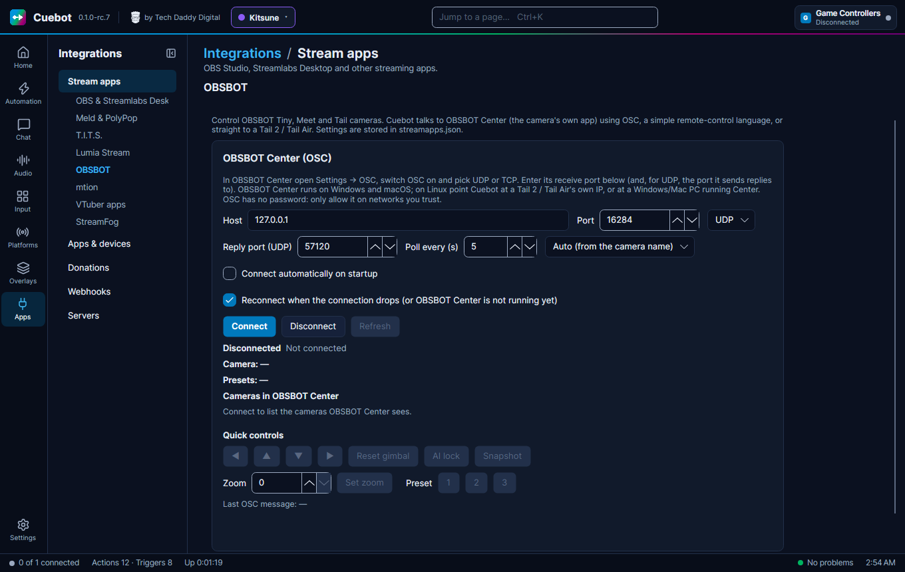

# OBSBOT cameras

OBSBOT makes webcams that can move and follow you by themselves: the Tiny, Meet and Tail cameras. Cuebot can move the
camera, zoom, jump to a saved position, lock the AI tracking, change picture settings, take a snapshot and more. It
also starts your actions when the camera moves, zooms or goes to sleep. For example: a `!zoom` chat command can zoom
in on your face for ten seconds.

## What you need

There are two ways to connect:

- **Through OBSBOT Center** (the camera's own app). Works with Tiny, Meet and Tail cameras. OBSBOT Center runs on
  Windows and macOS.
- **Straight to a Tail 2 or Tail Air** over your network, without OBSBOT Center. This also works on Linux, but the
  camera understands fewer commands this way.

Neither has a password. Only use it on networks you trust (like your home network).

## Set it up through OBSBOT Center

Cuebot talks to OBSBOT Center with **OSC**, a simple remote-control language that many stream tools use. OSC can
travel two ways: **UDP** (quick little messages) or **TCP** (a steady connection). Pick either; both sides just need
the same one.

**In OBSBOT Center:**

1. Open **Settings > OSC**.
2. Switch OSC on and pick **UDP** or **TCP**.
3. Note the **receive port** (the port OBSBOT Center listens on; a **port** is the door number an app listens on).
   For UDP, also note the port it sends its replies to.

**In Cuebot:**

1. Open **Apps > Stream apps**, tab **OBSBOT**.
2. Leave **Host** at `127.0.0.1` if OBSBOT Center runs on this computer.
3. Type OBSBOT Center's receive port in **Port** (Cuebot starts with `16284`), and pick the same **UDP** or **TCP**.
4. For UDP: type OBSBOT Center's reply port in **Reply port (UDP)** (Cuebot starts with `57120`).
5. **Poll every (s)** is how often Cuebot asks the camera for its zoom, angle and so on (5 seconds; 0 means never).
6. Leave the camera box on **Auto (from the camera name)**. Pick **Tiny series**, **Tail series** or **Meet series**
   only if some controls do not work.
7. Tick **Connect automatically on startup** if you like, and click **Connect**.

**How to know it worked:** the status says **Connected to OBSBOT Center at ...** (TCP) or **OBSBOT Center answered at
...** (UDP). **Camera** shows the selected camera, **Presets** its saved positions, and **Cameras in OBSBOT Center**
lists every camera. Try the **Quick controls**: the arrow buttons turn the camera a little, **Reset gimbal** points it
straight ahead again (the gimbal is the motor that moves it), **AI lock** turns tracking lock on or off, and **Set
zoom** and the **Preset** buttons **1**, **2** and **3** do what they say. **Snapshot** takes a picture: OBSBOT Center
saves it while its preview window is open.

## Set it up straight to a Tail 2 or Tail Air

1. Find the camera's address (IP) on your network, for example in your router or the OBSBOT app.
2. In Cuebot, on the **OBSBOT** tab, type the camera's address in **Host**.
3. In the camera box pick **Tail 2 direct (no OBSBOT Center)** or **Tail Air direct (no OBSBOT Center)**.
4. Leave **Port** at `16284`: Cuebot then uses the camera's own port, `57110`, by itself.
5. Click **Connect**.

Reached this way, the camera knows only part of the commands: moving, zooming, mirror, focus, exposure and white
balance, plus presets, AI mode, tracking speed, recording and snapshots. Sleep and wake, field of view and the AI lock
need OBSBOT Center. A step that needs OBSBOT Center fails with a clear message (see
Troubleshooting). A Tail 2 reached directly also turns further: pan -159 to 159 degrees, tilt -62 to 62.

## What Cuebot can do

### Triggers (when this happens...)

Add them on **Automation > Actions** with **+ Trigger**, in the **OBSBOT** group.

| Trigger | Runs when... | Useful variables |
| --- | --- | --- |
| **Connected** / **Disconnected** | Cuebot starts or stops talking to OBSBOT Center or the camera | `%reason%` |
| **Zoom changed** | The zoom changes, from Cuebot, OBSBOT Center or the camera | `%obsbot.zoom%`, `%obsbot.oldZoom%` |
| **Gimbal moved** | The camera turns or tilts | `%obsbot.yaw%` (left-right), `%obsbot.pitch%` (up-down) |
| **AI tracking locked/unlocked** | Tracking locks onto someone, or lets go | `%obsbot.aiLocked%` |
| **Camera slept or woke** | The camera goes to sleep or wakes up | `%obsbot.awake%` |
| **Selected camera changed** | Another camera is picked in OBSBOT Center | `%obsbot.deviceName%` |
| **Other OBSBOT message (advanced)** | Any other OSC message from OBSBOT | `%obsbot.address%`, `%obsbot.arg0%` |

See the [OBSBOT triggers page](../../reference/triggers/obsbot.md).

### Sub-actions (do this...)

Add them with **+ Sub-action**, in the **OBSBOT** group. Every step has **Camera** (1 to 4, in OBSBOT Center's
order): leave it empty for the camera selected in OBSBOT Center. Some steps only fit one camera family: the name says
so, like **(Tiny)**, **(Tail 2)** or **(Meet)**.

| Sub-action | What it does |
| --- | --- |
| **Move gimbal** | Turns the camera Up, Down, Left or Right at a **Speed**, for a **Duration**, or until a **Stop** step. |
| **Set gimbal position** | Turns the camera to an exact angle (pan and pitch, in degrees). |
| **Reset gimbal** | Points the camera straight ahead again. |
| **Go to preset position** | Moves to saved position 1, 2 or 3. |
| **Set zoom** / **Zoom to maximum / minimum** | Zooms to 0 (widest) to 100 (closest), or all the way in or out. |
| **Set field of view** | 86° (widest), 78° or 65°. |
| **Wake / sleep camera** | Wakes the camera or puts it to sleep, handy at the end of a stream. |
| **AI tracking lock (Tiny)** / **Set AI mode** / **Set tracking mode (Tiny)** / **Set tracking speed** | How the camera follows you. |
| **Lock pan / tilt axis (Tail 2)** | Stops a Tail 2 from turning one way. |
| **Set auto framing (Meet)** / **Set virtual background (Meet)** / **Standard mode (Meet)** | Meet camera modes, like a blurred background. |
| **Set image setting** | Focus, exposure, ISO, white balance and more. |
| **Set mirror** | Flips the picture left to right. |
| **Take snapshot** / **Recording** | A photo or a recording, on your computer or (Tail) on the camera. |
| **Select camera** | Picks which camera the next steps control, if you have more than one. |
| **Get camera state** | Keeps zoom, angle, AI lock and more in variables like `%obsbot.zoom%`. |
| **Send OSC message (advanced)** | For experts: any OSC address from OBSBOT's own list. |

See the [OBSBOT sub-actions page](../../reference/sub-actions/obsbot.md). Scripts can use the
[obsbot functions](../../reference/script-functions/obsbot.md).

## Examples

**A `!zoom` command.**

1. Make a Cuebot chat command `!zoom` and an action called `Zoom in`, with the trigger **Commands › Command
   triggered**.
2. Add **OBSBOT › Set zoom** with **Zoom** `80`.
3. Add **Core › Delay** for 10 seconds.
4. Add **OBSBOT › Set zoom** with **Zoom** `0`.

**Look at the guitar.** Save the guitar view as preset 2 in OBSBOT Center. Then make an action with **OBSBOT › Go to
preset position**, **Preset** `2`, and run it from a deck button or hotkey.

**Camera to sleep at the end.** Add **OBSBOT › Wake / sleep camera** with **State** **Sleep** to your "stream ended"
action.

## Troubleshooting

| Cuebot says | What to do |
| --- | --- |
| **Sending to ...; waiting for OBSBOT Center to answer (OSC on? ports match?)** | UDP sends, but nothing comes back. Check OSC is on in OBSBOT Center, the **Port** is its receive port and the **Reply port (UDP)** is the port it sends to. |
| **OBSBOT Center stopped answering at ...; still trying** | OBSBOT Center was closed or OSC was turned off. Cuebot keeps trying. |
| **... not reachable (...)**, often with **retrying in ...** | TCP: OBSBOT Center is closed, or the port or UDP/TCP choice is wrong. |
| **A Tail 2 reached directly has no ... (it is an OBSBOT Center command). Connect through OBSBOT Center, or send raw OSC.** | That step needs OBSBOT Center. Connect through Center, or use **Send OSC message (advanced)**. |
| **Could not send ... to OBSBOT Center: ...** | The message could not go out. Check the connection. |
| A control does nothing | Pick your camera family in the camera box instead of **Auto**. |

!!! warning "Experimental"
    OBSBOT support is built from OBSBOT's own instructions and checked by Cuebot's tests, but not yet with a real
    OBSBOT Center or camera. See [What's experimental](../help/experimental.md).

## How it works (for the curious)

Cuebot sends OSC messages to OBSBOT Center (or the Tail's own OSC server on port 57110) over UDP or TCP, and reads the
answers to fill in the camera's state. OBSBOT Center's own default ports are not documented: `16284` and `57120` are
the numbers community setups use. Settings are stored in `streamapps.json`.
