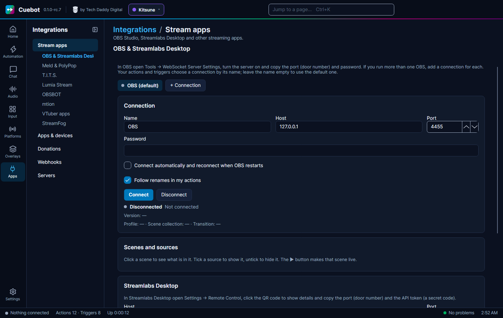

# Other stream apps

Not using OBS, or using something next to it? Cuebot also talks to other streaming apps. Think of each connection as
a phone line between Cuebot and the app: Cuebot can tell the app what to do (switch a scene, throw an item, flash your
lights), and the app can tell Cuebot when something happens, which starts your actions.

Each app has its own tab on **Apps > Stream apps**, and its own triggers and sub-actions, like OBS does.

| App | What it is | Tab | Guide |
| --- | --- | --- | --- |
| **Streamlabs Desktop** | A streaming app, like OBS | **OBS & Streamlabs Desktop** | [Streamlabs Desktop](streamlabs-desktop.md) |
| **Meld Studio** | A streaming app with scenes and layers | **Meld & PolyPop** | [Meld Studio](meld-studio.md) |
| **PolyPop** | Animated scenes, alerts and effects | **Meld & PolyPop** | [PolyPop](polypop.md) |
| **T.I.T.S.** | Throws things at your VTuber avatar | **T.I.T.S.** | [T.I.T.S.](tits.md) |
| **Lumia Stream** | Smart lights that react to your stream | **Lumia Stream** | [Lumia Stream](lumia-stream.md) |
| **OBSBOT cameras** | Webcams that move and follow you | **OBSBOT** | [OBSBOT cameras](obsbot.md) |
| **mtion studio** | 3D scenes and avatars | **mtion** | [mtion studio](mtion-studio.md) |
| **StreamFog** | AR camera effects (cannot be controlled) | **StreamFog** | [StreamFog](streamfog.md) |
| **OBS Studio** | The most used streaming app | **OBS & Streamlabs Desktop** | [OBS Studio](obs.md) |
| **veadotube, VTube Studio, VNyan, Warudo and other VTuber apps** | Avatar apps | **VTuber apps** | [VTuber apps](vtuber/index.md) |

!!! warning "Experimental"
    **Meld Studio**, **PolyPop**, **T.I.T.S.**, **Lumia Stream**, **mtion studio** and **OBSBOT** are built from each
    app's own instructions and checked by Cuebot's tests, but not yet with the real apps. **OBS Studio** and
    **Streamlabs Desktop** were tried for real; the newer Streamlabs Desktop extras were not. See
    [What's experimental](../help/experimental.md).

## Streamlabs Desktop

Streamlabs Desktop has its own page now: [Streamlabs Desktop](streamlabs-desktop.md). It covers connecting with the
API token, scenes, sources, filters, streaming, recording, the replay buffer, studio mode, scene collections, stream
health, notifications and all its triggers.

For Streamlabs donations, alerts and the Streamlabs website, see [Streamlabs](../services/streamlabs.md).
