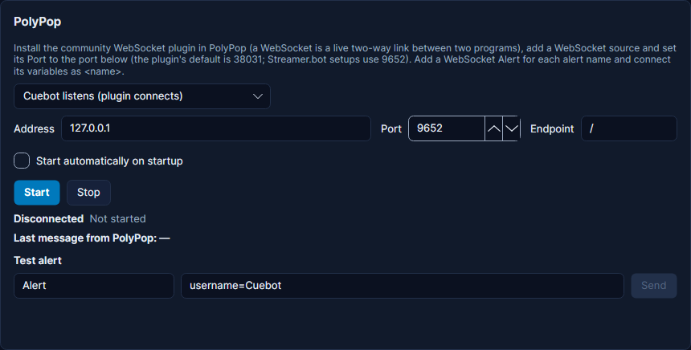

# PolyPop

PolyPop is an app for animated stream scenes, alerts and effects. Cuebot talks to it through a community **WebSocket
plugin** for PolyPop (a WebSocket is a live two-way link between two programs). Cuebot can make PolyPop play an alert
with your own values, and PolyPop can start your Cuebot actions. For example: when someone follows, Cuebot can make
PolyPop play a "New follower" animation with the follower's name.

## What you need

- PolyPop, on this computer or another computer in your home network.
- The community **WebSocket plugin** installed in PolyPop.

## Set it up

There are two sides: Cuebot opens a "door" (a **port**: the door number an app listens on), and the PolyPop plugin
comes in through it.

**In Cuebot:**

1. Open **Apps > Stream apps**, tab **Meld & PolyPop**. Scroll down to the **PolyPop** card.
2. Leave the box at the top on **Cuebot listens (plugin connects)**. That is the normal setup.
3. Leave **Address** at `127.0.0.1` and **Endpoint** at `/`. Note the **Port**: Cuebot uses `9652` (the port
   Streamer.bot setups use, so an existing PolyPop setup keeps working). The plugin's own default is `38031`: you can
   type that here instead. Both sides just need the same number.
4. Tick **Start automatically on startup** if you want the link to start with Cuebot.
5. Click **Start**. The status says **Waiting for PolyPop on ws://127.0.0.1:9652/ (set the WebSocket plugin's Port to
   9652)**.

**In PolyPop:**

1. Add a **WebSocket** source (it comes with the plugin).
2. Set its **Port** to the same number as in Cuebot.
3. For each alert you want Cuebot to play, add a **WebSocket Alert** and give it a name, like `Follow`. Its variables
   come from Cuebot as `<name>`, for example `<user>`.

**How to know it worked:** Cuebot's status changes to **PolyPop connected (...)**. Type an alert name in **Test
alert**, add values like `user=Sam`, and click **Send**. PolyPop plays the alert. When PolyPop sends something to
Cuebot, it shows under **Last message from PolyPop**.

!!! tip "Plugin listens instead?"
    Some plugin builds open the door themselves. Then pick **Cuebot connects to the plugin**, type the plugin's
    address and port, and click **Start**. The status says **Connected to PolyPop at ...**.

## What Cuebot can do

### Triggers (when this happens...)

Add them on **Automation > Actions** with **+ Trigger**, in the **PolyPop** group.

| Trigger | Runs when... | Useful variables |
| --- | --- | --- |
| **Plugin connected** | The PolyPop plugin connects to Cuebot | `%polypop.remote%` |
| **Plugin disconnected** | The last PolyPop plugin connection closes | `%reason%` |
| **Message from PolyPop** | PolyPop sends Cuebot a message, for example when a button or trigger in PolyPop is pressed. **Message types** and **Names** filter which ones | `%polypop.type%`, `%polypop.name%`, `%polypop.data%` |

See the [PolyPop triggers page](../../reference/triggers/polypop.md).

### Sub-actions (do this...)

| Sub-action | What it does |
| --- | --- |
| **PolyPop › Trigger alert** | Plays a WebSocket Alert in PolyPop. **Alert name** is the name you gave it in PolyPop, exactly. **Variables** are values for the alert, one per line as `name=value`, like `user=%user%`. `%polypopClients%` says how many plugins got it. |

See the [PolyPop sub-actions page](../../reference/sub-actions/polypop.md). Scripts can use the
[polypop functions](../../reference/script-functions/polypop.md).

## Examples

**A follower animation.**

1. In PolyPop, add a WebSocket Alert called `Follow` and use `<user>` in its text.
2. In Cuebot, make an action called `PolyPop follow` with your platform's follow trigger.
3. Add **PolyPop › Trigger alert** with **Alert name** `Follow` and **Variables** `user=%user%`.

**A PolyPop button that runs a Cuebot action.**

1. In PolyPop, make a button that sends a message through the WebSocket plugin, and give it a name, like `Scene2`.
2. In Cuebot, make an action with the trigger **PolyPop › Message from PolyPop** and type `Scene2` in **Names**.
3. Add any steps you like, for example an OBS scene switch.

## Troubleshooting

| Cuebot says | What to do |
| --- | --- |
| **Waiting for PolyPop on ws://...** and it stays that way | The plugin is not connecting. Check the WebSocket source's **Port** in PolyPop is the same as in Cuebot. |
| **cannot listen on 127.0.0.1:9652 (...)** | Another program already uses that port. Pick another port in Cuebot and in PolyPop. |
| **PolyPop not reachable at ...; retrying in ...** | Only with **Cuebot connects to the plugin**: the plugin is not listening there. Check its address and port. |
| **PolyPop is not connected.** (when a step runs) | No plugin is connected right now. Open PolyPop and check the status on the card. |
| The alert does not play | The **Alert name** must match the WebSocket Alert in PolyPop exactly. |

!!! warning "Experimental"
    PolyPop support is checked by Cuebot's tests only, not yet with a real PolyPop and the WebSocket plugin. See
    [What's experimental](../help/experimental.md).

## How it works (for the curious)

In the normal setup Cuebot runs a small WebSocket server at `ws://address:port/endpoint`, and the PolyPop plugin
connects to it. More than one plugin may connect; an alert goes to all of them. Settings are stored in
`streamapps.json`.
