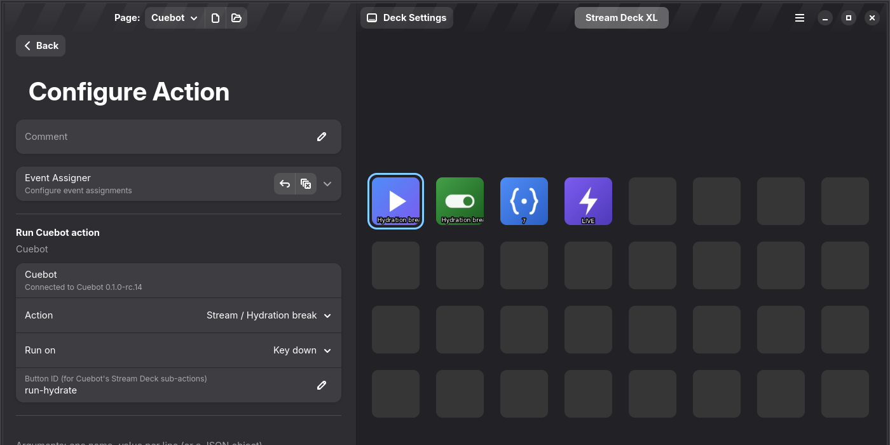
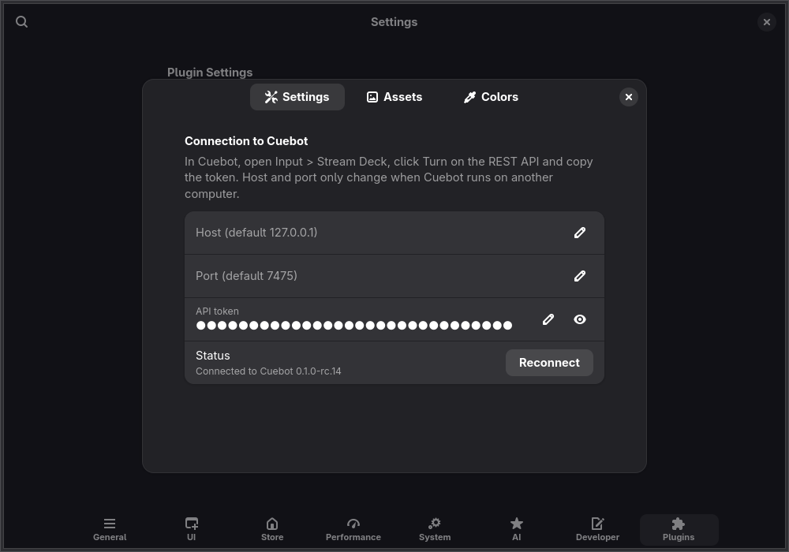
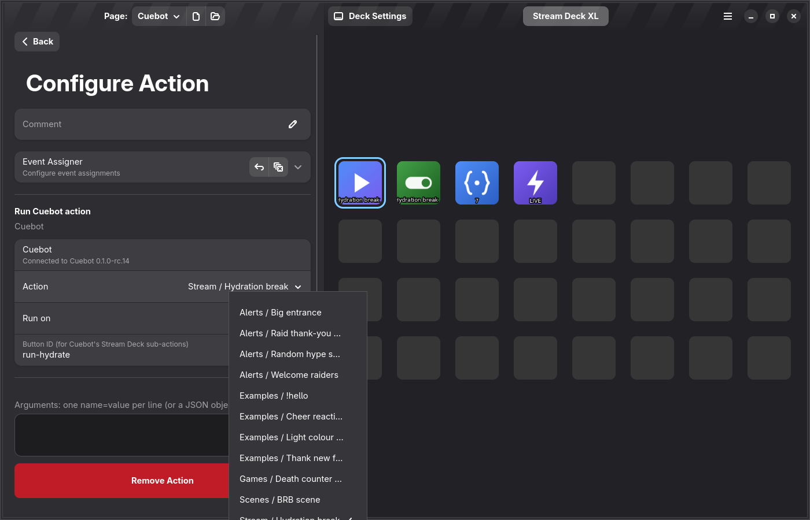
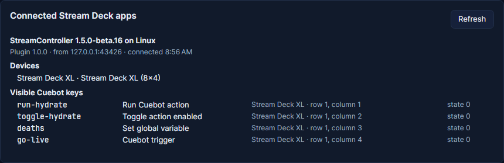

# StreamController

[StreamController](https://streamcontroller.core447.com/) is a Stream Deck app for Linux. Cuebot has a plugin for it,
so your Stream Deck keys can run Cuebot actions while StreamController keeps all your other keys and plugins.

It does the same things as Cuebot's plugin for Elgato's Stream Deck app (see [Stream Deck](stream-deck.md)):

| Key | What it does |
| --- | --- |
| **Run Cuebot action** | Runs the action you pick. **Run on**: when you press (**Key down**) or let go (**Key up**). |
| **Toggle action enabled** | Turns an action on or off. The key is green when the action is on and grey when it is off. |
| **Set global variable** | Sets a [global variable](../actions/variables.md#global-variables), adds to it, or flips it between true and false. **Show the value** puts the current value on the key. On a Stream Deck + dial, each turn adds **Dial step per tick**. |
| **Cuebot trigger** | Starts the **Stream Deck key or dial used** trigger, for actions that listen to it. |

The key shows a green tick when Cuebot did what it asked, and a warning sign when it could not (Cuebot is not running,
or the action is missing or turned off).



!!! warning "Partly checked"
    Tried with StreamController 1.5.0-beta.16 and a real Stream Deck XL on Linux: every key, the action list, and
    everything Cuebot's Stream Deck sub-actions send. Dials on a Stream Deck + have not been tried with a real one
    yet. See [What's experimental](../help/experimental.md).

## Install the plugin

1. Close StreamController.
2. Download **Cuebot-StreamController-plugin.zip** from the
   [Cuebot release](https://github.com/TechDaddyKB/cuebot/releases).
3. Unzip it into StreamController's plugins folder, so you get the folder `io_github_cuebot_Cuebot` there:

    ```bash
    unzip Cuebot-StreamController-plugin.zip -d ~/.var/app/com.core447.StreamController/data/plugins/
    ```

    That folder is the same for the Flatpak and for StreamController from the AUR. If you moved StreamController's
    data somewhere else (in its settings), use that folder's `plugins` folder instead.

4. Start StreamController.

To update, close StreamController and unzip the new file over the old one.

!!! warning "Only one program at a time"
    A Stream Deck can only listen to one program. While StreamController uses your Stream Deck, untick **Use Stream
    Decks on USB** on Cuebot's **Input > Stream Deck** page. After you close StreamController, other programs (Cuebot's
    direct USB, OpenDeck) only find the Stream Deck once you unplug it and plug it back in.

## Connect it to Cuebot

1. In Cuebot, go to **Input > Stream Deck**. Under **1. Turn on the REST API**, click **Turn on the REST API**.
2. Under **3. Pair**, click **Copy** next to the token.
3. In StreamController, add any Cuebot key (see below). The first time, the **Connection to Cuebot** settings open by
   themselves. You can also find them later: menu (☰) > **Open Settings** > **Plugins** > **Cuebot** > **Open
   Settings**.
4. Paste the token into **API token**. Leave **Host** and **Port** empty unless Cuebot runs on another computer.
5. **Status** says "Connected to Cuebot" and the version.



The token is kept in StreamController's settings folder on this computer. Anyone who has it can control Cuebot, so
do not show it on stream. If it gets out, click **Regenerate** next to the token in Cuebot and paste the new one.

## Add Cuebot keys

1. In StreamController, click a key, then **Add Action**.
2. Open **Cuebot** and pick one of the four keys.
3. For **Run Cuebot action** and **Toggle action enabled**, pick the action in **Action**. The list shows your
   actions by group; it fills in once the plugin is connected to Cuebot.
4. **Arguments** (Run Cuebot action and Cuebot trigger) are extra values for the action, one `name=value` per line.
   The action can use them like `%name%`.



The key shows the action's name (or the variable's) at the bottom. Your own picture and labels from StreamController's
key settings win over what Cuebot puts on the key.

## Change keys from your actions

Every Cuebot key has a **Button ID**, like `run-3fa2c1`. You can change it to something easier, like `brb`. Cuebot's
**Stream Deck** sub-actions find keys by it: **Set Title**, **Set State**, **Toggle State**, **Set key picture**,
**Set key value**, **Show Alert** and **Show Ok** work on StreamController keys the same way as in the Stream Deck app.
Keys with the same Button ID change together, also on other pages.

In Cuebot, **Input > Stream Deck** lists StreamController under **Connected Stream Deck apps**, with your Stream Deck
and every Cuebot key:



In your actions, `%appName%` is `StreamController` for its keys (and `Stream Deck` for the Stream Deck app).

## If it does not connect

The **Status** line says what is wrong:

| Status | What to do |
| --- | --- |
| Cuebot is not running or its REST API is off | Start Cuebot, and turn on the REST API on **Input > Stream Deck**. |
| Cuebot refused the token | Copy the token again from Cuebot and paste it into **API token**. |
| Cuebot closed the connection | Cuebot quit or restarted. The plugin connects again by itself. |
| Paste the API token from Cuebot | The token is still empty. |

The plugin tries again by itself, first after 1 second, then less often (at most every 30 seconds). **Reconnect** tries
right away.
