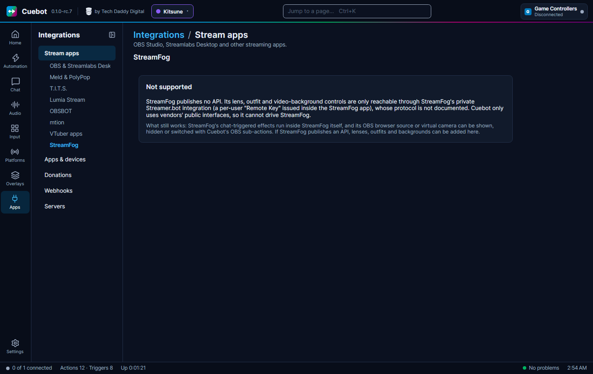

# StreamFog

StreamFog is an app that puts AR effects on your camera: lenses, outfits and video backgrounds that your viewers can
set off from chat. Cuebot **cannot** control StreamFog. This page explains why, and what you can do instead.

## Why Cuebot cannot control it

To let other apps control it, an app needs a public **API**: a documented way in, like a list of commands other apps
may send. StreamFog has none. Its lenses, outfits and backgrounds can only be reached through StreamFog's private
Streamer.bot connection, which uses a personal "Remote Key" made inside the StreamFog app, and how that connection
works is not documented. Cuebot only uses the public ways in that app makers publish, so it cannot drive StreamFog.

The **StreamFog** tab on **Apps > Stream apps** says the same.

## What you can do instead

- **Let StreamFog handle chat itself.** StreamFog's chat-triggered effects run inside StreamFog, without Cuebot.
- **Show, hide or switch StreamFog in OBS from Cuebot.** StreamFog appears in OBS as a browser source or a virtual
  camera. Cuebot's [OBS](obs.md) steps can show or hide that source, or switch to a scene that has it. For example:
  show the StreamFog source for 30 seconds when someone redeems a channel point reward.

If StreamFog publishes an API one day, lenses, outfits and backgrounds can be added to Cuebot.
