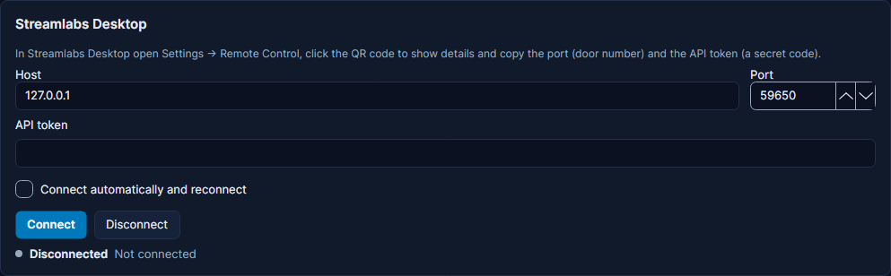

# Streamlabs Desktop

Streamlabs Desktop is a streaming app, like OBS Studio: it holds your scenes, sends your stream to Twitch or YouTube
and records it. Cuebot can remote-control it: switch scenes, show and hide sources, mute your microphone, start the
stream, save a replay and more. It also starts your actions when something happens in Streamlabs Desktop. For
example: when your stream drops and Streamlabs Desktop is reconnecting, Cuebot can post "Technical difficulties, back
in a moment!" in chat.

This page is about the **app** on your computer. Streamlabs donations, alerts and the Streamlabs website are a
different connection: see [Streamlabs](../services/streamlabs.md).

## What you need

- Streamlabs Desktop on the same computer as Cuebot, or on another computer in your home network.
- Its **API token**. A token is a long secret code that proves Cuebot may control the app. You copy it from
  Streamlabs Desktop in the steps below.

## Set it up

**In Streamlabs Desktop:**

1. Open **Settings > Remote Control**.
2. Click the QR code to show the details.
3. Copy the **port** and the **API token**. A **port** is the door number an app listens on. Streamlabs Desktop
   usually uses `59650`.

**In Cuebot:**

1. Open **Apps > Stream apps**, tab **OBS & Streamlabs Desktop**. Scroll down to the **Streamlabs Desktop** card,
   below the OBS cards.
2. Leave **Host** at `127.0.0.1` if Streamlabs Desktop runs on this computer. Otherwise type the other computer's
   address.
3. Check that **Port** is the number you copied.
4. Paste the token into **API token**. It is shown as dots.
5. Tick **Connect automatically and reconnect** if you want Cuebot to connect when it starts, and again by itself
   when you restart Streamlabs Desktop.
6. Click **Connect**.

**How to know it worked:** the dot turns green and the status says **Connected to 127.0.0.1:59650** (with your host
and port). The card then shows the **Current scene** and a button for each scene: click one to switch to it. Two more
buttons appear: **Start / stop stream** (click it twice within 5 seconds, so you do not go live by accident) and
**Start / stop recording**.

## What Cuebot can do

### Triggers (when this happens...)

Add them on **Automation > Actions** with **+ Trigger**, in the **Streamlabs Desktop** group.

| Trigger | Runs when... | Useful variables |
| --- | --- | --- |
| **Connected** / **Disconnected** | Cuebot connects to Streamlabs Desktop, or loses it (for example you close it) | `%reason%` (Disconnected) |
| **Scene changed** | Streamlabs Desktop switches to another scene. Type a scene in **Scene** to react to only that one | `%sceneName%`, `%previousScene%` |
| **Streaming started** / **Streaming stopped** | You go live, or end the stream | |
| **Stream reconnecting** | Your stream dropped and Streamlabs Desktop is trying to reconnect | |
| **Stream error** | Streamlabs Desktop reports a streaming error, like losing the server | `%errorMessage%` |
| **Recording started** / **Recording stopped** | A recording starts or stops | |
| **Replay buffer started** / **Replay buffer stopped** | The replay buffer (it keeps the last moments of your stream, ready to save) turns on or off | |
| **Replay buffer saved** | A replay clip was saved to a file | `%savedReplayPath%` |
| **Studio mode changed** | Studio mode is turned on or off | `%studioMode%` (true or false) |
| **Scene collection changed** | You switch to another scene collection (a whole set of scenes) | `%sceneCollectionName%` |

The full list with every setting is on the [Streamlabs Desktop triggers page](../../reference/triggers/streamlabs-desktop.md).

### Sub-actions (do this...)

A **sub-action** is one step inside an action. Add them with **+ Sub-action**, in the **Streamlabs Desktop** group.
Type scene, source and filter names exactly as Streamlabs Desktop shows them.

| Sub-action | What it does |
| --- | --- |
| **Set active scene** | Switches to another scene. |
| **Get current scene** | Keeps the scene that is showing now in `%slobsScene%` (and `%currentScene%`). |
| **Set source visibility state** | Shows, hides or flips (Toggle) one source in a scene, like your camera. |
| **Hide all scene sources** / **Hide group's sources** | Hides every source in a scene, or in a group (a folder of sources). |
| **Set random group source visible** | Shows one random source from a group and hides the others. The pick is in `%randomSource%`. |
| **Set source mute state** | Mutes, unmutes or flips an audio source, like `Mic/Aux`. |
| **Set text** | Changes the words of a text source. `%variables%` work here. |
| **Set browser source URL** | Makes a browser source open another web page. |
| **Flip source** / **Rotate source** | Mirrors a source, or turns it to an angle (90 is a quarter turn). |
| **Set source filter state** / **Set scene filter state** | Turns a filter (an effect, like Color Correction) on or off. |
| **Set state of a random filter** / **Hide source's filters** | Changes one random filter, or turns all filters on a source off. |
| **Streaming** / **Recording** | Start, stop or toggle the stream or the recording. |
| **Replay buffer** | Start, stop or toggle the replay buffer, or **Save** the last moments as a clip. |
| **Studio mode** | Turn studio mode on or off, or **Transition** (send the preview scene live). |
| **Set scene collection** | Switches to another scene collection. It takes a moment, because every scene reloads. |
| **Get stream health** | Reads `%slobsCpu%`, `%slobsFps%`, `%slobsDroppedFrames%`, `%slobsDroppedPercent%` and `%slobsBandwidth%`. |
| **Show a Streamlabs Desktop notification** | Shows a message inside Streamlabs Desktop that only you see. Pick **Info**, **Warning** or **Success**. |
| **Send Streamlabs command (advanced)** | Sends one remote-control command of your own. The answer is in `%slobsResult%`. |

The full list with every setting is on the [Streamlabs Desktop sub-actions page](../../reference/sub-actions/streamlabs-desktop.md).
Scripts can use the [slobs functions](../../reference/script-functions/slobs.md).

!!! note "Some steps use hidden parts of Streamlabs Desktop"
    The filter steps, the **Replay buffer saved** trigger and the **Stream error** trigger use parts of Streamlabs
    Desktop that its own API documentation does not list. A Streamlabs Desktop update may break them. Cuebot still
    connects when one of them is missing.

## Examples

**A `!health` chat command.**

1. Go to **Automation > Commands**, click **+**, name it `health` and type `!health` under **Commands**.
2. Go to **Automation > Actions** and make an action called `Stream health`.
3. Add the trigger **Commands › Command triggered** and choose `health`.
4. Add the sub-action **Streamlabs Desktop › Get stream health**.
5. Add **Chat (all platforms) › Send chat message (any platform)** with:
   `CPU %slobsCpu% percent, %slobsFps% FPS, %slobsDroppedFrames% dropped frames`.

**Warn when the stream drops.**

1. Make an action called `Stream dropped`.
2. Add the trigger **Streamlabs Desktop › Stream reconnecting**.
3. Add **Send chat message (any platform)** with: `My stream dropped, it will be back in a moment!`
4. Add **Streamlabs Desktop › Show a Streamlabs Desktop notification** with **Type** set to **Warning** and the
   message `Stream is reconnecting`.

**Save a replay with a hotkey or deck button.**

1. Make an action called `Save replay`.
2. Add the sub-action **Streamlabs Desktop › Replay buffer** with **Mode** set to **Save**.
3. Run the action from a hotkey or a [deck](decks.md) button. The replay buffer must be running in Streamlabs
   Desktop.

## Troubleshooting

These are the texts Cuebot shows on the card, and what to do.

| Cuebot says | What to do |
| --- | --- |
| **Streamlabs Desktop needs its API token (Settings → Remote Control → Show details).** | Paste the token into **API token**. |
| **Streamlabs Desktop rejected the API token (...)** | The token is wrong or old. Copy it again from **Settings > Remote Control** and paste it. |
| **Could not reach Streamlabs Desktop at 127.0.0.1:59650. Is it running with Remote Control enabled?** | Start Streamlabs Desktop. Check the **Host** and **Port** match **Settings > Remote Control**. |
| **Streamlabs Desktop did not answer in time.** | Streamlabs Desktop is busy or stuck. Wait a moment and click **Connect** again. |
| **Streamlabs Desktop has no scene named '...'.** (or source, filter, group, scene collection) | Check the spelling in your step. Capitals do not matter, but spaces do. |
| A **Streaming** or **Recording** step fails with a message from Streamlabs | Streamlabs Desktop could not start, for example because it has no stream key. The step shows Streamlabs' own reason. Fix it in Streamlabs Desktop. |

!!! warning "Partly checked"
    Connecting, scenes, sources, streaming and recording were tried with a real Streamlabs Desktop. The newer extras
    (studio mode, scene collections, stream health, notifications, the **Stream reconnecting** and **Stream error**
    triggers, and a failed start being reported) were only checked with a pretend Streamlabs Desktop. See
    [What's experimental](../help/experimental.md).

## How it works (for the curious)

Cuebot connects to Streamlabs Desktop's remote-control API with a WebSocket (a live two-way link between two
programs) at `ws://host:port/api`, and logs in with your token. It then listens for events like scene switches and
stream status. Settings are stored in `streamlabs-desktop.json`.
