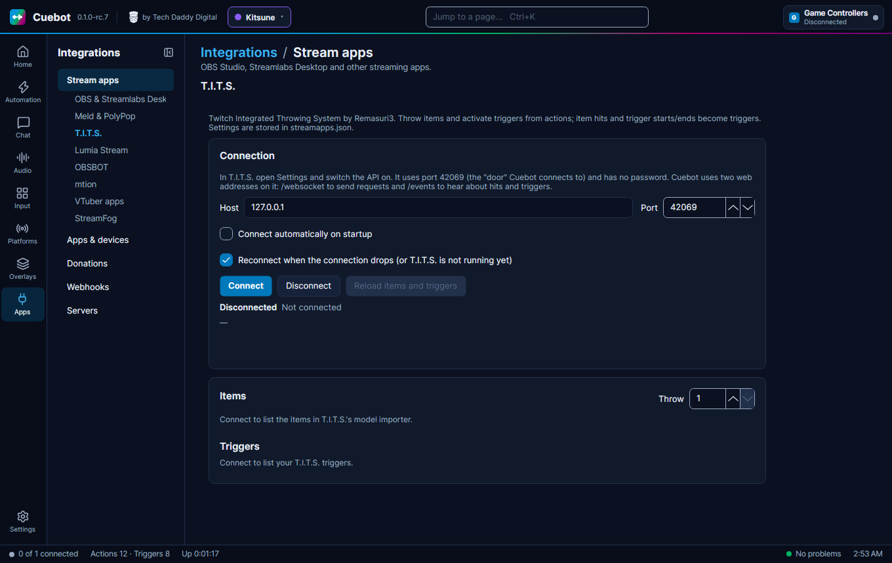

# T.I.T.S.

T.I.T.S. (Twitch Integrated Throwing System, by Remasuri3) is an app that throws things at your VTuber avatar: balls,
plushies, tomatoes. Cuebot can throw items and start T.I.T.S. triggers from any action, and it starts your actions
when an item hits you. For example: when a viewer redeems "Throw a tomato", Cuebot throws 10 tomatoes, and every hit
plays an "ouch" sound.

## What you need

- T.I.T.S., on this computer or another computer in your home network.
- Nothing else: the T.I.T.S. API has no password or key.

## Set it up

**In T.I.T.S.:**

1. Open **Settings**.
2. Switch the **API** on.

T.I.T.S. then listens on port `42069`. A **port** is the door number an app listens on.

**In Cuebot:**

1. Open **Apps > Stream apps**, tab **T.I.T.S.**
2. Leave **Host** at `127.0.0.1` if T.I.T.S. runs on this computer, and **Port** at `42069`.
3. Tick **Connect automatically on startup** if you want Cuebot to connect when it starts. **Reconnect when the
   connection drops (or T.I.T.S. is not running yet)** is ticked already.
4. Click **Connect**.

**How to know it worked:** the status says **Connected to T.I.T.S. at 127.0.0.1:42069 (events connected; 12 items, 3
triggers)**. The **Items** list shows every item T.I.T.S. can throw, and **Triggers** shows your T.I.T.S. triggers.
Click **Throw** next to an item to throw it at your avatar as a test (the **Throw** box at the top says how many), or
**Activate** next to a trigger.

Added something new in T.I.T.S.? Click **Reload items and triggers**.

## What Cuebot can do

### Triggers (when this happens...)

Add them on **Automation > Actions** with **+ Trigger**, in the **T.I.T.S.** group. "T.I.T.S. trigger" below means
the triggers you made inside T.I.T.S., which decide when items get thrown.

| Trigger | Runs when... | Useful variables |
| --- | --- | --- |
| **Item hit** | A thrown item hits your avatar. Filter by **Items**, **T.I.T.S. triggers** or **Minimum strength** | `%itemName%`, `%triggerName%`, `%strength%` |
| **Trigger activated** / **Trigger ended** | A T.I.T.S. trigger starts or finishes | `%triggerName%`, `%triggerId%` |
| **Connected** / **Disconnected** | Both of Cuebot's links to T.I.T.S. are working, or one of them drops | `%tits.host%`, `%tits.port%` |
| **Websocket connected** / **Websocket disconnected** | The link Cuebot uses to send commands comes up or drops | `%reason%` |
| **Events connected** / **Events disconnected** | The link Cuebot uses to hear hits and triggers comes up or drops | `%reason%` |

See the [T.I.T.S. triggers page](../../reference/triggers/t-i-t-s.md).

### Sub-actions (do this...)

Add them with **+ Sub-action**, in the **T.I.T.S.** group. Each throw step has **Amount** (how many in total) and
**Delay between throws (seconds)** (T.I.T.S. normally uses 0.05).

| Sub-action | What it does |
| --- | --- |
| **Throw item** / **Throw item by name** | Throws one kind of item, one or more times. |
| **Throw items** / **Throw items by name** | Throws random items from your list. Each throw picks one. |
| **Activate trigger** / **Activate trigger by name** | Starts a T.I.T.S. trigger, which throws whatever you set up in T.I.T.S. |
| **Get items** / **Get triggers** | Keeps the lists in `%tits.items%` and `%tits.triggers%`, and the counts in `%tits.itemCount%` and `%tits.triggerCount%`. |

The steps without "by name" take a name or an id. The "by name" steps need the name exactly as T.I.T.S. shows it.
After a throw, `%tits.thrownItems%` says how many items T.I.T.S. threw.

See the [T.I.T.S. sub-actions page](../../reference/sub-actions/t-i-t-s.md). Scripts can use the
[tits functions](../../reference/script-functions/tits.md).

## Examples

**Throw tomatoes for a channel point reward.**

1. Make an action called `Tomatoes`, with your platform's reward trigger.
2. Add **T.I.T.S. › Throw item by name** with **Item** `Tomato` and **Amount** `10`.

**A sound on every hard hit.**

1. Make an action called `Ouch`.
2. Add the trigger **T.I.T.S. › Item hit** and type a number in **Minimum strength**. To find a good number, write
   `%strength%` to the log for a few hits first (**Core › Write to log**).
3. Add a step that plays your "ouch" sound.

**Throw the bits amount.**

1. Make an action with the trigger for cheers (bits).
2. Add **T.I.T.S. › Throw items** with a few items in **Items** (like `Ball, Plushie, Cube`) and the bits variable in
   **Amount**.

## Troubleshooting

| Cuebot says | What to do |
| --- | --- |
| **127.0.0.1:42069 not reachable (...)**, often with **retrying in ...** | T.I.T.S. is closed, or its API is off. Open T.I.T.S. and switch the API on. |
| **... events socket not connected yet ...** | Commands work, but Cuebot cannot hear hits yet. Wait a moment; if it stays, reconnect. |
| **T.I.T.S. has no item '...'.** | Check the spelling, or click **Reload items and triggers** after adding the item. |
| **T.I.T.S. refused the request: ...** | T.I.T.S. said no, with its own reason. Check the item or trigger exists. |
| **T.I.T.S. did not answer in time.** | T.I.T.S. is busy. Try again. |
| **T.I.T.S. is not connected.** | Click **Connect** first. |

!!! warning "Experimental"
    T.I.T.S. support is built from T.I.T.S.'s own instructions and checked by Cuebot's tests, but not yet with a real
    T.I.T.S. See [What's experimental](../help/experimental.md).

## How it works (for the curious)

Cuebot opens two WebSocket links (live two-way links between two programs) to T.I.T.S. on port 42069: `/websocket` to
send requests, and `/events` to hear about hits and triggers. Settings are stored in `streamapps.json`.
