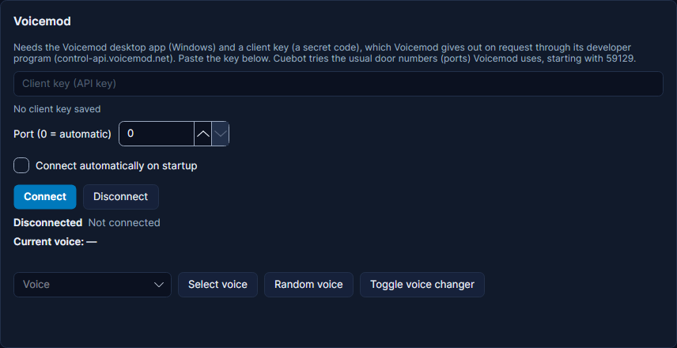

# Voicemod

**Voicemod** is a voice changer for Windows: it makes you sound like a robot, a monster or a chipmunk, and it has a
soundboard. Cuebot can switch voices, turn the voice changer on and off, play soundboard sounds and more, and start an
action when you change something in Voicemod. For example: a channel point reward gives you a random silly voice for
one minute.

## What you need

- **Windows** with the **Voicemod** desktop app. (Voicemod only makes it for Windows.)
- A Voicemod **client key**: a secret code that lets another program control Voicemod. Voicemod hands these out on
  request through its developer program at [control-api.voicemod.net](https://control-api.voicemod.net): fill in their
  form, and they send you the key by email. Cuebot cannot come with a key of its own.

## Set it up

1. Ask Voicemod for a client key (see above) and wait for their email.
2. Open the Voicemod app.
3. In Cuebot open **Apps > Apps & devices**, then **Apps & services** in the list on the left. Find the **Voicemod**
   card.
4. Paste your key into **Client key (API key)**. It stays hidden: below the box Cuebot shows only dots and, for a long
   key, its last four characters.
5. Leave **Port (0 = automatic)** on `0`. (A **port** is the door number an app listens on. Voicemod uses one of a few
   known doors, starting with 59129, and Cuebot tries them all.)
6. Click **Connect**. Tick **Connect automatically on startup** if Cuebot should connect every time it opens.

**How you know it worked:** the status says **Connected to Voicemod on port …**, and **Current voice** shows the
voice Voicemod uses now. Pick a voice in the **Voice** list and click **Select voice** to try it. **Random voice**
and **Toggle voice changer** work right away too.

## What Cuebot can do

In an action, click **+ Sub-action** or **+ Trigger** and search for **Voicemod**. Voices and sounds are picked by the
name Voicemod shows, like `Robot`.

### Sub-actions (do this)

| Sub-action | What it does |
| --- | --- |
| **Select voice** | Switches to a voice by name. |
| **Select random voice** | Switches to a random voice: from all voices, free voices, favourites or your own custom voices. |
| **Set voice changer state** | Turns the voice changer on or off (off means your normal voice). |
| **Play sound** | Plays a sound from your Voicemod soundboard. |
| **Stop all sounds** | Stops every soundboard sound that is playing. |
| **Hear myself on/off** | Lets you hear your own changed voice in your headphones, or not. |
| **Set microphone mute state** | Mutes or unmutes your microphone in Voicemod. |
| **Set background effect state** | Turns the voice's background sounds on or off. |
| **Set censor beep** | Turns Voicemod's beep over bad words on or off. |
| **Get current voice**, **Get voices**, **Get sounds** | Reads the current voice, or the lists, into variables for later steps. |

After **Select voice** you have `%voicemodVoiceName%`; after **Play sound**, `%voicemodSoundName%`.

Full details: [Voicemod sub-actions](../../reference/sub-actions/voicemod.md).

### Triggers (when this happens)

They run for changes made in Voicemod itself too, not only by Cuebot.

| Trigger | Runs when |
| --- | --- |
| **Voice changed** | You switch to another voice. **Voices** can limit it to some voices. `%voiceName%` is the new voice. |
| **Voice changer toggled** | The voice changer is turned on or off. |
| **Hear myself toggled** | "Hear my voice" is turned on or off. |
| **Microphone mute toggled** | Your microphone is muted or unmuted in Voicemod. |
| **Background effects toggled** | The background sounds are turned on or off. |
| **Soundboard changed** | You pick another soundboard, or its list of sounds changes. |
| **Connected** / **Disconnected** | Cuebot connects to Voicemod, or loses it (for example when you close Voicemod). |

Full details: [Voicemod triggers](../../reference/triggers/voicemod.md).

## Examples

**Random voice for a minute.** Make an action called *Silly voice*. Add the trigger **Twitch > Channel point reward**
for your reward. Add **Select random voice** (**From** `All voices`); then **Delay** of 60000 milliseconds; then **Set voice changer state**
with **State** `Turn off`, so you sound like yourself again.

**Show the voice name on stream.** Make an action with the trigger **Voice changed**. Add the OBS step **Set text**
with `Voice: %voiceName%` on a text source in your scene.

**Soundboard from chat.** Make an action with a chat command like `!airhorn` and the sub-action **Play sound** with the
name of your airhorn sound.

## Troubleshooting

| You see | What to do |
| --- | --- |
| **Enter your Voicemod Control API client key first.** | Paste your key into **Client key (API key)**, then click **Connect**. |
| **Voicemod rejected the client key (…). Check the key and click Connect.** | The key is wrong or not valid any more. Copy it again from Voicemod's email, without spaces. |
| The status never says **Connected** | Open the Voicemod app first. If you changed Voicemod's port, type it in **Port**. |
| **Voicemod has no voice named '…'.** | Type the voice's name exactly as Voicemod shows it, or use its ID. |
| **Voicemod has no sound named '…'.** | Type the sound's name as your soundboard shows it. |
| **Voicemod did not answer … in time.** | Voicemod is busy or stuck. Restart Voicemod, then click **Connect**. |

!!! note "Tried with a real Voicemod"
    Voicemod was tried for real. See [What's experimental](../help/experimental.md) for what has been checked.

## How it works (for the curious)

Voicemod has a **Control API**: a local server on your computer that talks over a **WebSocket** (a connection that
stays open both ways). Cuebot tries Voicemod's known ports one after another, starting with 59129, and remembers the
one that worked for next time. The first thing it sends is your client key. Your key is stored in `integrations.json`
in Cuebot's data folder and is never written to the log.
