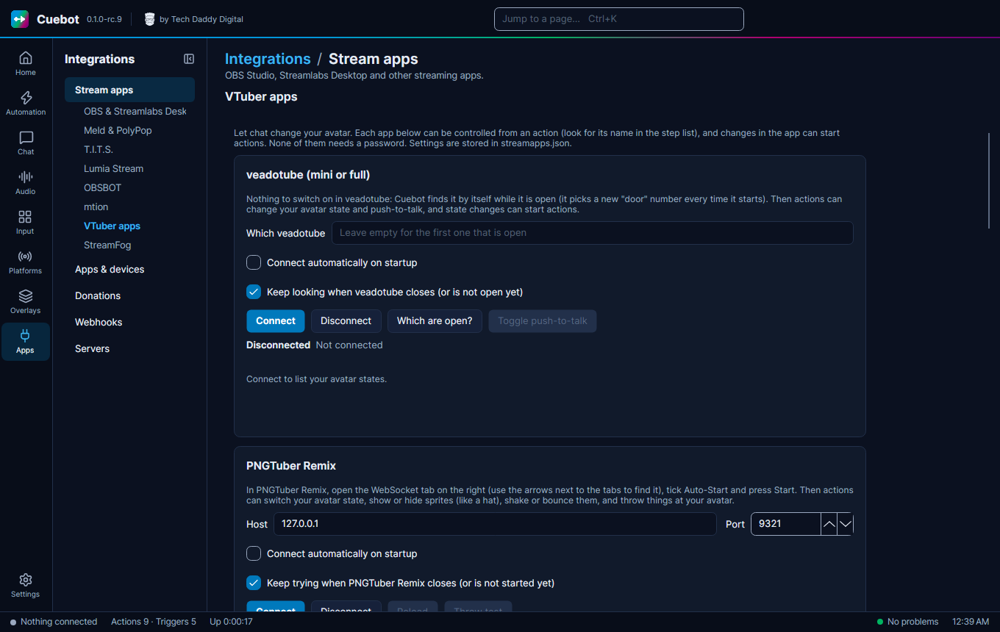

# VTuber apps

Cuebot can talk to the apps that move your avatar. A viewer redeems a reward, and your model changes outfit, throws a
prop, or shows a new face.

## The basics

Every app has a card on **Apps > Stream apps**, on the **VTuber apps** tab. Open the app first, then press **Connect**
on its card. None of these apps needs a password. Each app's steps are under its name in the sub-action list, like
**veadotube > Change avatar state**.

veadotube mini, PNGTuber Remix, RahiTuber, VNyan and Warudo were tried with the real apps. VRChat, nizima LIVE, Animaze
and VMC are [experimental](../../help/experimental.md): they may not work yet.

## Which app does what

| App | What Cuebot can do | What you switch on in the app |
| --- | --- | --- |
| [**VTube Studio**](vtube-studio.md) | Hotkeys, expressions, models, tints, throwing things, pinning items, visual effects, physics, custom tracking values; most can undo themselves after some seconds. Starts actions on clicks, hotkeys, tracking, animations and more. | **Start API (allow plugins)**, then **Allow** the Cuebot popup. Its card is on **Apps > Apps & devices**. |
| [**veadotube mini** and **veadotube**](veadotube.md) | Change your avatar state, turn push-to-talk on or off. Starts actions when the state or push-to-talk changes. | Nothing. Cuebot finds veadotube by itself while it is open. |
| [**PNGTuber Remix**](pngtuber-remix.md) | Change your avatar state, show or hide sprites, shake, bounce, move or stretch them, press key binds, throw things at your avatar, load another model; run actions when your avatar state changes. | The **WebSocket** tab: tick **Auto-Start** and press **Start**. |
| [**RahiTuber**](rahituber.md) | Press your states, like their hotkeys: tap them, let go, or hold them for some seconds. | **Preferences > Integration > Control States via HTTP**. |
| [**VNyan**](vnyan.md) | Run your node graph (API Message and WebSocket nodes), set parameters. Starts actions when VNyan's Websocket Message node sends text. | Nothing for API Message nodes. **Settings > Misc**: Start Receiver for WebSocket nodes, the OSC port for parameters. |
| [**VRChat**](vrchat.md) | Set avatar parameters, write in your chatbox, show the typing bubble. Starts actions when you change avatar or a parameter changes. | **Action Menu > Options > OSC > Enabled**. |
| [**Warudo**](warudo.md) | Run blueprints, flip and read toggles, send text (also to On WebSocket Message Received nodes). Starts actions when a toggle changes. | Add an **On Stream Deck Trigger**, **Toggle** or **Message** node to a blueprint. |
| [**nizima LIVE**](nizima-live.md) | Turn expressions on and off, play motions, press the model's hotkeys, show and hide items, swap models, switch effects. Starts actions when you select another model. | **Plugin Manager**: switch plug-ins on, then switch **Cuebot** on after the first Connect. |
| [**Animaze**](animaze.md) | Change avatar, background or quickscene, play emotes, special actions, poses and idles, turn the virtual camera on or off. Starts actions when you change avatar. | **Settings > Animaze API**: switch it on. |
| [**VSeeFace**, **VMagicMirror** and other 3D apps (VMC)](vmc.md) | Show expressions like a smile or an angry face, for a few seconds or until you change them. | The app's **VMC receiver** (VMC is a shared language many 3D apps speak). |

Using **VTube Studio**? It is on **Apps > Apps & devices** instead: see
[Lights, mixers and other apps](../lights-and-mixers.md).
