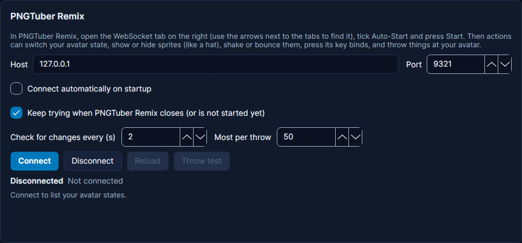

# PNGTuber Remix

Cuebot can change your PNGTuber Remix avatar state, show or hide sprites, shake, bounce, move or stretch them, press
your key binds, throw things at your avatar, and load another model. It can also run actions when your avatar state
changes. Its card is on **Apps > Stream apps**, tab **VTuber apps**. New to this? See
[VTuber apps](index.md) for what Cuebot can do with each app.

[PNGTuber Remix](https://mudkipworld.itch.io/pngremix) is a free PNGTuber app for Windows, Linux and (from 1.4.x)
macOS.

1. In PNGTuber Remix, look at the tabs on the right side (Properties, Movement and so on). Press the small arrow next to
   them until you see **WebSocket**, and open it.
2. Tick **Auto-Start** (so you never have to do this again) and press **Start**.
3. In Cuebot open **Apps > Stream apps**, tab **VTuber apps**, and press **Connect** in the PNGTuber Remix card. Your states appear in a
   list; press **Show** next to one to test it.
4. Use the steps under **PNGTuber Remix** in an action, for example **Change avatar state** or **Throw things at avatar**.

## Names

**Sprites** are the pieces your model is made of, like `Hat`, `Glasses` or `Head`. Type the name exactly as it is in
PNGTuber Remix's **Sprites** list (the name box suggests them once you are connected). PNGTuber Remix cares about
capital letters; when Cuebot knows the sprite or state, it fixes them for you (`hat` becomes `Hat`).

- **Two sprites with the same name:** PNGTuber Remix always uses the first one. The name box then offers each of them
  with its id, like `Hat (id 5376930108)`; pick the one you mean. The log warns when a step uses a shared name.
- **A sprite that does not exist** is refused by Cuebot with a clear message. Press **Reload** on the card after you
  change your model (Cuebot also notices new sprites by itself within about 10 seconds while the checks are on).

## Showing and hiding

PNGTuber Remix always shows or hides **everything attached to a sprite** together with it. The name box shows how many,
like `Head (3 attached)`. (Older Cuebot versions offered "Just this sprite"; PNGTuber Remix never did that, so the
choice is gone. Saved actions keep working.)

To change **one sprite on its own**, or to tie two sprites together, use **Match sprite visibility**: it makes a sprite
visible when another one is (or hidden, with **Opposite**). Turn **Attached sprites follow** off to change only that
sprite. Example: "show the glasses whenever the hat is hidden" is **Match sprite visibility**, sprite `Glasses`, match
`Hat`, **Opposite** on.

**Get sprite visibility** puts `%pngtuberRemix.visible%` (True or False) into the action, for an **If** step.

Visibility changes are saved into the avatar state that is showing, like a change you make in PNGTuber Remix.

## Key binds

**Press PNGTuber Remix key bind** does what pressing the key would: every sprite bound to it toggles, and sprites with it
as their hide key hide. Type the key as Godot writes it: `A`, `1`, `F5`, `Space`. `%pngtuberRemix.actionsFound%` lists
what changed, like `Hat (Toggle)`; it is empty when no sprite uses that key.

## Effects: shake, bounce, move, grow, stretch

- **Move:** set **X and Y together**. PNGTuber Remix moves the sprite to that exact spot, so an empty Y would mean 0.
  Cuebot refuses a step with only one of them.
- **Size and Turn** are set together: when you set one, an empty Size means 1 (normal) and an empty Turn means 0
  (upright). Turn is the angle to end at, not an extra tilt.
- **Stretch wide / Stretch tall** change the size one way only, for squash-and-stretch (for example 1.3 wide and 0.7
  tall).
- **Go back after** returns the sprite to how it was. **Without it, the change stays and is saved into the avatar
  state.** If you then save your model in PNGTuber Remix, it is saved in the file too.
- PNGTuber Remix remembers where a sprite was when an effect starts. Two effects on the same sprite at the same time
  would leave it out of place, so **Cuebot runs one effect at a time per sprite**: a second shake waits until the first
  is over. Effects on different sprites still run together.
- Do not save your model in PNGTuber Remix while an effect is running.

## Throwing

**Throw things at avatar** throws the images you added as throwables in PNGTuber Remix. Throwables must be turned on
there; otherwise the step says "throwing is not set up".

- **How many** can be `%bits%`, but each item is a physics object and thousands of them freeze PNGTuber Remix. Cuebot
  lowers any amount to the card's **Most per throw** (50 unless you change it). For big cheers, divide first, for
  example `$math(%bits% / 100)$` for one item per 100 bits (Cuebot rounds, and throws at least one).
- **Variance** and **From both sides** change how the items fly. Leave them empty (App setting) to use PNGTuber
  Remix's own throwables settings.
- **Pause/resume throwing** stops throws while you are on a break. The **Throwing paused/resumed** trigger runs when a
  Cuebot step pauses or resumes; PNGTuber Remix cannot tell Cuebot about its own pause key.

## Noticing changes

PNGTuber Remix does not tell other programs when something changes. So while connected, Cuebot asks for the avatar
state every **2 seconds** (the card's **Check for changes every** setting; the sprites about every 10 seconds). That
makes these triggers work:

- **Avatar state changed:** when you switch state with a PNGTuber Remix hotkey or button, from a Cuebot step, or by
  loading another model. Use it to switch an OBS scene when you go to your "AFK" state, or play a sound on "Angry".
  `%pngtuberRemix.changedBy%` says whether Cuebot or PNGTuber Remix changed it.
- **Sprites changed:** when sprites are added, removed or renamed, for example after you load another model.

Set **Check for changes every** to 0 to turn the checks off. Cuebot then only sends a small "ping" every 15 seconds. If
PNGTuber Remix stops answering twice in a row (it froze, or the computer slept), Cuebot drops the connection and
connects again.

## Loading a model

**Load PNGTuber Remix model** needs the full path of a `.pngRemix` or `.save` file, with the ending written exactly like
that (capital R). When PNGTuber Remix runs on the same computer, Cuebot checks that the file exists first. After
loading, Cuebot waits until the new model's states and sprites appear (up to 2 seconds).

## Ideas

- **Raid:** **Shake sprite** on your top sprite for 2 seconds.
- **Bits:** **Throw things at avatar** with **How many** set to `%bits%` (lowered to Most per throw).
- **Channel point "Hat on":** **Show/hide sprite**, sprite `Hat`, **Visible**; then **Delay** 60 seconds; then the same
  step with **Hidden**.
- **Make it big:** **Move, grow or spin sprite** with **Size** `2` and **Go back after** `5`.
- **Boing:** **Move, grow or spin sprite** with **Stretch wide** `1.3`, **Stretch tall** `0.7`, **Seconds** `0.15` and
  **Go back after** `0`.
- **Outfit redeem:** **Press PNGTuber Remix key bind** with the key your outfit sprites are bound to.
- **AFK scene:** trigger **Avatar state changed** for the state `AFK`, then switch your OBS scene.

## Troubleshooting

- **"did not answer ... in time":** PNGTuber Remix was busy (loading a model, or a very big model). Cuebot keeps later
  answers matched to the right steps, so the next steps work normally.
- **"has no state" / "has no sprite":** check capital letters, and press **Reload** after changing your model.
- **Throws do nothing:** turn throwables on in PNGTuber Remix and add at least one image; press **Throw test** on the
  card.
