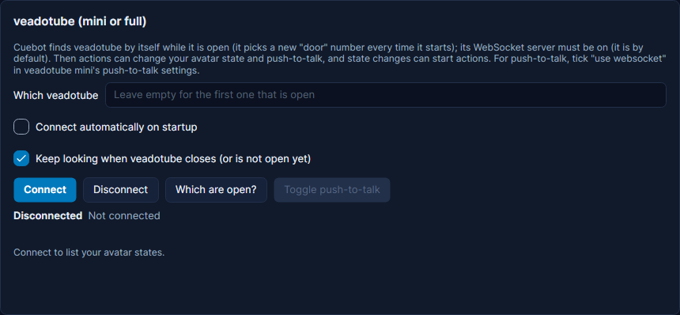

# veadotube

veadotube mini and veadotube are PNGTuber apps: your avatar is a set of pictures (states) that change when you talk. Cuebot can change your avatar state (also for a few seconds, or to a random one), turn push-to-talk on or off, and set Number nodes in full veadotube, and starts actions when the state, push-to-talk or a number changes. Cuebot finds veadotube by itself while it is open. Its card is on **Apps > Stream apps**, tab **VTuber apps**. New to this? See
[VTuber apps](index.md) for what Cuebot can do with each app.

1. Open veadotube mini (or veadotube). Its WebSocket server must be on: it is by default (veadotube mini: in the
   program settings; veadotube: the **websocket server** panel). For push-to-talk from Cuebot, also tick **use
   websocket** in veadotube mini's push-to-talk settings.
2. In Cuebot open **Apps > Stream apps**, tab **VTuber apps**, and press **Connect** in the veadotube card. Your avatar states appear in
   a list with their pictures; press **Show** next to one to test it.
3. In an action, add **veadotube > Change avatar state** and type the state's name, or **Push-to-talk on/off**.

veadotube picks a new "door" (port) number every time it starts, so there is nothing to type in. Leave **Which
veadotube** empty unless you run more than one: then type its name, for example `veadotube mini`. For veadotube on
another computer, type its address and port, like `192.168.1.20:2424`.

**How to change the state.** "Switch to this state" just shows it. "Show on top" shows it but remembers the state before,
so a later "Take this state off" goes back. That is handy for a short reaction: show *surprised* on top, wait 5 seconds,
take it off.

The trigger **Avatar state changed** runs whenever the state changes, also when you click it in veadotube yourself.

**Only for a while.** **For (seconds)** puts things back by themselves: a state shown on top is taken off again, a
switched state goes back to the one before, push-to-talk is set back. One step instead of three: *surprised* on top for
5 seconds. Changing the same state again before the time is up starts the time over.

**Random state.** Pick **Switch to a random state** and leave **State** empty for any state, or type a few names
separated by commas. It never picks the state already showing (unless it is the only one).

**More than one veadotube.** Every step has **Which veadotube**. Leave it empty for the one Cuebot is connected to; type
another one's name (like `veadotube mini`) or address to control it too, for example your own mini and a collab
partner's mini on the same computer. Triggers only come from the connected one.

**Full veadotube nodes.** In full veadotube you expose nodes yourself in the scene editor (**Websocket** nodes).
**Set number node** sets or adds to a Number node; give **Lowest value** and **Highest value** to set its range (left
empty, the range it has stays). **Get number node** reads one, the trigger **Number node changed** runs when one changes,
and **Reset node** clears an on/off or Number node back to no value.

**Overlays.** **Get avatar state** also gives `%veadotube.stateImage%`, the picture of the state showing now, which an
overlay can show.
