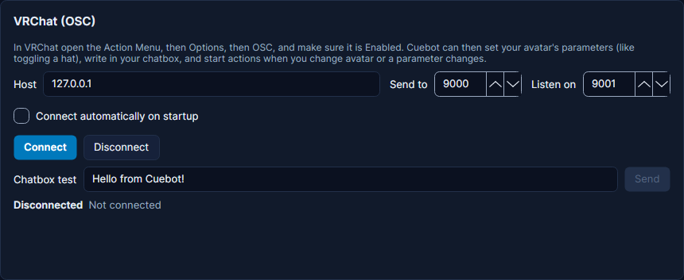

# VRChat

Cuebot can set your VRChat avatar parameters, write in your chatbox and show the typing bubble. It starts actions when you change avatar or a parameter changes. Its card is on **Apps > Stream apps**, tab **VTuber apps**. New to this? See
[VTuber apps](index.md) for what Cuebot can do with each app.

!!! warning "Experimental"
    VRChat is only checked by Cuebot's own tests so far. The real test stopped at VRChat's terms page. See
    [What's experimental](../../help/experimental.md).

1. In VRChat open the **Action Menu**, then **Options > OSC**, and make sure OSC is **Enabled**.
2. In Cuebot press **Connect** in the VRChat card.
3. Use the steps **VRChat > Set avatar parameter**, **Send chatbox message** or **Show typing bubble**.

**Parameters** are the switches and sliders your avatar has, like `Hat` or `Outfit`. Type the name exactly as in your
avatar and pick its type: **Bool** for on/off (you can also type `toggle`), **Int** for a whole number from 0 to 255,
**Float** for a number from -1 to 1. When you change avatar or a parameter changes, Cuebot remembers it, and the
parameter name box suggests the ones it has heard.

The **chatbox** shows text above your head for everyone in your world, up to 144 characters.

!!! note "Only one app can listen on port 9001"
    VRChat sends to port 9001. If another OSC app (for example a face-tracking or OSC router app) already listens
    there, Cuebot can still *send* to VRChat but cannot *hear* it, and the card says so. Close the other app, or set
    your OSC router to forward to another port and type that port into **Listen on**.
