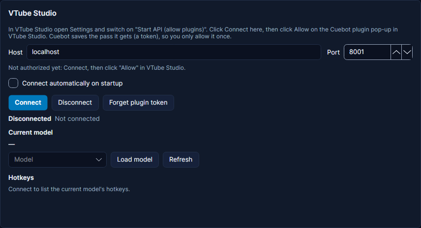

# VTube Studio

Cuebot can do almost everything a VTube Studio plugin can: press hotkeys, switch expressions and models, tint your
model, throw things at it, pin hats on it, change the visual effects, bounce the physics, and feed your own tracking
values in. It also starts actions when something happens in VTube Studio, like a click on your model's head. Its card is
on **Apps > Apps & devices**, tab **Apps & services**.

## Connecting

1. In VTube Studio open the settings and switch on **Start API (allow plugins)**. Leave the port at 8001.
2. In Cuebot press **Connect** on the VTube Studio card, and tick **Connect automatically** so Cuebot reconnects
   every time.
3. VTube Studio shows a popup with the Cuebot logo: click **Allow**. You have two minutes. Cuebot remembers this, so you
   only do it once.

Do this before you go live: if the popup is denied or nobody clicks it, Cuebot stops asking until you press
**Connect** again.

Cuebot also listens for VTube Studio's network announcements, so it finds VTube Studio on another port too, for example
a second VTube Studio window (port 8002). If you take Cuebot's access away in VTube Studio's plugin list, Cuebot notices
and shows the **Allow** popup again.

Some things need one more **Allow** in VTube Studio the first time: loading pictures (like a viewer's profile picture)
as items, and turning NDI output on or off. Cuebot asks when it first needs it; you can also ask ahead of time with
**Ask VTube Studio for a permission**.

## Things that go back by themselves

Many steps have **Undo after (seconds)**: the change goes back after that time. This works for **Set expression
state**, **Load model**, **Change model**, **Move model**, **Color tint** and the visual effects steps; **Load item**
has **Unload after (seconds)** instead.

If the same thing is changed again before the time is up, the timer starts over, and it still goes back to how it was
before the first change. A change without a timer cancels the pending undo.

## Ideas

- **Hat for a channel point reward:** **Load item** with your hat, **Pin to the model** on **The middle of an ArtMesh**
  with your head ArtMesh, and **Unload after** 300 seconds.
- **Throw the chatter at the model:** **Throw items at the model** with **Or images** set to `%userProfileImageUrl%`.
  Works for follows, subs and tips on every platform with one **Activity (any platform)** trigger.
- **Bonk volley on a raid:** **Throw items at the model** with your item files, **How many** `%viewers%` (up to 50).
- **Sub tint:** **Color tint** with your sub color, only the **ArtMesh groups** you set up in VTube Studio (like `Hair`),
  and **Undo after** 30 seconds. Or **Rainbow color tint** for 10 seconds.
- **Raid weather:** **Load visual effects preset** with your rain preset and **Undo after** 60 seconds.
- **Headpats:** trigger **Model clicked** with **Clicked ArtMeshes** set to your head ArtMeshes, then **Set expression
  state** `Happy` with **Undo after** 5 seconds.
- **Wind for gifted subs:** **Physics and wind boost** with **Wind** 80 for 10 seconds.
- **Heart rate on your model:** **Create custom parameter** `CuebotHeartRate` once, then on every heart rate update
  **Set parameter (keep it)** with `%heartRate%`. In VTube Studio, use `CuebotHeartRate` as the input of a parameter,
  like a blush or breathing speed. Cuebot creates the parameter again every time it connects.
- **Off camera:** triggers **Face tracking lost** and **Hand tracking lost** run when VTube Studio stops seeing you.
- **Sounds at an exact moment of an animation:** add an event in the Cubism Animator, then trigger **Model animation**
  on **Custom** with that event's text.

## Good to know

- **Color tints** are kept by Cuebot and put back after a reconnect (VTube Studio clears a plugin's tints when it
  disconnects).
- Items Cuebot loads disappear when Cuebot disconnects, unless you untick **Unload when Cuebot disconnects**. **Unload
  item** with **Unload every item Cuebot loaded** clears them all.
- **Expression toggled** ignores the list of every expression VTube Studio sends when a model loads; untick **Ignore the
  list sent when a model loads** to react to it.
- **Expression toggled** only runs on the VTube Studio beta; on the normal version Cuebot's log says so.
- When VTube Studio refuses something, Cuebot's error says what to do, for example closing a settings window in
  VTube Studio or using **add** mode when another plugin controls a parameter.
- **Send VTube Studio request (advanced)** sends anything else in the
  [VTube Studio API](https://github.com/DenchiSoft/VTubeStudio).
