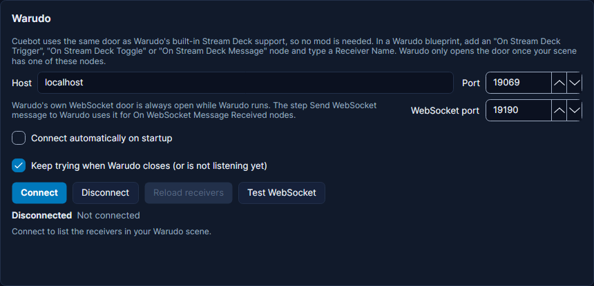

# Warudo

Cuebot can run Warudo blueprints, flip toggles, read a toggle and send text. It starts actions when a toggle changes.
Its card is on **Apps > Stream apps**, tab **VTuber apps**. New to this? See [VTuber apps](index.md) for what Cuebot
can do with each app.

Cuebot uses the same connection as Warudo's built-in Stream Deck support, so you need no mod.

1. In Warudo, open a blueprint and add one of these nodes. Type a **Receiver Name** into it, for example `Confetti`:
    - **On Stream Deck Trigger**: runs its **Exit** path once each time Cuebot sends it.
    - **On Stream Deck Toggle**: runs its **If Yes** path when it turns on and its **If No** path when it turns off,
      for things like showing a hat.
    - **On Stream Deck Message**: sets its **Message** output to the text Cuebot sends, for example a viewer's name,
      then runs **Exit**.
2. In Cuebot press **Connect** in the Warudo card. Your receiver names appear in a list with a test button each.
3. Use the steps **Warudo > Trigger Warudo blueprint**, **Warudo toggle on/off**, **Get Warudo toggle state** or
   **Send message to Warudo**.

Warudo only opens this connection while the open scene has at least one of these nodes. If you switch to a scene
without one, or remove the last one, Warudo closes it; with **Keep trying** on, Cuebot reconnects by itself once a
node is back. When Warudo is running but the scene has no such node, the card says so. Add a node, then press
**Connect** again.

Receiver names are case-sensitive. Cuebot reads them again when you connect, when you press **Reload receivers**, when
a step's suggestion list is opened (at most every 10 seconds), and when Warudo reports a toggle Cuebot has not seen.
If a step names a receiver the open scene does not have, Cuebot still sends it and writes one warning to the log, for
example "No On Stream Deck Trigger node named 'confetti'... did you mean 'Confetti'?".

## Toggles

Warudo can only flip a toggle. For **On** and **Off**, Cuebot asks Warudo for the toggle's state first when it does not
know it (for example right after you added the node), and only flips when it is not already right. Afterwards
`%warudo.toggle%` holds the state Warudo reported: `True` (on), `False` (off), or empty when Warudo did not report one,
which usually means no node has that Receiver Name.

**Get Warudo toggle state** asks Warudo whether a toggle is on, puts the answer in `%warudo.toggle%`, and runs its **On**
or **Off** branch. Use it for things like "only throw the hat if the hat is on".

The trigger **Warudo > Toggle changed** runs when a toggle turns on or off, whoever flipped it: Cuebot, a Stream Deck,
or you in Warudo.

## WebSocket messages (no Stream Deck node needed)

Warudo also has its own WebSocket port, **19190**, which is open whenever Warudo runs. Text sent there starts every
**On WebSocket Message Received** node in the open scene, with the text as its message. This is the way Warudo's own
tutorials suggest for "a third-party integration such as Streamer.bot".

1. In a Warudo blueprint, add an **On WebSocket Message Received** node and connect what should happen.
2. In Cuebot, use the step **Warudo > Send WebSocket message to Warudo** with your text, for example `%user%`. It can be
   JSON if your blueprint reads JSON.
3. To check it, press **Test WebSocket** on the Warudo card. It sends `Hello from Cuebot`.

This step does not need the Stream Deck connection: it connects to port 19190 on the first message and reconnects
when Warudo was restarted. Every On WebSocket Message Received node gets every message, so if you have several, check
the text in the blueprint. Warudo's **On WebSocket Action** node expects a format Warudo does not document yet, so
Cuebot has no step for it.

## Ready-made: channel point redeems that throw props or launch liquid

Warudo's own Interaction Setup can react to Twitch, YouTube and Bilibili. With Cuebot, the same props and liquid can come
from anything Cuebot sees: Kick, TikTok, tips, counters, commands or chat.

1. Download [warudo-redeem-examples.cuebot](warudo-redeem-examples.cuebot) and open it on **Settings > Import / Export**,
   tab **Import**. It adds two actions in the group **Warudo**:
    - **Warudo: throw a prop on redeem**: the Twitch reward **Throw** sends the viewer's name (`%user%`) to the
      receiver `Throw`.
    - **Warudo: launch liquid on redeem**: the Twitch reward **Water** fires the receiver `Water`.
2. Change the reward titles in the triggers to your own rewards, or add other triggers.
3. In a Warudo blueprint:
    - **On Stream Deck Message** (Receiver Name `Throw`) → **Throw Prop At Character**. Its **Message** output is the
      viewer's name, if you want to show it.
    - **On Stream Deck Trigger** (Receiver Name `Water`) → **Launch Liquid At Character**.

## Expressions over VMC

Warudo can also receive VMC (blend shapes) on port **39539**, which is where Cuebot's [VMC](vmc.md) steps send by
default. In Warudo this is a motion capture source: add a VMC receiver in the setup, and it then works together with
your face tracking, so test that expressions from Cuebot do not fight your tracked face.

## Warudo and the Streamer.bot plugin

The community **StreamerBot Integration** plugin for Warudo
([Steam Workshop](https://steamcommunity.com/sharedfiles/filedetails/?id=3260939914)) gives Warudo a **Do StreamerBot
Action** node, which also works with Cuebot. It runs Cuebot actions from Warudo.

1. Turn on Cuebot's Streamer.bot-compatible WebSocket server on **Apps > Servers** (see
   [WebSocket API](../../developers/websocket-api.md)).
2. Leave **Authentication** off for that server. The plugin cannot log in, so with authentication on every **Do
   StreamerBot Action** is refused, and the plugin ignores the refusal: the node silently does nothing. Cuebot writes
   a warning to the log when this happens. The server listens on 127.0.0.1 by default, so other computers cannot
   reach it anyway.
3. In Warudo, set the plugin's StreamerBot asset: **IP Address** `127.0.0.1` and **Port** the Cuebot server's port.
   Plugin releases from July 2026 on default to 8080; older ones may not.
4. The node's **Action** list shows your Cuebot actions. Its **Args** dictionary arrives in the action as arguments,
   so an entry `user` = `Zed` becomes `%user%`. The plugin suggests the "StringPair & Dictionary" Workshop plugin for
   building Args.

The plugin only runs actions. It does not receive Cuebot events: its "On StreamerBot Event" node is switched off in the
published version. To react in Warudo to things that happen in Cuebot, use the Stream Deck nodes or the WebSocket
messages above.
