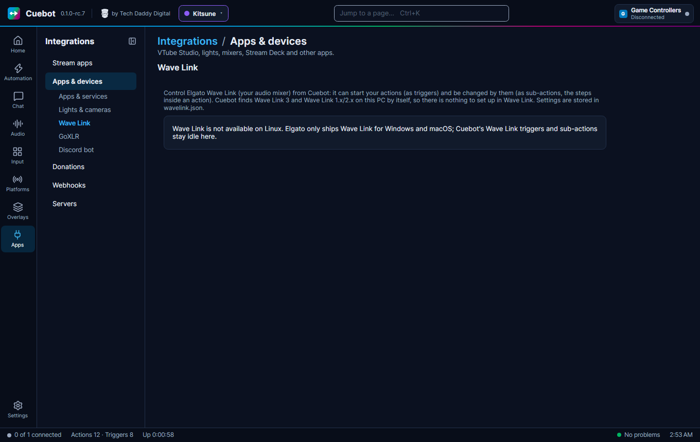

# Elgato Wave Link

**Wave Link** is Elgato's audio mixer program. It sorts the sounds on your computer into **channels** (like Mic, Game,
Music, Browser) and blends them into **mixes**: a mix is a blend of your channels sent to one place, such as your
stream or your headphones. Cuebot can mute channels, change volumes, switch effects and more, and start an action when
something changes in Wave Link. For example: when you mute your Music channel, show a "music off" sign on stream.

Cuebot works with both kinds of Wave Link:

- **Wave Link 3**, the new one.
- **Wave Link 1.x/2.x**, the older one (Cuebot calls it **legacy**).

## What you need

- **Windows or macOS.** Elgato only makes Wave Link for those. On Linux the page says **Wave Link is not available on
  Linux** and the Wave Link steps do nothing.
- Wave Link installed and open, on the same computer as Cuebot.
- Nothing to set up inside Wave Link, and no key or password.

## Set it up

1. Open Wave Link.
2. In Cuebot open **Apps > Apps & devices**, then **Wave Link** in the list on the left.
3. Leave **Version** on **Detect automatically** and **Port (0 = detect)** on `0`. (A **port** is the door number an
   app listens on. Cuebot finds Wave Link's door by itself.)
4. Click **Connect**.
5. Tick **Connect automatically on startup**, and **Keep looking while Wave Link is not running, and reconnect when it
   closes** if you often start Wave Link after Cuebot.

**How you know it worked:** the status says **Connected to Wave Link 3 on port …** (or **Wave Link 1.x/2.x**), and
**Detected** shows the version and port. The **Channels** card lists your channels and mixes with a volume slider and a
**Mute** button each, so you can try them right away. **Test** checks that Wave Link answers and says how fast.
**Monitor** next to a mix makes it the mix you hear in your own headphones.

With Wave Link 1.x/2.x the card is called **Inputs (volume = Monitor Mix)**: the older Wave Link has two fixed mixes,
**Monitor Mix** (your headphones) and **Stream Mix**, and the slider there changes the Monitor Mix.

## What Cuebot can do

In an action, click **+ Sub-action** or **+ Trigger** and search for **Wave Link**. Channels and mixes are picked by
the name Wave Link shows, like `Music` or `Stream Mix`. Volumes are 0 (silent) to 100 (full).

### Sub-actions (do this)

| Sub-action | What it does |
| --- | --- |
| **Mute channel** | Mutes, unmutes or toggles a whole channel. |
| **Set channel mix mute** | Mutes a channel in only one mix, for example music off on stream but still in your headphones. |
| **Set channel volume** / **Adjust channel volume** | Sets a channel's volume, or moves it up or down by an amount. Leave **Mix** empty for the whole channel. |
| **Mute mix** / **Set mix volume** / **Adjust mix volume** | The same for a whole mix. |
| **Set channel effect state** | Switches an effect on a channel on or off. |
| **Mute input device** | Mutes your microphone itself. |
| **Set input gain**, **Set input gain lock state** | How loud the microphone picks you up, and locking it. |
| **Set input Clipguard (stops crackling)**, **Set input low cut filter** | The microphone's built-in helpers. |
| **Set Mic/PC balance** | The balance of your voice and PC sound in your headphones. |
| **Set monitored mix**, **Set main output device**, **Set output volume** | What you listen to, and on which speakers or headphones. |
| **Add application to channel** | Sends a program's sound to a channel, like your game to **Game** (Wave Link 3 only). |
| **Add output to device mix** | Makes an output device play a chosen mix (Wave Link 3 only). |
| **Get channel information**, **Get mix information**, **Get input device information**, **Get selected output device** | Read the current state into variables for later steps. |

The legacy sub-actions (**Mute input**, **Set input volume**, **Mute microphone**, **Set microphone gain**, **Set
output volume**, **Set filter state** and more) are for people coming from older setups. Most of them also work with
Wave Link 3; their description says when one does not.

Full details: [Wave Link sub-actions](../../reference/sub-actions/wave-link.md) and
[Wave Link (legacy) sub-actions](../../reference/sub-actions/wave-link-legacy.md).

### Triggers (when this happens)

| Trigger | Runs when |
| --- | --- |
| **Connected** / **Disconnected** | Cuebot connects to Wave Link, or loses it (for example when you close Wave Link). |
| **Channel mute changed** | A channel, or one of its mixes, is muted or unmuted. **State** picks only muted, only unmuted, or any. |
| **Channel volume changed** | A channel's volume changes. |
| **Channel effects changed** | An effect on a channel is switched on or off, added or removed. |
| **Channel updated** | Anything about a channel changes (runs next to the more exact triggers). |
| **Mix updated** | A mix is muted, unmuted or its volume changes. |
| **Input device updated**, **Input gain changed**, **DSP effects changed** | Something about your microphone changes. |
| **Output device updated**, **Main output device changed**, **Output mix changed** | Something about your speakers or headphones changes. |
| **Channels changed**, **Mixes changed**, **Input devices changed** | Something was added or removed. |
| **Focused app changed** | The program in front changes, as Wave Link 3 sees it. |
| **Level meter updated** | Wave Link reports how loud things are. Off until you switch it on (see below). |

The [Wave Link (legacy) triggers](../../reference/triggers/wave-link-legacy.md) (**Input mute changed**, **Microphone
mute changed**, **Output switched** and more) only run with Wave Link 1.x/2.x. The ones above work with both.

Useful variables in **Channel mute changed**: `%waveLinkChannelName%`, `%waveLinkMuted%` (true or false),
`%waveLinkScope%` (`channel` for the whole channel, `mix` for one mix) and `%waveLinkMixName%`.

Full details: [Wave Link triggers](../../reference/triggers/wave-link.md).

### Level meters

Wave Link says how loud each channel is many times a second. That is a lot of events, so Cuebot ignores them until you
tick **Publish level meter events** in the **Level meters** card. **Events per second** (1 to 30) limits how often the
**Level meter updated** trigger can run. Leave it off unless an action needs it, for example a "you are loud" warning.

## Examples

**"Music off" sign.** Make an action called *Music sign*. Add the trigger **Wave Link > Channel mute changed** with
**Channels** `Music` and **Mixes** `Stream Mix`. Add an **If** step: **Value** `%waveLinkMuted%`, **Operator** `equals`,
**Compare to** `true`. Under **True** add the OBS step **Set source visibility** to show your sign; under **False**,
the same step to hide it.

**Music down while you talk to chat.** Make an action called *Quiet music*. Add **Set channel volume** with **Channel**
`Music`, **Mix** `Stream Mix`, **Volume** `20`. Make a second action *Loud music* with **Volume** `60`. Put both on
[deck buttons](decks.md).

**Mute your mic from a controller button.** Make an action with the trigger **Controller Button** (see
[Game controllers](game-controllers.md)) and the sub-action **Mute input device** with **State** `Toggle`.

## Troubleshooting

| You see | What to do |
| --- | --- |
| **Wave Link is not available on Linux** | Wave Link does not exist for Linux. Nothing to fix. |
| **Wave Link is not running (nothing answered on …)** | Open Wave Link. With **Keep looking…** ticked, Cuebot connects by itself as soon as it starts. |
| **…; retrying in 4 s** | Cuebot is waiting for Wave Link and tries again, waiting longer each time (up to 30 seconds). |
| **Wave Link closed the connection** | Wave Link was closed or restarted. Cuebot reconnects if **Keep looking…** is ticked. |
| **… is a Wave Link 1.x/2.x feature; the connected Wave Link 3 does not offer it.** (or **… needs Wave Link 3; …**) | That step only works with the other Wave Link. Pick a step that your Wave Link has; the step's description says which version it is for. |
| Cuebot finds the wrong program | Set **Version** to your Wave Link and type its port. Wave Link 3 usually uses a port from 1884, the older one from 1824. |

!!! warning "Experimental"
    Wave Link has only been checked by Cuebot's own tests, with a pretend Wave Link. Nobody has tried a real Wave Link
    yet. Please try it before you rely on it on stream: connect, mute a channel, change a volume. See
    [What's experimental](../help/experimental.md).

## How it works (for the curious)

Wave Link runs a small local server that Elgato's own Stream Deck plugin talks to: JSON messages over a **WebSocket**
(a connection that stays open both ways) on `127.0.0.1`, this computer only. Wave Link 3 writes its port into a file;
Cuebot reads it, and otherwise tries ports 1884 to 1893 (Wave Link 3) and 1824 to 1834 (Wave Link 1.x/2.x) at the same
time and keeps the one that answers like Wave Link. Elgato publishes no documentation for it, so Cuebot follows what
open-source tools found out. Settings are stored in `wavelink.json` in Cuebot's data folder.
