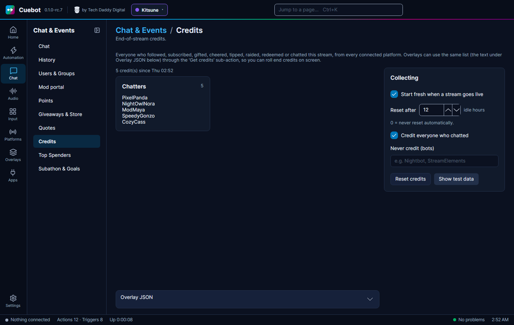
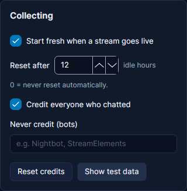

# Credits

**Credits** are a thank-you list at the end of your stream, like the end of a film. Cuebot collects everyone who
helped, and your actions can use the list.

**Chat > Credits** collects everyone who followed, subbed, tipped, raided or chatted during your stream. The
**Get credits** sub-action reads that list into variables, for example for a "thanks to everyone" chat message, and
**Add to credits** puts in anyone else, like a "Special thanks" line. See the
[credits sub-actions](../../reference/sub-actions/credits.md).

!!! note "The Credits roll widget is separate"
    The **Credits roll** overlay widget does not read this list. It makes its own from the stream totals (this
    stream's followers, subscribers, tippers, cheerers and raiders), so **Never credit**, **Reset credits** and
    **Show test data** here do not change it. See [Credits roll](../overlays/widgets/credits-roll.md).

## Settings

- **Start fresh when a stream goes live** (ticked at first) clears the list each stream.
- **Reset after** … idle hours (12 at first) empties the list after that many hours with no new
  events. 0 means never.
- **Credit everyone who chatted** (ticked at first): untick it to leave out people who only wrote in chat.
- **Never credit (bots)**: names that never appear, like `Nightbot`.
- **Reset credits** empties the list now.
- **Show test data** fills it with pretend names, so you can see how it looks.
