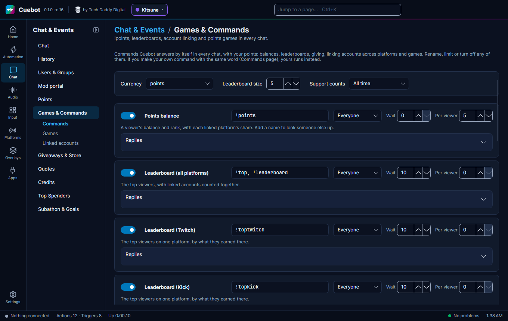
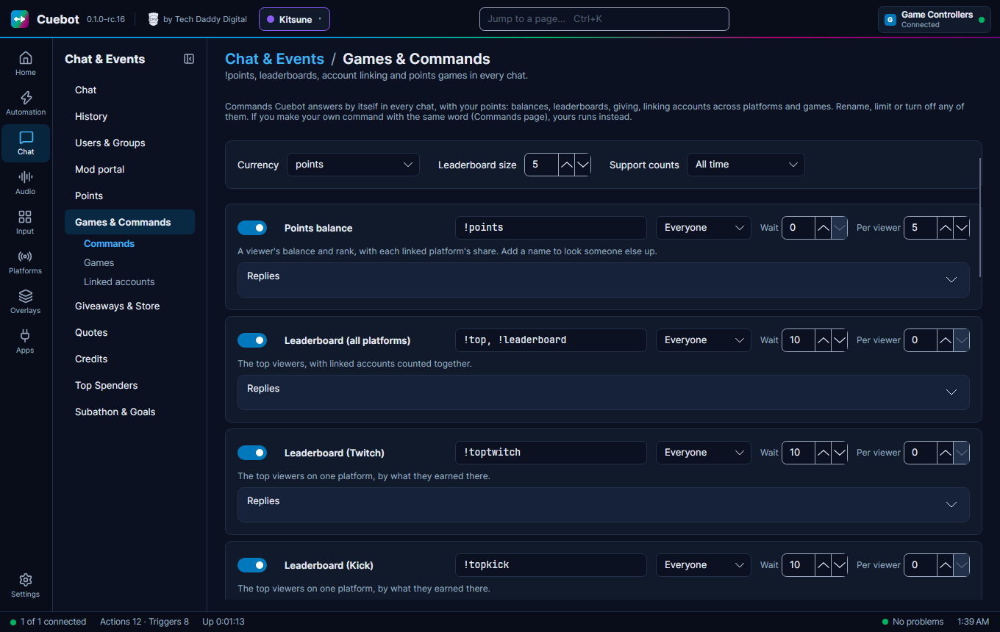
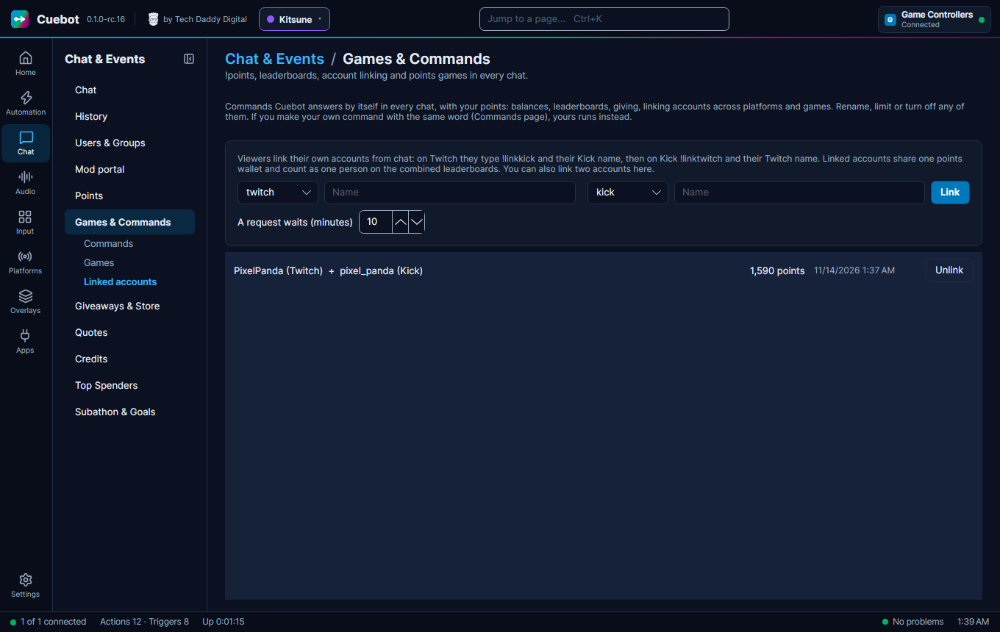
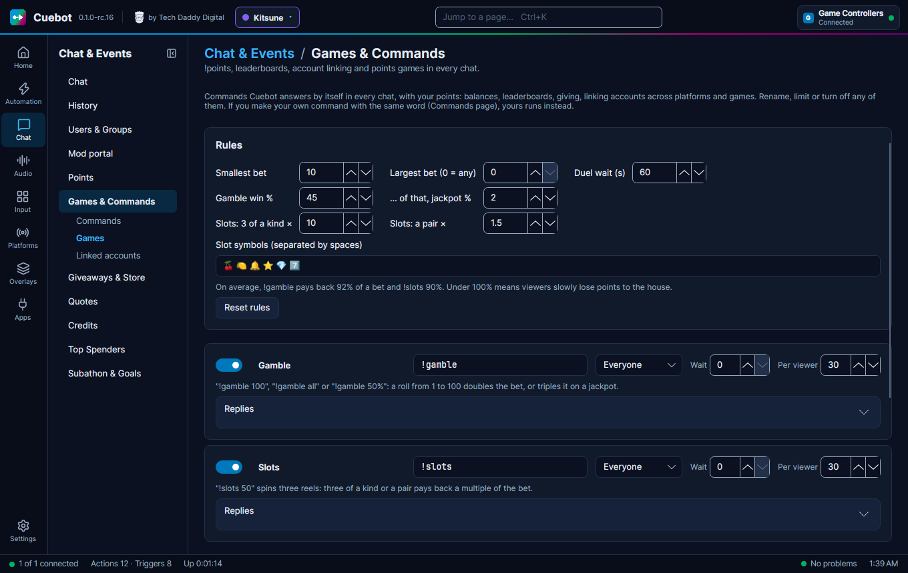

# Games and commands

Cuebot answers a set of **chat commands by itself**, in every chat (Twitch, YouTube, Kick and Rumble), right after you
install it. Viewers can check their [points](points.md), see the leaderboards, give points away, link their accounts
across platforms and play games. You do not need to make actions for any of them.

Go to **Chat > Games & Commands**. It has three tabs: **Commands**, **Games** and **Linked accounts**.

## The commands

| Command | What viewers type | What Cuebot says | On at first |
| --- | --- | --- | --- |
| Points balance | `!points`, `!points bob` | `alice has 1,250 points (rank #3) · Twitch 1,000 · Kick 250` | yes |
| Leaderboard (all platforms) | `!top`, `!leaderboard` | `Top points: 1. alice 1,250 · 2. bob 900 · …` | yes |
| Leaderboard (one platform) | `!toptwitch`, `!topkick`, `!topyt`, `!toprumble` | `Top Twitch points: 1. bob 900 · …` | yes |
| Give points | `!give bob 50` | `alice gave 50 points to bob. alice now has 1,200 points.` | yes |
| Link an account | `!linktwitch`, `!linkkick`, `!linkyt`, `!linkrumble` + your name there | See [Linking accounts](#linking-accounts) | yes |
| Unlink an account | `!unlink kick`, or `!unlink` | `alice, your Kick account is unlinked.` | yes |
| Support total | `!support`, `!support bob` | `alice has supported the stream with $52.30: 1,200 bits, 3 gifted subs, $25.33 in Super Chat. Thank you!` | **no** |
| Top supporters | `!topsupporters` | `Top supporters: 1. alice $52.30 · 2. bob $20.00` | **no** |
| Gamble | `!gamble 100`, `!gamble all`, `!gamble 50%` | `alice rolled 87 and won 100 points! Now 1,350 points.` | yes |
| Slots | `!slots 50` | `[ 🍒 🍒 🔔 ] alice got a pair and won 25 points. Now 1,275 points.` | yes |
| Duel | `!duel bob 100`, then bob types `!accept` | `bob beat alice in a duel and won 100 points!` | yes |

Wherever a command takes an amount, viewers can type a number (`250`, `1,500`, `2k`), `all`, or a part of their
balance like `50%`.

The **support** commands are off at first because they show how much money people gave. Turn them on if you want a
money leaderboard in chat. They use the [Top spenders](top-spenders.md) list and its prices for bits, Kicks and subs.
**Support counts** sets the period they add up (all time at first, or this stream, this week…).

### Changing a command

Each command has a card:

- **The switch** turns it on or off.
- **The words** that run it. Put several with commas, like `!top, !leaderboard`. Rename `!points` to `!cookies` if
  your money is called cookies.
- **Who may use it**: Everyone, or only Subscribers, VIPs, Moderators or the Broadcaster (you).
- **Wait**: seconds before anyone can use it again. **Per viewer**: seconds before the same person can use it again.
  `!top` waits 10 seconds at first, so chat does not fill up with leaderboards.
- **Replies**: what Cuebot says, one line per situation (`self`, `unknown`, `win`, `lose`…). Words in braces are
  filled in: `{user}` is who typed it, `{balance}` their points, `{target}` the person they named, and so on. Leave a
  line empty and Cuebot says nothing in that case. **Reset replies** puts them back.

Above the cards, **Currency** picks which of your [currencies](points.md#the-name-of-your-money) the commands and games
use, and **Leaderboard size** how many people the leaderboards list.

### Your own command wins

If you make a command on **Automation > Commands** with the same word, like your own `!points`, your command runs and
Cuebot stays quiet for that word. Nothing you made before stops working.

## Linking accounts

Many viewers watch on more than one platform. Linking puts their accounts in **one wallet**: their points add up,
they can spend them anywhere, and they are one person on `!top` and `!topsupporters`. What they earn still lands on
the platform where they earned it, so `!toptwitch` and the other platform boards stay fair.

Both accounts have to agree, so nobody can link someone else's account:

1. On Twitch, alice types `!linkkick alice_k` (her name on Kick).
2. Cuebot answers: *alice, to finish: as alice_k in Kick chat, type !linktwitch alice within 10 minutes.*
3. On Kick, alice_k types `!linktwitch alice`.
4. Both chats see: *Linked! alice (Twitch) + alice_k (Kick) now share 1,250 points.*

It works in either order, and a viewer can link all four platforms one at a time. A wallet holds one account per
platform: to switch to another Kick account, `!unlink kick` first.

When a viewer spends, Cuebot takes the points from the platform they are typing on first, then from their other
accounts. `!unlink kick` takes the Kick account out again; each account keeps the points that are in it then.

### Linking by hand

On the **Linked accounts** tab you see every linked viewer with their total. **Unlink** separates them again. To link
two accounts yourself (for a viewer who asks you), pick the two platforms, type both names and click **Link**. Both
accounts must have chatted before, so Cuebot knows them. **A request waits** sets how many minutes a viewer has to
finish a link from the other chat.

## Games

Games let viewers bet the points they earned. Points are not money, and nobody can buy them, so these are just for fun.

### Gamble

`!gamble 100` rolls a number from 1 to 100:

- **Rolls above 55** (a 45% chance): the bet doubles. alice bets 100, gets 200 back, and is 100 up.
- **Rolls above 98** (2% of those): **jackpot**, the bet triples.
- **Anything else**: the bet is lost.

### Slots

`!slots 50` spins three reels of symbols (`🍒 🍋 🔔 ⭐ 💎 7️⃣`):

- **Three of a kind** pays back 10 times the bet.
- **A pair** pays back 1.5 times the bet.
- **Nothing matching**: the bet is lost.

### Duel

`!duel bob 100` challenges bob on the same platform. bob has 60 seconds to type `!accept`. Then both bets are taken, a
coin flip picks the winner, and the winner gets both. If bob does not answer in time, nothing happens and nobody pays.

### The rules

On the **Games** tab:

| Setting | Starts at | Means |
| --- | --- | --- |
| **Smallest bet** | 10 | The fewest points a viewer can bet. |
| **Largest bet (0 = any)** | 0 | The most a viewer can bet at once. 0 means no limit, so `!gamble all` works. |
| **Duel wait (s)** | 60 | How long a duel waits for `!accept`. |
| **Gamble win %** | 45 | The chance that `!gamble` pays out. |
| **… of that, jackpot %** | 2 | The chance of a jackpot (triple instead of double). |
| **Slots: 3 of a kind ×** | 10 | What three matching reels pay back, times the bet. |
| **Slots: a pair ×** | 1.5 | What two matching reels pay back, times the bet. |
| **Slot symbols** | 🍒 🍋 🔔 ⭐ 💎 7️⃣ | The reels' pictures. Fewer symbols make matches more likely. |

Under the rules, Cuebot works out how much each game pays back on average. At first `!gamble` pays back about 92% of
bets and `!slots` about 90%, so the house slowly wins and points stay worth something. Over 100% means viewers win
points on average. **Reset rules** puts everything back.

Each game also has a **Per viewer** wait (30 seconds at first), so one person cannot fill your chat with spins.

