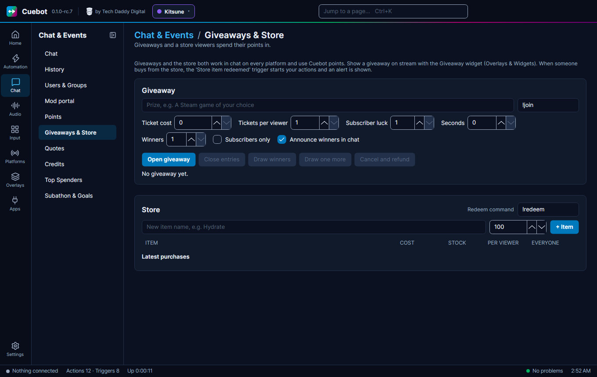

# Giveaways

A **giveaway** lets viewers enter in chat for a chance to win a prize. Entering can be free, or cost
[Cuebot points](points.md). It works in chat on **every platform** at once.

Go to **Chat > Giveaways & Store**. The giveaway is the top part of the page; the [store](store.md) is below it.

## Run a giveaway

1. Type the **Prize**, like `A Steam game`.
2. The join command (the box that shows `!join`) is what viewers type to enter. `!join 3` buys 3 tickets.
3. Set **Ticket cost** (0 for free), **Tickets per viewer**, how many **Winners**, and **Seconds** (how long entries
   stay open; 0 keeps them open until you click **Close entries**).
4. Optional: **Subscribers only**, **Subscriber luck** (better odds for subs), **Announce winners in chat**.
5. Click **Open giveaway**.
6. When it is time, click **Close entries**, then **Draw winners**. Winner not here? **Draw one more**.

**Cancel and refund** stops it and gives everyone their points back. Click it twice: the first click only asks you to
click again within 5 seconds.

## Show it on stream

Show it on stream with the [**Giveaway** widget](../overlays/widgets/giveaway.md) on your [overlay](../overlays/overlays.md).
