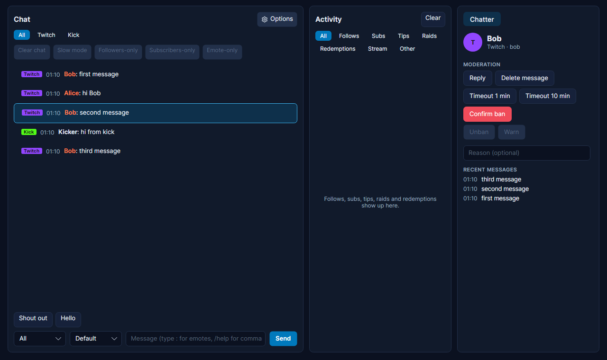
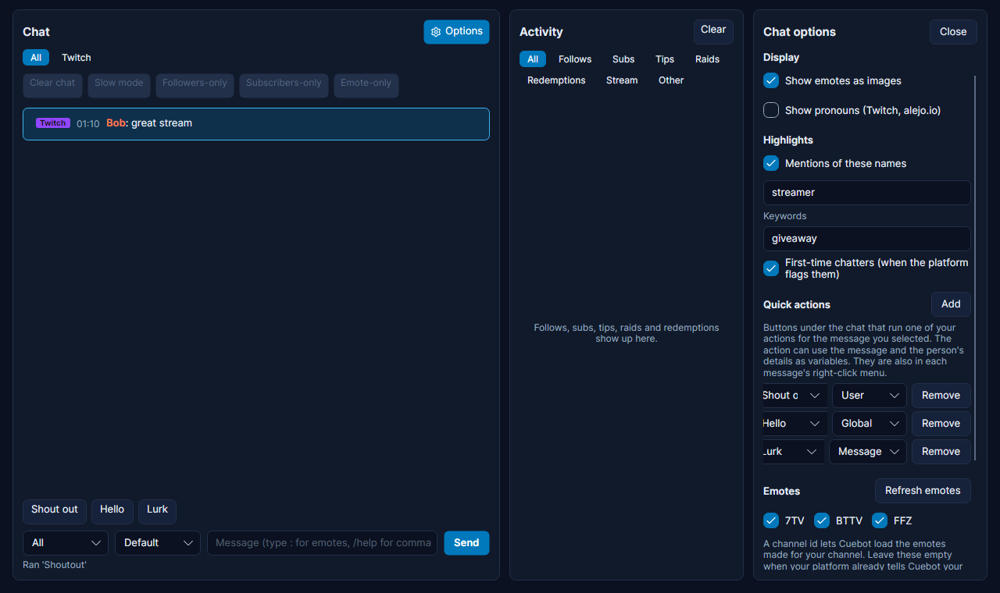

# Chat and community

These features give your viewers something to do: type commands, collect points, spend them, win giveaways, vote in
polls and save funny quotes. They live under **Chat** in the left rail, and they work on **every platform** at once.

## What's in here

- [Chat commands](commands.md): make `!words` your viewers type to start an action.
- [Points](points.md): your own channel money that viewers earn by watching and chatting.
- [Games and commands](games-and-commands.md): `!points`, leaderboards, linking accounts across platforms, and games
  like `!gamble`, all answered by Cuebot itself.
- [Giveaways](giveaways.md): let viewers enter in chat and draw a winner.
- [The store](store.md): let viewers spend points on things you offer.
- [Polls and predictions](polls-and-predictions.md): let chat vote, or bet points on what happens.
- [Quotes](quotes.md): save funny things said on stream and bring them back.
- [Credits](credits.md): a thank-you list that scrolls at the end of your stream.
- [Top spenders](top-spenders.md): see and show who supported you the most.
- [Stream data](stream-data.md): the latest follower, sub and tip and the totals your overlays show, and how to fix them.
- [Users and groups](users-and-groups.md): the viewers Cuebot knows, and groups that get special rights.
- [Moderating your chat](moderation.md): delete, time out, ban, warn and chat modes on every platform, and the mod log.
- [Linked accounts and linked bans](identity-links.md): when one viewer chats on several platforms (off by default).

## The chat page

**Chat > Chat** shows the chat of every platform you are signed in to, in one list. It has three parts:

| Part | What it shows |
| --- | --- |
| **Chat** (left) | Every message, with the platform in front. Type in the box at the bottom to write in chat. |
| **Activity** (middle) | Follows, subs, tips, raids and redemptions. The buttons on top show one kind only. **Clear** empties the list; it deletes nothing on your channel. |
| **Chatter** (right) | Click a message, and this shows who wrote it, their recent messages, and what you can do to them. |

Is the Cuebot window narrow? Then **Activity** moves into a tab next to **Chatter**.

Next to **Chatter** there is a **Mod log** tab, and on Twitch also **Held** and **Mod tools**. See
[Moderating your chat](moderation.md).

**Writing in chat:** type your message and press ++enter++ (or click **Send**).

- The first list next to the box picks **where** it goes: one platform, or **All** connected ones.
- The second list picks **who** posts it: **Default**, **Broadcaster** (you) or **Bot** (your bot account, when one
  is signed in).
- Type `:` to pick an emote, or `/help` to see the slash commands.

### Chat options

Click **Options** (top right of the chat) to change how the chat looks and add your own buttons. **Close** hides the
options again.

| You want | Do this |
| --- | --- |
| Emotes as little pictures, not words | Tick **Show emotes as images** (under **Display**). |
| Bigger or smaller chat text | Set **Chat text size** (under **Display**), from 10 to 28. The default is 13. |
| To see he/she/they next to names | Tick **Show pronouns (Twitch, alejo.io)**. It shows what the viewer set on alejo.io, a pronoun website. |
| To notice when someone says your name | Tick **Mentions of these names** and type your names, like `kris, krisbot`. Those messages get a colour. |
| To notice a word, like `giveaway` | Type it under **Keywords**. Separate words with commas. |
| To say hello to new people | Tick **First-time chatters (when the platform flags them)**. Their first message gets a colour. |
| A button that runs one of your actions | Under **Quick actions**, click **Add**, then pick the action and when the button works. The buttons show under the chat, and in each message's right-click menu. |
| Emotes from 7TV, BTTV or FFZ | Tick them under **Emotes**. **Refresh emotes** downloads the lists again after you add new emotes. |

**Example:** a quick action called **Shout out** that runs your shout-out action. Click a message, then click
**Shout out**, and the action gets that person's name.

The **Moderation** part of the options turns on [linked accounts](identity-links.md). It is off by default.
