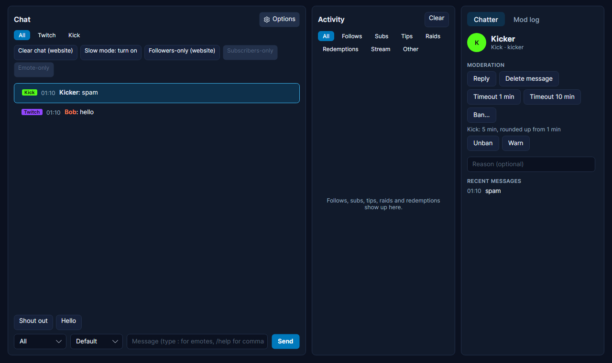
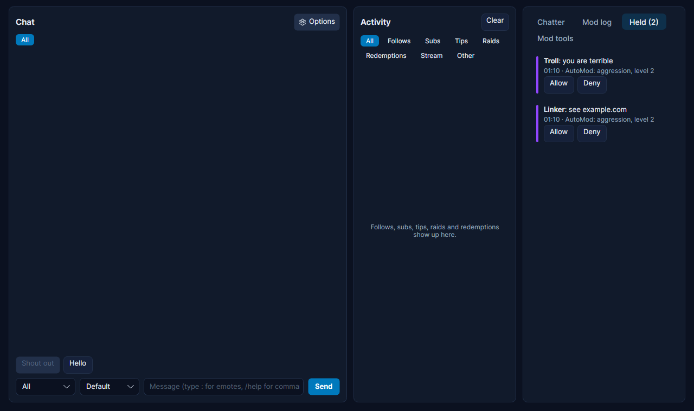
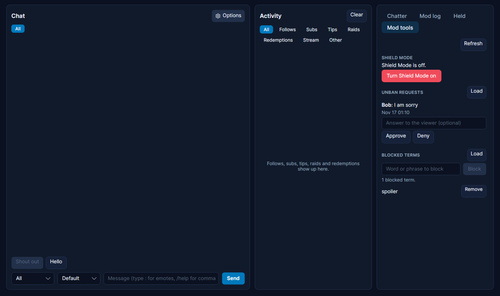
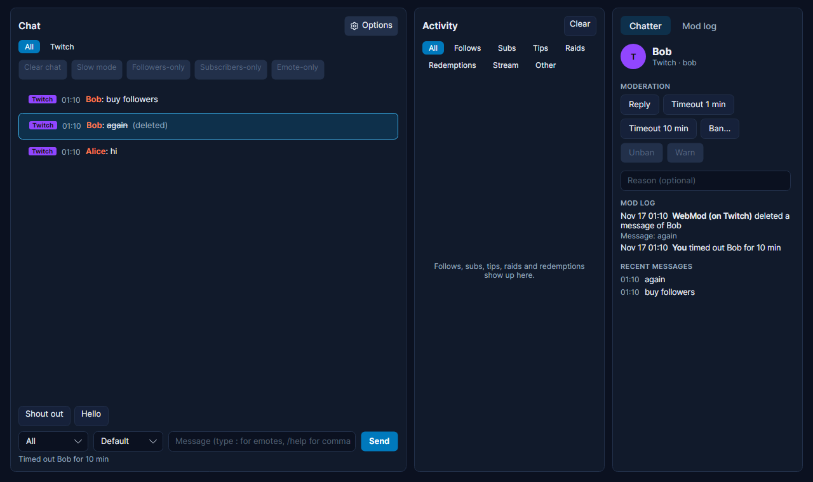

# Moderating your chat

**In short:** you can delete messages, time people out and ban them on Twitch, YouTube, Kick and Rumble, all from the
**Chat** page. Cuebot writes down everything that happened in a **mod log**.

Not every platform can do the same things. That is fine: every button tells you what it will do on that platform
before you click it.

## The buttons

Click a message. The **Chatter** tab on the right shows who wrote it and what you can do:

| Button | What it does |
| --- | --- |
| **Delete message** | Removes this one message for everyone. |
| **Timeout 1 min**, **Timeout 10 min** | Stops the person chatting for that long. |
| **Ban…** | Stops the person chatting for good. Click once: it turns into **Confirm ban**. Click again to do it. |
| **Unban** | Lifts a ban or a timeout. |
| **Warn** | Warns the person. |
| **Reason (optional)** | Why you did it. It goes in the mod log. Twitch and Kick also show it to their moderators. |

**Buttons for the whole chat** sit above the chat: **Clear chat**, **Slow mode**, **Followers-only**,
**Subscribers-only** and **Emote-only**. They work on one platform at a time:

- the platform of the message you clicked, or
- the platform you picked in the buttons above the chat (**All**, **Twitch**, **Kick**…).

A chat mode button switches the mode on, like **Slow mode: turn on**. After that it offers to switch it off again.

### What each platform can do

Not every platform can do everything. Hold the mouse over a button to see what it does there:

- **Works**: the platform does it.
- **Closest equivalent**: it does something similar, and says how it differs. For example, Kick counts timeouts in
  whole minutes, so a timeout of 30 seconds becomes 1 minute. When that happens, the line under the timeout buttons
  says so.
- **(website)**: the platform has no way for apps to do it. The button opens the platform's own page, where you do it
  yourself. Example: **Clear chat (website)** on Kick.
- Greyed out: the platform has no such feature, or you need to sign in again and allow it. The tooltip says which.

| Button | Twitch | YouTube | Kick | Rumble |
| --- | --- | --- | --- | --- |
| Delete message | Works | Works (costs 20 quota units) | Works | Website (or see below) |
| Timeout | Works, 1 second to 14 days | Works, while you are live | Whole minutes, 1 minute to 7 days | Website (or see below) |
| Ban | Works | Works, while you are live | Works | Website (or see below) |
| Unban | Works | Only bans made from Cuebot | Works | Website |
| Warn | Works | A chat message to the viewer | A chat message to the viewer | Not available |
| Clear chat | Works | Not available | Website (type `/clear`) | Not available |
| Chat modes | Works | Slow and members-only on YouTube Studio | Website | Slow and subscribers-only on the website |
| Held messages, Shield Mode, suspicious chatters, unban requests, blocked terms | Works (see below) | Not available | Not available | Not available |

**Warn** on YouTube and Kick posts a chat message like "@Bob Warning from the mods: no spoilers". These platforms have
no real warnings. You can switch this off in `moderation.json` (`"SoftWarnings": false`).

After each click, the line under the send box says what happened: "Timed out Bob for 10 min", or what went wrong.

## Messages others delete

When a mod deletes a message on the platform's website, Cuebot crosses it out too. When someone is banned or timed
out, their name card says so. This works on Twitch, YouTube and Kick, and on Rumble for deleted messages.

Some messages have no platform id, for example Rumble chat read from the key link. Cuebot cannot delete those, so it
does not offer **Delete message** for them.

## Twitch: held messages, Shield Mode and more

Twitch has more moderation tools than the other platforms. On the Chat page you find them in two extra tabs, **Held**
and **Mod tools**, and on the **Chatter** tab.

### Held messages

Twitch's AutoMod (and your blocked terms) can hold a message back before anyone sees it. Think of it as a waiting
room: the message waits there until a mod says yes or no.

1. Open the **Held** tab. Its name shows how many wait, like **Held (2)**. The oldest is on top.
2. Each message says why it was held, like "AutoMod: aggression, level 2" or "Blocked term".
3. Click **Allow** to let it into the chat, or **Deny** to keep it out. Denying does not punish the viewer.

When a mod decides on Twitch's website, the line says who.

### Mod tools

The **Mod tools** tab has three tools. **Refresh** reads them all again from Twitch.

- **Shield Mode** is Twitch's emergency switch, for example during a hate raid. It turns on the strict settings you
  chose on Twitch. The tab shows whether it is on and who turned it on. Click **Turn Shield Mode on**, and later
  **Turn Shield Mode off**.
- **Unban requests**: banned viewers can ask to be unbanned. Click **Load** to see the waiting ones. Write an answer if
  you like ("One more chance, please follow the rules"). Then click **Approve** (the ban is lifted) or **Deny**.
- **Blocked terms**: words and phrases Twitch keeps out of your chat. Click **Load** to see them. Type a new one and
  click **Block**, or click **Remove** next to one. `*` works as a wildcard: `spoil*` blocks `spoiler` and `spoils`.

### Suspicious chatters

On the **Chatter** tab, Twitch messages get three more buttons:

- **Monitor**: the person's messages still show, marked for mods.
- **Restrict**: only mods see their messages.
- **Not suspicious**: removes the mark.

Twitch also marks people by itself, for example a likely ban evader. Their messages show **[suspicious]** in the chat,
and the Chatter tab says why ("suspicious: monitored (likely ban evader)").

![A restricted Twitch chatter: [suspicious] in front of their messages, and Monitor, Restrict and Not suspicious on the Chatter card](../../assets/screens/chat-suspicious-users.png)

### Missing permission?

These tools need Twitch permissions that you may not have given Cuebot yet. A greyed-out tool then says which one,
like "Sign in to Twitch again and allow ...". To fix it:

1. Go to the **Twitch** page.
2. On the **Settings** tab, tick the permission (or click **Request everything**).
3. Sign in again on the **Accounts** tab.

## The mod log

The **Mod log** tab is a diary of moderation. It lists every ban, timeout, unban, deletion, warning and chat mode
change, with:

- **who** did it: you, a mod from the [mod portal](../mods/mod-portal.md), an action, or a mod on the platform's
  website;
- **to whom**;
- **why** (the reason).

The **Chatter** tab shows the same rows for the person you clicked, under **Mod log**.

**On Twitch** the log also lists what mods do on Twitch itself, with their name: bans, timeouts, unbans, deletions,
warnings, chat modes, Shield Mode, VIPs and moderators added or removed, raids, blocked terms, unban request answers,
held messages they allowed or denied, and actions in other channels of a shared chat. Your own actions from Cuebot
are listed once, even though Twitch reports them back too.

**Where it is kept:** in a file on your computer (`modlog.db` in your data folder). It is part of your
[backups](../help/backups.md) and is never sent anywhere. Each row is linked to the one before it, so a changed or
missing row can be noticed.

**Old rows are cleaned up by themselves.** Cuebot removes personal details after a while:

| What | Removed after |
| --- | --- |
| The text of a deleted message | 60 days |
| Who was timed out, warned or had a message deleted | 180 days |
| Who was banned | 24 months after the ban was lifted. A ban that is still in place keeps its row. |

You can make these shorter (never longer) in `moderation.json` in your data folder: `MessageTextDays`, `TimeoutDays`
and `BanMonthsAfterEnd`.

## YouTube quota

YouTube gives every app a daily allowance, called **quota**. It resets at midnight Pacific time. Every YouTube action
uses some of it: deleting a message costs 20 units; a ban, a timeout or an unban costs 200. The chat page shows how much is left when you work
on YouTube.

Cuebot keeps some quota back so your chat keeps arriving. Moderation stops when less than **Units moderation must
leave for reading chat** is left (2,000 at first; change it on the **YouTube** page under **Polling and quota**). For
more quota, use your own Google project: see **Advanced: use my own Google Cloud project** on the YouTube page.

YouTube can only lift a ban when it knows the ban's id. Cuebot keeps that id in the mod log. So **Unban** works for
bans you made from Cuebot, even after a restart. Lift other bans in YouTube Studio.

## Rumble

Rumble has no official way for apps to moderate chat. At first, the buttons open your Rumble chat, where you do it
yourself.

There is an experimental way around this. On the **Rumble** page, under **Moderation (experimental)**, tick **Rumble
moderation through unofficial endpoints**. Cuebot then deletes messages and mutes viewers itself. It uses the same web
addresses Rumble's own chat uses, with your chat sign-in.

- A timeout becomes a 5-minute mute. Anything longer mutes until the stream ends.
- A ban becomes a permanent mute.
- Unmute viewers on Rumble's website.

!!! warning
    Rumble's terms do not allow automated use of its website without Rumble's written permission. Rumble could act
    against your account, and the addresses can change without notice. Use it at your own risk.

## Sending as your bot

The list next to the platform picker in the send box chooses who posts your message:

- **Default**: each platform's own setting.
- **Broadcaster**: your channel.
- **Bot**: your bot account. It is offered only when a bot account is signed in on that platform (Twitch, YouTube or
  Kick).

## Mods and safety

Mods who moderate from the mod portal act with your account. So Cuebot adds a few safety rules:

- They cannot time out or ban you, platform moderators or VIPs, other portal mods, or your bot accounts. Only you can.
- Each mod can make at most 10 bans and 30 timeouts in 10 minutes.
- On Twitch and Kick their name goes in front of the reason, like `[mod: Sam] spam`. That way the platform's own log
  shows who it was.

## Linked accounts

Some viewers chat on several platforms. You can link their accounts, keep notes on them, and ban or time out all of
them at once, with a preview first and one **Undo**. This is off by default while its privacy side is being reviewed:
see [Linked accounts and linked bans](identity-links.md).
