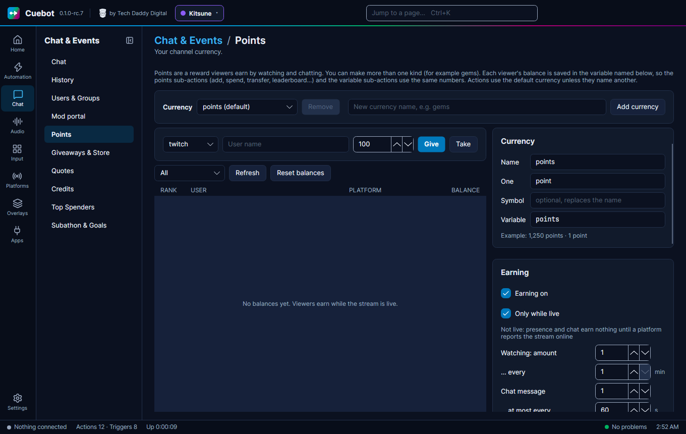
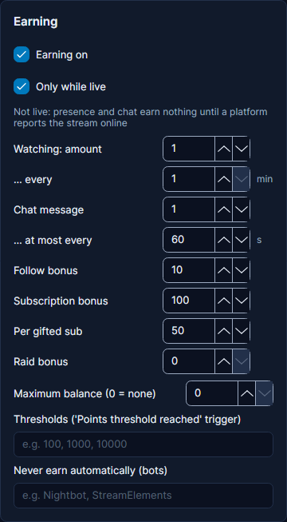
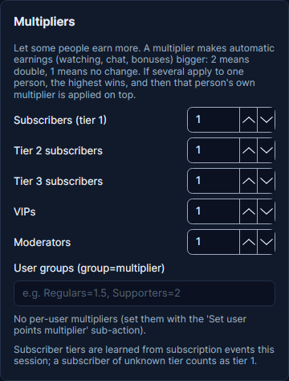

# Points

**Points** are your own channel money. Viewers earn them by watching and chatting, and spend them in your store, on
giveaways and on bets. They are Cuebot's own points, not Twitch channel points, and they work on **every platform** at
once.

Go to **Chat > Points**.

## How viewers earn points

Under **Earning** (these are the starting values; change any of them):

| Setting | Starts at | Means |
| --- | --- | --- |
| **Earning on** | on | Points are handed out at all. |
| **Only while live** | on | Only while you stream. |
| **Watching** | 1 every 1 min | Viewers who are watching get 1 point a minute. |
| **Chat message** | 1, at most every 60 s | Chatting gives a point, but not more than once a minute. |
| **Follow bonus** | 10 | Extra points for following. |
| **Subscription bonus** | 100 | Extra points for subscribing. |
| **Per gifted sub** | 50 | For each sub someone gifts. |
| **Raid bonus** | 0 | For raiding you. |
| **Maximum balance (0 = none)** | 0 | The most points one viewer can have. 0 means no limit. |

**Multipliers** give some viewers more: for example set **VIPs** to `2` and VIPs earn double. You can also set a
multiplier per group, like `Regulars=1.5`.

**Never earn automatically (bots)**: list your bots here so they do not collect points.

## The name of your money

Under the currency, set **Name** (like `cookies`), **One** (like `cookie`) and a **Symbol**. **Add currency** makes a
second kind of money if you want one.

## Giving and taking by hand

Pick the platform, type the **User name** and an amount, then click **Give** or **Take**.

The leaderboard below lists everyone, with **Refresh** and **Reset balances** (click twice to be sure).

## A `!points` command

Cuebot does not add chat commands for you. You make them, so you choose the words. For `!points`:

1. Make a `!points` command (see [Chat commands](commands.md)) and an action with a **Command triggered** trigger.
2. Add the **Get points** sub-action. It looks up the name typed after the command (`!points bob`), or the person who
   typed it when there is no name. Look at its **Variables this adds for the next steps** to see the name of the
   balance variable.
3. Add **Send chat message (any platform)** that uses that variable, like `%user%, you have ... points!`

Other points sub-actions include **Add points**, **Remove points**, **Transfer points** (for a `!give bob 50`
command) and **Get points leaderboard**. The trigger **Points threshold reached** runs when someone reaches an amount
you set under **Thresholds**.

## Spending points

- [Giveaways](giveaways.md): tickets can cost points.
- [The store](store.md): viewers buy things you offer.
- [Polls and predictions](polls-and-predictions.md): viewers bet points on what happens next.

!!! note "Not the same as goal ladder points"
    A [goal ladder](../services/goals.md) counts its own points, from subs, bits, tips and other events. Your viewers'
    Cuebot points do not go into it.
