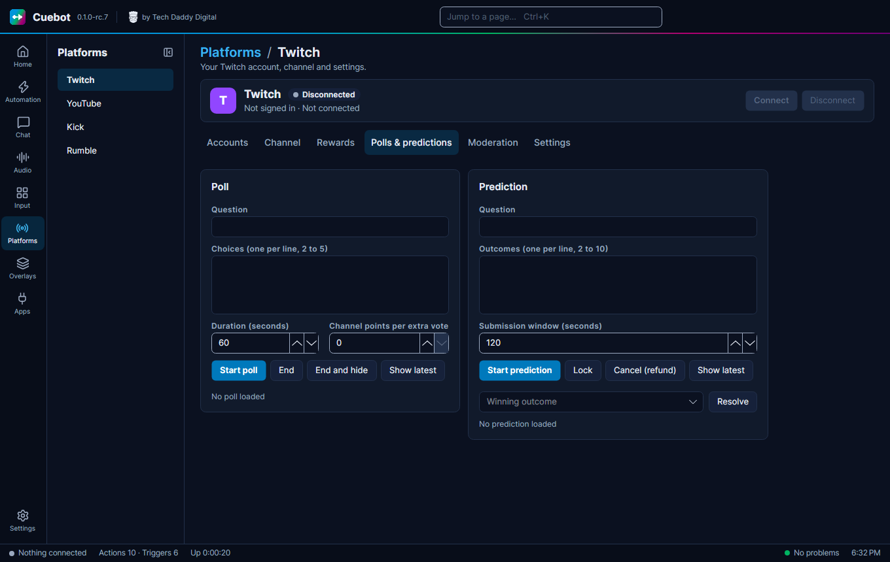

# Polls and predictions

A **poll** lets chat vote on a question, like "Which game next?". A **prediction** lets viewers bet points on what
happens, like "Will I beat the boss?". Cuebot can run both in chat on every platform, or use Twitch's own.

## On every platform

Go to **Overlays > Overlays & Widgets** and open **Chat poll and prediction (every platform)**. It runs a poll in chat
on every platform at once.

- **Poll**: type a question and choices, then **Start poll**. Viewers vote with `!vote 1`, `!vote 2` and so on.
  **End poll** finishes it.
- **Prediction (Cuebot points)**: type a question and the outcomes, then **Start**. Viewers bet
  [points](points.md) with `!bet 1 500` (or `!bet 1 all`). Click **Lock bets** when the game starts, then pick the
  **Winner** and **Pay out**. Winners share the whole pot, by how much they bet. **Cancel** gives everyone their
  points back.

Both have a time in seconds. 0 keeps voting (or betting) open until you click **End poll** (or **Lock bets**).

## Show it on stream

Show it with the **Poll and prediction** widget on your [overlay](../overlays/overlays.md).

## Twitch's own polls

**Platforms > Twitch**, tab **Polls & predictions**, uses Twitch's built-in polls and predictions (with Twitch channel
points). Fill in **Question** and the choices (one per line), then **Start poll** or **Start prediction**. To finish a
prediction, click **Lock**, type the **Winning outcome** and click **Resolve**. **Cancel (refund)** gives the channel
points back.
