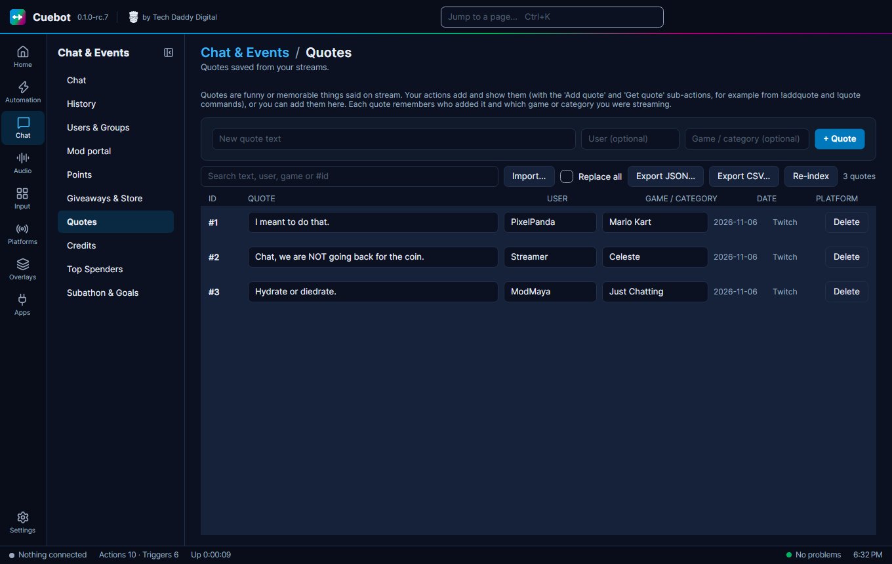

# Quotes

Something funny said on stream? Save it as a **quote**, so you and your chat can bring it back later with a `!quote`
command.

Go to **Chat > Quotes**.

## Add and find quotes

- Type the quote in **New quote text**, optionally the **User** who said it and the game, then click **+ Quote**.
- Search with the search box, or by number like `#12`.
- **Re-index** numbers the quotes 1, 2, 3… again, closing the gaps left by deleted quotes. Quote numbers people
  remember will change.

## Move quotes in and out

**Import…** and **Export JSON…** / **Export CSV…** move quotes in and out. Tick **Replace all** before you import to
throw away your current quotes and keep only the file's; unticked, the file's quotes are added to yours.

## Quotes in chat

For chat, make your own `!quote` and `!addquote` commands (see [Chat commands](commands.md)) with the **Get quote**
and **Add quote** sub-actions.
