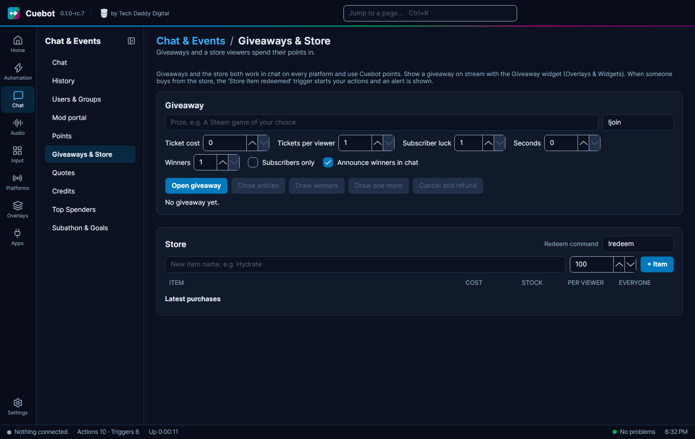

# The store

The store lets viewers spend their [Cuebot points](points.md) on things you offer, like "Pick my next game" or "I do
10 push-ups". It works in chat on **every platform** at once.

Go to **Chat > Giveaways & Store**. The store is below the [giveaway](giveaways.md) part of the page.

## Add an item

1. Type a **New item name** and its cost, then click **+ Item**.
2. Set **STOCK** (how many there are; `-1` means no limit), and cooldowns: **PER VIEWER** and **EVERYONE**, in seconds.
3. Tick **Needs approval** if you want to say yes or no first.

Each item also has a **Description (optional)** for viewers, **Available** (untick it to stop sales for now) and
**Subscribers only**.

## How viewers buy

Viewers type `!redeem` and the item name, like `!redeem push-ups`. Want a different word? Change the **Redeem command**
box at the top of the store.

Items that need approval wait under **Waiting for approval**. Click **Approve**, or **Reject (refund)** to give the
points back. **Latest purchases** shows what was bought.

## Make something happen

To make something happen when an item is bought, add the **Store item redeemed** trigger to an action (see
[How actions work](../actions/how-actions-work.md)).
