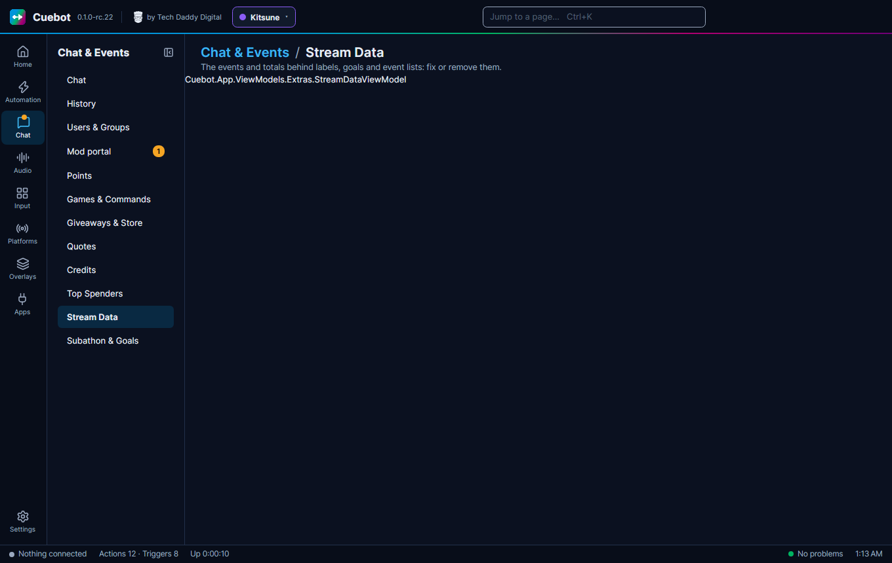

# Stream data

**Stream data** is Cuebot's memory of your stream events. Your labels, goal bars, event lists and custom widgets read
from it:

- the latest follower, sub, tip and cheer;
- the recent lists;
- counts and amounts for this stream, this week, this month and all time;
- the top donation and top donator for each.

**Chat & Events > Stream Data** lets you look at it and fix it. **Example:** you pressed a test button, and now a fake
$500 tip is your "top donation". Remove that event here, and the real top tip comes back.

## The stored events

The list shows every event Cuebot counted, newest first: when, what kind, who, the platform and the amount. Use the
boxes at the top to show only one type, one platform, a name, a date range (like `2026-11-17`), or **Test events
only**.

Click an event to change it at the bottom of the page:

- **Name** and **Amount**: fix a typo or a wrong amount. Click **Save**.
- **Test event**: tick it for an event that was not real. It then stops counting in your week, month and all-time
  totals and in the top donations.
- **Remove this event**: takes it out completely.

Whatever you change, every total, latest entry, recent list and leaderboard that event counted in is worked out again.
If you remove the biggest tip, the next biggest becomes the top donation.

To tidy up many at once:

- **Remove all test events** removes every test and emulated event (click it twice).
- **Remove the events shown** removes everything the list shows with your filters, for example every event between
  two dates (click it twice).

Cuebot keeps the last 5,000 events. Events from before Cuebot 0.1.0-rc.22 are not in the list, because older versions
only kept the totals. Fix those with **Change a total by hand** below.

## Test and emulated events

Test events come from a platform's or a tip service's **test** button, and from Cuebot's **Emulate** buttons set to
*everything*. They count for **this stream only**:

- They show as the latest entry, in the recent lists and in this stream's totals, so you can see your overlays work.
- They never count in the week, month and all-time totals, or in the top donations.
- They are cleared from the latest entries and recent lists when your next stream starts.

Tick **Count test events in week, month and all-time totals** if you want them to count like real ones.

## When this stream's totals reset

"This stream" totals start again by themselves **15 minutes after your last platform goes offline** (or when you go
live after that). So a short drop does not reset them. The page shows when this stream started and, while you are
offline, when the reset happens.

Pick **Only by hand** to keep them until you click **Reset this stream's totals now**. Week and month totals follow the
calendar; all-time totals never reset.

## Change a total by hand

For totals counted before Cuebot kept the event list, or to carry totals over from another bot:

1. Type the **Type** (follower, subscriber, tip, cheer, raid, superchat, kicks and so on). The values it has now show
   below the boxes.
2. Pick the period and enter a **Count**, an **Amount** or both, then click **Set total**.
3. For the latest entry, enter a **Name** and **Amount** and click **Set latest**, or **Clear latest**.
4. For the top donation, pick the **Board** (this stream, week, month or all time), then **Set top donation** or
   **Clear top donation**. **Set donator total** sets what one person gave on that board (0 takes them off); the top
   donator is whoever gave most.

## Backup

**Export…** saves every total and stored event to a file. **Import…** puts a saved file back, replacing what is there.
Export first before a big tidy-up.

## In actions and with the assistant

The **Stream totals** sub-actions get a total for a chat command, reset this stream, set goals and totals, set or clear
latest entries and top donations, remove events (test events by default), and choose when totals reset. See
[Stream totals sub-actions](../../reference/sub-actions/stream-totals.md).

The assistant can do the same with `get_stream_totals`, `set_stream_totals`, `list_stream_events`,
`update_stream_event` and `delete_stream_events`, and asks you before it removes or overwrites anything.
