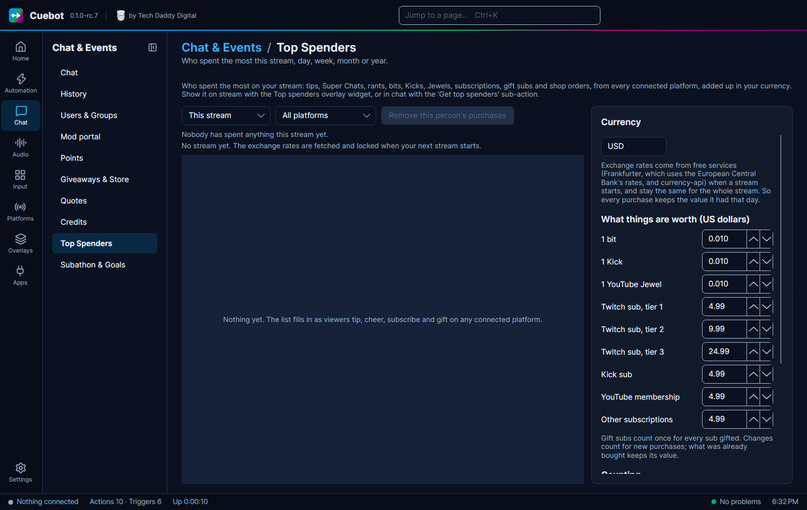

# Top spenders

**Top spenders** is a list of the viewers who supported you the most with money, on every platform, in your own
currency. Show it on stream to say thank you, or use it in chat.

**Chat > Top Spenders** shows who spent the most money on your stream. It adds up everything a viewer paid for, on
every platform you connected:

- Twitch: bits (cheers and power-ups), subs, resubs and gift subs
- YouTube: Super Chats, Super Stickers, Jewels, memberships and gifted memberships
- Kick: Kicks, subs and gift subs
- Rumble: rants, subscriptions and gift subs
- Tip services: Streamlabs, StreamElements and TipeeeStream tips, and merch
- Webhooks: Ko-fi, Patreon, Fourthwall, Shopify and Throne

## Pick a time and a platform

Pick the time at the top: **This stream**, **Today**, **This week**, **This month**, **This year** or **All time**.
**Weeks start on** (under **Counting**) sets the first day of **This week**: Monday at first, or Sunday or Saturday.
Pick one platform, or **All platforms** to see everyone together. The same name on two platforms counts as two people.
Under each name you see what they spent it on, like `Cheer $10.00, Subscription $4.99`.

## Your currency

Type your currency in the **Currency** box, like `USD`, `EUR`, `GBP` or `CAD`. Everything is changed into it.

1. When your stream starts, Cuebot fetches exchange rates from free services. It tries
   [Frankfurter](https://frankfurter.dev) first, which uses the European Central Bank's rates. For currencies Frankfurter
   does not have, it uses [currency-api](https://github.com/fawazahmed0/exchange-api). Neither needs an account.
2. Those rates stay the same for the whole stream. Every purchase is saved in your currency with the rate of that day,
   and the lists are sorted by that saved value. A €10 Super Chat from last month keeps last month's value.
3. If no service answers, Cuebot uses the rates of your last stream. If there are none, purchases in other currencies
   wait, and are counted as soon as the rates arrive.

If you change your currency later, older streams are shown in the new currency using their own locked rates.

## What bits, Kicks and subs are worth

Bits, Kicks, Jewels and subs are not money, so Cuebot gives them a price in US dollars. Change the prices under **What
things are worth** if your prices are different. For example, a Twitch tier 1 sub is $4.99 and a bit is $0.01. A gift
of 5 subs counts as 5 subs. A new price only counts for new purchases.

## What is left out

- **Charity donations** go to the charity, not to you. Tick **Count charity donations** to count them anyway.
- **Test events**, like the test buttons on the **Donations** and **Webhooks** pages and sample events sent from
  Cuebot (emulate event), are never counted. Cuebot's sample events still run the **Money spent** trigger and still
  move [subathon timers](../services/subathon-timers.md) and [goals](../services/goals.md), so you can try those out
  before a stream. A service's own test button does neither.
- Names in **Never list**, like `Anonymous`. Add your own test account here. Their purchases still count for
  [subathon timers](../services/subathon-timers.md) and [goals](../services/goals.md) and still run the **Money
  spent** trigger. They are only left off the list.
- Bits, subs and Super Chats that tip services like Streamlabs pass on from Twitch or YouTube. Connect Twitch or YouTube
  in Cuebot to count those, so nothing is counted twice.

To take someone off the list after a refund, click their name and **Remove this person's purchases**. It removes what
they bought in the time you picked. **Clear all history** (click twice) forgets every purchase and stream; your
settings stay.

## When a stream starts and ends

A new stream starts when a platform goes live. If you go offline and come back within 15 minutes, it is still the same
stream. If no platform tells Cuebot you went live, the first purchase after you were offline starts the new stream.
You can also click **Start a new stream now**, or use the **Start a new stream for top spenders** sub-action.

## Show it on stream

Add the **Top spenders** widget to an overlay (see [Overlays](../overlays/overlays.md)). In its settings, pick the
**Period**, a **Platform** (or leave it empty for all) and **How many people** (3 at first, up to 10). **Layout**
shows one person per line, or everyone on one line.

## A `!topspender` command

1. Make a `!topspender` command and an action with a **Command triggered** trigger.
2. Add the **Get top spenders** sub-action. Pick **This stream** and leave **Platform** empty.
3. Add **Send chat message (any platform)** with `Top spender: %topSpender% (%topSpenderFormatted%)`.

The trigger **New top spender this stream** runs when someone takes first place. Use it for a "new top spender!"
alert. The trigger **Money spent** runs for every purchase, with the amount already in your currency.

